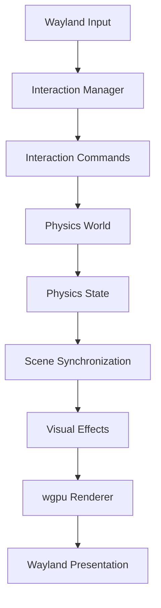

# Dock — AI Agent Guide

This document is the **primary entry point** for any AI coding agent working on this project. It describes what each subsystem does, how they interact, which architectural decisions must not be violated, what is safe to modify, and how to verify correctness.

## Project Overview

**Dock** is a hardware-accelerated desktop dock/application launcher for Linux (Wayland). It combines:

- A **wgpu-based GPU renderer** (`wgpu-api/`) for 2D rendering
- A **physics engine** with springs, rigid bodies, and force fields for natural UI animation
- **Wayland client integration** for window management and input
- **PipeWire integration** for screen/window capture and video streams
- A **Slint-based widget system** for dock icons and UI components
- A **scene graph** for hierarchical rendering

## Codebase Structure

```
dock/
├── AGENTS.md                 ← You are here (project-wide guide)
├── docs/
│   ├── architecture/         ← Subsystem architecture docs
│   ├── decisions/            ← Architectural Decision Records (ADRs)
│   ├── contracts/            ← Subsystem interface contracts
│   └── diagrams/             ← Mermaid diagrams
├── wgpu-api/                 ← GPU rendering library (the core)
│   ├── src/
│   │   ├── lib.rs            ← Crate root; all public re-exports
│   │   ├── renderer/         ← GPU renderer entry point
│   │   ├── physics/          ← Physics engine (springs, rigid bodies, fields)
│   │   ├── video/            ← PipeWire video integration
│   │   ├── wayland/          ← Wayland client abstraction
│   │   ├── scene/            ← Scene graph
│   │   ├── interaction/      ← Input event processing
│   │   ├── gpu/              ← Low-level GPU backend
│   │   ├── layout/           ← Layout and arrangement
│   │   └── ...               ← Geometry, color, text, animation, etc.
│   └── AGENTS.md             ← wgpu-api-specific rules
├── src/                      ← Application layer
│   ├── app/                  ← Dock widgets, system bar, popups
│   ├── render/               ← Application-level rendering
│   ├── state/                ← Application state management
│   ├── events/               ← Event handling
│   ├── listeners/            ← Wayland/DBus listeners
│   ├── interaction/          ← High-level interaction logic
│   ├── services/             ← Background services (PipeWire, monitoring)
│   ├── resolvers/            ← Icon, application, process resolution
│   └── ...
└── ui.slint                  ← Slint UI definition
```

## Subsystem Summary

| Subsystem | Location | Responsibility |
|-----------|----------|----------------|
| **Renderer** | `wgpu-api/src/renderer/` | GPU device, surfaces, textures, frame rendering |
| **Physics** | `wgpu-api/src/physics/` | Spring/field/rigid-body simulation for UI animation |
| **Video** | `wgpu-api/src/video/` | PipeWire stream management, frame acquisition, GPU upload |
| **Wayland** | `wgpu-api/src/wayland/` | Window creation, popups, input event abstraction |
| **Scene Graph** | `wgpu-api/src/scene/` | Hierarchical node tree for rendering |
| **Interaction** | `wgpu-api/src/interaction/` | Input normalization and event routing |
| **GPU Backend** | `wgpu-api/src/gpu/` | Pipelines, buffers, caches, presentation |
| **Layout** | `wgpu-api/src/layout/` | Dock arrangement, insertion, projection |
| **Animation** | `wgpu-api/src/animation/` | Easing, keyframes, continuous animation |
| **App Layer** | `src/app/` | Dock widgets, system bar, popups |
| **State** | `src/state/` | Application state, interaction runtime |
| **Listeners** | `src/listeners/` | Wayland protocols, D-Bus services |

## Critical Architectural Invariants

These rules **must not be violated** under any circumstances:

### 1. Renderer Ownership
- The `Renderer` struct owns the wgpu device and queue.
- No other subsystem creates or destroys wgpu resources directly.
- All GPU resource creation goes through the renderer's API.

### 2. Physics Independence
- The physics engine is **pure Rust** — no wgpu, Wayland, or PipeWire dependencies.
- Physics operates in **logical pixel coordinates**.
- Physics uses a **fixed timestep** (default 120 Hz), decoupled from rendering frame rate.
- Physics never directly modifies scene nodes; synchronization happens through an explicit interface.

### 3. Coordinate Space Discipline
- **Logical pixels**: UI coordinates, used by physics and scene graph.
- **Physical pixels**: Framebuffer coordinates, used by the renderer.
- **World coordinates**: Physics simulation space (same as logical pixels).
- **Texture UVs**: Normalized [0,1] range.
- **Wayland surface coordinates**: Surface-relative, may differ from logical pixels due to scale factor.
- **Never mix coordinate spaces** without explicit conversion.

### 4. Video Buffer Lifetime
- PipeWire buffers must be returned/released promptly.
- Never retain a borrowed buffer beyond its valid lifetime.
- Only the active stream's frames are uploaded to GPU each frame.
- Stream lifetime ≠ frame lifetime.

### 5. Wayland Compositor Boundary
- The compositor (labwc, etc.) handles: window positioning, stacking, decorations, input routing.
- Dock handles: rendering pixels inside windows, scene graph, animations, video.
- Dock does **not** implement compositor functionality.

### 6. Public API Purity
- The `wgpu-api` public API is **independent of wgpu types**.
- Application code describes **what** to render, not **how** to allocate GPU buffers.
- All wgpu internals are hidden inside the backend.

## Safe to Modify

The following areas are **safe** for an AI agent to modify without special review:

- Adding new physics force types or constraints
- Adding new animation types or easing functions
- Adding new geometry primitives or path operations
- Adding new text styling options
- Adding new GPU pipeline types
- Adding new dock widget configurations
- Adding new event handlers
- Documentation and comments
- Test code

## Requires Caution

The following areas require **understanding the surrounding architecture** before modification:

- Coordinate space conversions (viewport, transform)
- GPU resource lifetime management (texture, buffer)
- PipeWire buffer handling (acquire, release)
- Wayland protocol handlers (surface lifecycle)
- Scene graph traversal and mutation
- Physics world integration with rendering

## How to Verify Correctness

| Change Type | Verification Method |
|-------------|---------------------|
| Physics changes | `cargo test physics` in `wgpu-api/` |
| Rendering changes | Visual inspection + `cargo check` |
| Wayland changes | Run under labwc, check window behavior |
| Video changes | Run with PipeWire stream active |
| General compilation | `cargo check` at project root |
| Full test suite | `cargo test` in `wgpu-api/` |

## Data Flow Diagram



## Code Documentation

When creating or modifying public APIs, follow these rules:

- Add Rust documentation comments (`///`) to all public items.
- Document **purpose**: why does this type/function exist?
- Document **ownership and lifecycle**: who creates, owns, and destroys resources?
- Document **coordinate spaces**: logical pixels, physical pixels, world coordinates, UVs?
- Document **units**: seconds, pixels, radians, normalized values?
- Document **invariants**: what must always remain true?
- Document **threading and synchronization**: must be called on a specific thread?
- Document **errors and failure conditions**: when can this fail?
- Include examples where useful.
- **Do not** add redundant comments that merely repeat the code.

Standard annotation format:

```rust
/// Brief description of what this function does.
///
/// # Coordinate Space
/// Which coordinate space inputs/outputs use.
///
/// # Units
/// Units of parameters (seconds, pixels, radians, etc.).
///
/// # Invariants
/// What must always remain true.
///
/// # Ownership
/// Who creates, owns, and destroys resources.
///
/// # Dependencies
/// Which subsystems may call this.
pub fn function_name(...) { ... }
```

### Architectural Rules

These rules **must not be violated** when implementing changes:

- **Physics must not depend on wgpu.** The physics engine is pure Rust.
- **Renderer must not calculate physical forces.** Rendering consumes transforms, not forces.
- **PipeWire must not own renderer resources.** Video frames are uploaded via the renderer's API.
- **Logical surfaces are distinct from Wayland surfaces.** Never conflate them.
- **GPU resources are owned by the renderer.** No other subsystem creates wgpu resources directly.
- **Physics uses a fixed timestep.** Never tie physics to the rendering frame rate.
- **Rendering uses interpolated physics state.** Visual transforms are smooth between simulation steps.
- **Cross-subsystem communication must use explicit interfaces.** No hidden dependencies.
- **Coordinate spaces must never be mixed** without explicit conversion.
- **PipeWire buffers must be released promptly.** Never retain beyond valid lifetime.

### Change Management

**Before implementation:**

1. Inspect relevant modules and their `AGENTS.md` files.
2. Read relevant architecture documentation in `docs/architecture/`.
3. Identify affected subsystem boundaries.
4. Propose a plan for nontrivial changes.
5. Check `docs/decisions/` for relevant ADRs that constrain the change.

**After implementation:**

1. Update relevant documentation in `docs/architecture/`.
2. Update architectural diagrams in `docs/diagrams/` if data flow changes.
3. Add or update tests.
4. Run formatting, compilation, and relevant tests.
5. Report unresolved assumptions and limitations.
6. **Do not silently introduce new architectural dependencies.**
7. If a foundational decision changes, create a new ADR in `docs/decisions/`.

## Where to Find Details

- **AI Instructions**: `docs/AI_INSTRUCTIONS.md` — engineering instructions for AI agents (start here for new agents)
- **Dependency Matrix**: `docs/DEPENDENCY_MATRIX.md` — automated version verification and dependency compatibility
- **System Map**: `docs/architecture/SYSTEM_MAP.md` — index of every subsystem (start here for code changes)
- **Reference Library**: `docs/reference/` — dependency documentation (official docs, API refs, integration notes)
- **Architecture**: `docs/architecture/` — detailed subsystem descriptions
- **Decisions**: `docs/decisions/` — Architectural Decision Records (ADRs)
- **Contracts**: `docs/contracts/` — subsystem interface boundaries
- **Diagrams**: `docs/diagrams/` — Mermaid visualizations
- **Per-subsystem**: Each `wgpu-api/src/<subsystem>/AGENTS.md` has local rules

### Architecture Documentation Index

| Document | Topic |
|----------|-------|
| [overview.md](docs/architecture/overview.md) | System-wide architecture and data flow |
| [renderer.md](docs/architecture/renderer.md) | GPU renderer subsystem |
| [physics.md](docs/architecture/physics.md) | Physics engine (three-system architecture) |
| [interaction.md](docs/architecture/interaction.md) | Two-layer interaction system |
| [layout.md](docs/architecture/layout.md) | Visual and physical dock layout |
| [wayland.md](docs/architecture/wayland.md) | Wayland compositor integration |
| [pipewire.md](docs/architecture/pipewire.md) | PipeWire video and DMA-BUF |
| [threading.md](docs/architecture/threading.md) | Thread ownership and cross-thread communication |
| [memory.md](docs/architecture/memory.md) | GPU/CPU memory management and resource lifetimes |
| [performance.md](docs/architecture/performance.md) | FPS targets, latency, caching, optimization |
| [testing.md](docs/architecture/testing.md) | Build, test, and regression procedures |
| [known_issues.md](docs/architecture/known_issues.md) | Existing bugs, limitations, and workarounds |
| [coding_rules.md](docs/architecture/coding_rules.md) | Coding conventions and implementation rules |
| [dependencies.md](docs/architecture/dependencies.md) | Library versions and compatibility |
| [error_handling.md](docs/architecture/error-handling.md) | Error detection, diagnosis, recovery, and prevention |
| [error_detection.md](docs/architecture/error-detection.md) | GPU errors, memory debugging, Linux tools, AI error resolution workflow |
| [error_policy.md](docs/architecture/error-policy.md) | Error detection, diagnosis, and recovery policy (mandatory AI workflow) |
| [error_stack.md](docs/architecture/error-stack.md) | Final error-handling stack: tools, versions, justification, integration |
| [WAYDOCK_WGPU_BACKEND.md](docs/architecture/WAYDOCK_WGPU_BACKEND.md) | WGPU backend engineering spec: priorities, rendering architecture, development order |

## Testing and Quality Control

The `docs/testing/` directory contains the mandatory testing protocol and 8-layer quality control pipeline:

**Mandatory Protocol:**
- [TESTING_PROTOCOL.md](docs/testing/TESTING_PROTOCOL.md) — **22-phase AI agent testing & verification protocol** (read before any code changes)

| Document | Topic |
|----------|-------|
| [README.md](docs/testing/README.md) | Testing pipeline overview and quick start |
| [profiling.md](docs/testing/profiling.md) | CPU/RAM profiling with perf, heaptrack, Massif, Tracy |
| [gpu-validation.md](docs/testing/gpu-validation.md) | GPU validation: wgpu error scopes, Vulkan layers, RenderDoc, MangoHud |
| [visual-regression.md](docs/testing/visual-regression.md) | Screenshot comparison with tolerance-based testing |
| [fuzzing.md](docs/testing/fuzzing.md) | cargo-fuzz targets and stress tests |
| [AI_AUDIT.md](docs/testing/AI_AUDIT.md) | Independent code audit instructions for AI agents |

**Scripts:**
- `scripts/check.sh` — Automated static analysis pipeline (fmt, check, clippy, tests, audit)

**CI:**
- `.github/workflows/ci.yml` — GitHub Actions: static analysis, dependency audit, physics tests, docs build

**Tests:**
- `tests/compatibility.rs` — Wayland and Slint compatibility test framework

## Core Engineering Priorities

Per [ADR 005](docs/decisions/005-waydock-priorities.md), these priorities are mandatory:

1. **Lowest possible CPU usage**
2. **Lowest possible system RAM usage**
3. **Highest possible responsiveness**
4. **Graphics, animations, interactivity and Slint integration**
5. **Lowest possible VRAM usage**

Key rules: event-driven Wayland loop, zero idle rendering, no steady-state heap allocations, analytical springs over general-purpose physics, bounded caches, lazy allocation.

## Rendering Architecture Note

The dock uses a **hybrid rendering approach**:
- **Main dock**: Slint software renderer → CPU pixel buffer → Wayland SHM. This is the correct pattern for headless Slint on Wayland.
- **Popups**: wgpu-api GPU backend when GPU features are needed.
- **FemtoVG**: Removed. All FemtoVG rendering has been eliminated.

Slint's `unstable-wgpu-30` feature is enabled, but full GPU integration for the main dock is not possible without replacing Slint entirely with wgpu-api's scene graph. The current architecture preserves Slint for widget semantics while providing a wgpu backend for future GPU features.

## Reference Library

The `docs/reference/` directory contains detailed documentation for all major dependencies, including official documentation links, API references, architecture notes, migration guides, and dependency compatibility information.

| Category | File | Libraries |
|----------|------|----------|
| GPU Rendering | [gpu-rendering.md](docs/reference/gpu-rendering.md) | wgpu, Vulkan, wgpu-dmabuf |
| Wayland & Windowing | [wayland.md](docs/reference/wayland.md) | wayland-client, wayland-protocols, smithay, raw-window-handle |
| PipeWire & Capture | [pipewire.md](docs/reference/pipewire.md) | pipewire, pipewire-sys, libspa-sys |
| UI & Widgets | [slint.md](docs/reference/slint.md) | slint, slint-build |
| Image & SVG | [image-svg.md](docs/reference/image-svg.md) | image, resvg, usvg, tiny-skia, cairo, fast_image_resize |
| Text & Fonts | [text-fonts.md](docs/reference/text-fonts.md) | cosmic-text, fontdb, swash, fontdue |
| Physics & Math | [physics.md](docs/reference/physics.md) | rapier2d, nalgebra, glam, bytemuck |
| Async & Concurrency | [async-concurrency.md](docs/reference/async-concurrency.md) | tokio, futures-util, parking_lot, dashmap |
| System Integration | [system-integration.md](docs/reference/system-integration.md) | zbus, zvariant, sysinfo, libc |
| Serialization & Utils | [serialization-utils.md](docs/reference/serialization-utils.md) | serde, serde_json, lru, memmap2, walkdir, dirs, log |
| Rust Engineering | [rust-engineering.md](docs/reference/rust-engineering.md) | The Rust Book, std, Cargo, Clippy, API Guidelines |

Before modifying code in a subsystem, read the corresponding reference file to understand the dependency's capabilities, limitations, and integration patterns.

## AI Annotation Workflow

Run this repeatable task whenever a new subsystem or significant module is introduced, or periodically after major refactoring.

```
Analyze this module and make it AI-maintainable.

1. Identify its responsibilities and boundaries.
2. Document public types and functions.
3. Identify resource ownership and lifecycle.
4. Document coordinate spaces, units and invariants.
5. Identify thread-safety and synchronization requirements.
6. Document dependencies on other subsystems.
7. Identify undocumented assumptions.
8. Add or update the appropriate architecture documentation.
9. Check that comments describe actual behavior rather than intended behavior.
10. Do not change implementation logic unless necessary to correct documentation inaccuracies.
11. Flag any uncertainty instead of inventing architectural behavior.
```

### Preferred Tools

| Tool | Purpose |
|------|---------|
| `rust-analyzer` | Symbol navigation and type information |
| `rustdoc` | API documentation |
| `cargo doc` | Generate documentation |
| `cargo clippy` | Catch implementation issues |
| Mermaid | Architecture diagrams |
| Graphviz | Dependency graphs |
| `cargo deny` | Dependency policy |

### Documentation Philosophy

- **Do not** try to make every source file extensively commented.
- **Do** make important interfaces exceptionally well documented.
- **Do** make subsystem boundaries explicit.
- **Do** make architectural rules verifiable through tests and types.
- This combination helps an AI agent understand the engine much more reliably than thousands of comments.
