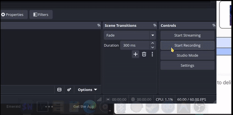

# Dock

[](https://github.com/resdon/dock/actions/workflows/ci.yml)

A lightweight, high-performance Wayland dock written in Rust



## Features

- **Auto-hide**: Remains hidden until the cursor hovers near the screen edge, sliding smoothly into view.
- **Smart focus**: Click an application icon to switch focus, bring its window to the foreground, or background.
- **Window list**: Hover over an icon to see a list of open windows. Use the scroll wheel to cycle through them, or click the red box on a preview to close that window.
- **Drag&Drop**: Drag files directly onto dock icons to pass context or launch them with specific applications.
- **Context Menu**: Right-click an icon to access app-specific actions (e.g., "Open in Incognito Mode").
- **Pins**: Pin or unpin applications, and drag-and-drop icons to reorder them anywhere on the dock.
- **Wayland Native**: Built with Layer Shell and Foreign Toplevel protocols for smooth integration.
- **Fast & Transparent**: Low resource consumption with seamless transparent animations.
- **RAM & CPU**: ~152 MB PSS (exclusive) | ~6–13% CPU (0.1 cores), ~70 FPS continuous rendering.
- **Desktop & Steam Integration**: Resolves application icons, `.desktop` files, and Steam game launcher shortcuts dynamically.
- **D-Bus Support**: Integrates with system protocols for dynamic window management, drag-and-drop handling, and running status indicators.

## Supported Compositors (Wayland)

`dock` works on any Wayland compositor supporting `wlr-layer-shell-unstable-v1` and `wlr-foreign-toplevel-management-unstable-v1`:

- **labwc** (Primary target / recommended)
- **Sway**
- **Hyprland**
- **Wayfire**
- **river**
- **COSMIC**

## Prerequisites & Dependencies

### Rust Version
- **Cargo / Rustc**: `1.75.0` or higher (Rust Edition 2021 recommended)

### System Dependencies

Ensure the following build tools and development libraries are installed on your system:

- **Build Tools**: `make`, `gcc`, `pkg-config`
- **Wayland Libraries**: `wayland-client`, `wayland-protocols`
- **Input & Graphics**: `libxkbcommon`, `fontconfig`, `mesa` (Vulkan)
- **System Services**: `dbus`, `pipewire`

#### Installing Dependencies on Arch Linux:
```bash
sudo pacman -S --needed base-devel cargo wayland wayland-protocols libxkbcommon fontconfig dbus mesa pipewire
```

#### Installing Dependencies on Ubuntu / Debian:
```bash
sudo apt update
sudo apt install -y build-essential cargo pkg-config libwayland-dev wayland-protocols libxkbcommon-dev libfontconfig1-dev libdbus-1-dev libegl1-mesa-dev pipewire
```

## Installation

### Pre-compiled Binary
Download and extract the [latest release archive](https://github.com/resdon/dock/releases/latest/download/dock-linux-amd64.tar.gz):
```bash
tar -xzf dock-linux-amd64.tar.gz
cd dock-linux-amd64
make install
```
Or download via terminal:
```bash
curl -sSL https://github.com/resdon/dock/releases/latest/download/dock-linux-amd64.tar.gz | tar -xz
cd dock-linux-amd64
make install
```

### Building From Source

### 1. Clone the Repository
```bash
git clone https://github.com/resdon/dock.git
cd dock
```

### 2. Build and Install
Compile the binary in release mode and install it to system PATH (`/usr/local/bin`):

```bash
make install
```

*Alternatively, build manually via Cargo:*
```bash
cargo build --release
```

### 3. Launching the Dock

#### Run in Background (CLI):
```bash
nohup dock &
```

#### Autostarting on `labwc`:
Add the following line to `~/.config/labwc/autostart`:
```bash
dock &
```

#### Autostarting on `Sway` / `Hyprland`:
- **Sway** (`~/.config/sway/config`):
  ```sway
  exec dock
  ```
- **Hyprland** (`~/.config/hypr/hyprland.conf`):
  ```ini
  exec-once = dock
  ```

## Repository Structure

```text
dock/
├── assets/          # Bundled fonts and connection indicator icons
├── scripts/         # Launcher and icon listing scripts
├── src/             # Core Rust source files
│   ├── app/         # Dock widgets, popups, and GPU draw command builders
│   ├── events/      # Wayland event handling
│   ├── handlers/    # Popup interaction and click handlers
│   ├── interaction/ # Proximity, motion, and hover routines
│   ├── listeners/   # Wayland protocol and D-Bus listeners
│   ├── render/      # DMA-BUF texture pool and GPU utilities
│   ├── resolvers/   # Desktop file parser, icon, and Steam app resolver
│   ├── services/    # PipeWire capture, resource monitoring, system services
│   ├── state/       # Application state management
│   └── ...          # Config, models, frame scheduler, etc
├── wgpu-api/        # GPU rendering library (wgpu backend, text, video, physics)
├── docs/            # Architecture docs, ADRs, contracts, and diagrams
├── Cargo.toml       # Cargo package manifest
├── Makefile         # Build & installation targets
└── PKGBUILD         # Arch Linux packaging file
```

## License

Distributed under the MIT License.


## Rendering Architecture

The dock uses **100% GPU rendering** via wgpu with DMA-BUF zero-copy sharing to the Wayland compositor. All surfaces — main dock, popups, side bars, and status panels — render through `DrawCommand`-based GPU pipelines. There is no CPU pixel buffer rendering or Slint dependency.

### GPU Features
- **Persistent vertex buffers** — eliminates per-primitive GPU buffer allocation (~3,750/sec reduced to 2/sec)
- **Cross-frame text cache** — skips cosmic-text shaping for static text, reducing CPU usage by ~20%
- **Content-hash caching** — skips render passes for static popups (context menu, Bluetooth)
- **Format-aware video upload** — BGRx/BGRA frames upload directly without intermediate copies
- **Lazy TextManager** — defers GPU font loading until first popup needs text rendering

### Performance
- **~70 FPS** continuous rendering at 75 FPS cap
- **~152 MB PSS** exclusive memory (including ~43 MB NVIDIA Vulkan driver)
- **~6–13% CPU** usage (0.1 cores)

## Tray and status strip

The dock supports StatusNotifierItem (SNI) clients and renders the tray in a dedicated box to the left of the centered application dock. Right-clicking a tray icon opens a dock-native GPU-rendered context menu. The bottom status panel shows keyboard layout, network throughput, and date/time.

Application icons are loaded at 512px source resolution when possible and downsampled using SIMD-optimized Lanczos-3 filtering via `fast_image_resize`. Icon cache format version 4 ensures older low-resolution cache entries are reloaded.

### PipeWire audio mixer

A speaker control opens an in-dock quick mixer for output/input volume, mute,
default device selection, and active application stream volume. It uses
WirePlumber's `wpctl` from a background worker; `pavucontrol` is an optional
launch target for its full mixer UI. See [AUDIO_WIDGET.md](AUDIO_WIDGET.md) for
runtime requirements and troubleshooting.
### Bluetooth device manager

A Bluetooth glyph next to the speaker opens a compact BlueZ device panel. It
shows the local adapter power state, connected devices first, paired devices,
and newly discovered devices. The panel can power the adapter, start/stop its
own discovery session, pair new devices, and connect or disconnect known ones.
BlueZ D-Bus calls run in a dedicated worker thread so pairing and connection
operations do not block the Wayland event loop. See [BLUETOOTH_WIDGET.md](BLUETOOTH_WIDGET.md)
for the agent requirement and troubleshooting.

### Tray and system widget sidecar

The Rclone, process, PipeWire audio, and Bluetooth controls are rendered in a
separate compact subsurface immediately to the right of the main dock. Its
position follows the negotiated dock width as running applications are added
or removed; it does not contribute to the main app-row width. StatusNotifierItem
registration supports both freedesktop and KDE watcher names, including a
compatibility watcher when a Wayland session exposes only one. Right-clicking a
tray icon opens the dock's action menu. See [`TRAY_AND_WIDGET_BAR.md`](TRAY_AND_WIDGET_BAR.md)
for diagnostics and implementation notes.


### Sidecar status layout

The native tray icons occupy a separate 76×72 rounded box to the left of the centered application dock. Steam and qBittorrent icons are laid out in a two-column grid, matching the right-hand 76×72 utility box. The right box contains Rclone, Processes, Audio, and Bluetooth. Keyboard layout, network throughput, and date/time are displayed in a 34px-high, 360px-minimum panel centered below the app row. These sidecars do not affect the main dock's width, and both side boxes follow the dock whenever the app row resizes. The bottom status panel is click-through; the layer surface remains overlay-only with exclusive zone 0.


## Three-region dock status layout

The application dock remains a compact centered app row. Native StatusNotifierItem
icons (including Steam and qBittorrent when they register with the session watcher)
render in a separate rounded tray box immediately to the left. Rclone, process,
audio, and Bluetooth shortcuts render in a matching box immediately to the right.
Both side boxes follow the current app-row geometry and do not contribute to the
main layer-surface width. Keyboard layout, network transfer rates, and date/time
render in a centered passive strip directly below the app row. The bottom strip
is click-through; the dock's visible input region is limited to the app row and
the side boxes retain their own input regions.


### Recent layout and launcher fixes

- The left SNI tray now uses the same 76×72 rounded box footprint as the right widget panel, arranging icons in a two-column grid.
- Additional SNI icons wrap into extra rows instead of stretching the tray horizontally.
- Launcher script resolution is independent of the dock's current working directory. Source builds select the script from `CARGO_MANIFEST_DIR`; installed Arch builds fall back to `/usr/share/dock/launcher.sh`.
- GTK/Qt scale override variables are stripped from launched apps, including direct-Exec handling for D-Bus-activatable desktop entries.
- Set `DOCK_LAUNCH_DEBUG=1` to inspect which launcher script is selected and whether scale overrides are removed.
