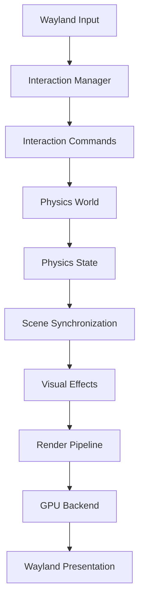
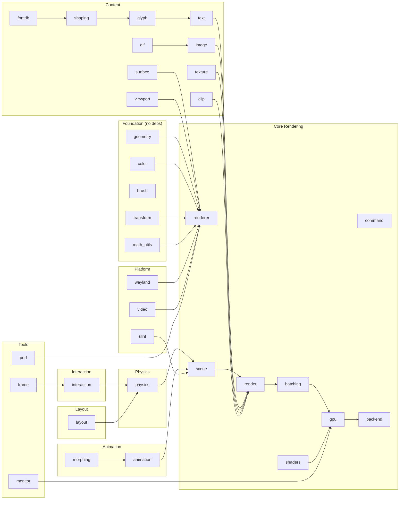

# System Map

**Central index of every subsystem in `wgpu-api`.**

This file tells an AI agent where to look before it starts changing anything. Every subsystem lists its responsibilities, public interfaces, owned resources, dependencies, invariants, implementation files, and tests.

For dependency-specific documentation (official docs, API references, integration notes), see the [Reference Library](../reference/README.md).

---

## Table of Contents

1. [Renderer](#1-renderer)
2. [Physics Engine](#2-physics-engine)
3. [Interaction](#3-interaction)
4. [Scene Graph](#4-scene-graph)
5. [Layout](#5-layout)
6. [Animation](#6-animation)
7. [Video / PipeWire](#7-video--pipewire)
8. [Wayland](#8-wayland)
9. [GPU Backend](#9-gpu-backend)
10. [Batching](#10-batching)
11. [Geometry](#11-geometry)
12. [Color & Brush](#12-color--brush)
13. [Transform](#13-transform)
14. [Image](#14-image)
15. [Text](#15-text)
16. [Surface](#16-surface)
17. [Texture](#17-texture)
18. [Command](#18-command)
19. [Frame](#19-frame)
20. [Render Pipeline](#20-render-pipeline)
21. [Shaders](#21-shaders)
22. [Backend](#22-backend)
23. [Glyph & Font](#23-glyph--font)
24. [Viewport](#24-viewport)
25. [Morphing](#25-morphing)
26. [Clip](#26-clip)
27. [Slint Integration](#27-slint-integration)
28. [GIF](#28-gif)
29. [Math Utilities](#29-math-utilities)
30. [Monitor](#30-monitor)
31. [Performance](#31-performance)

---

## 1. Renderer

**Responsibilities:** Owns the wgpu device and queue; creates surfaces, textures, and pipelines; compiles scene graphs into GPU command buffers; submits frames.

**Public Interface:**
- `Renderer`, `RendererConfig`, `RendererBackend`
- Surface creation, texture management, frame rendering

**Owned Resources:**
- wgpu `Device` and `Queue` (sole owner — no other subsystem creates wgpu resources)
- GPU pipelines, bind groups, shader modules
- Texture and buffer caches

**Dependencies:**
- `gpu/` (low-level GPU backend)
- `batching/` (draw call batching)
- `shaders/` (shader compilation)
- `backend/` (abstraction layer)

**Invariants:**
- Renderer is the sole owner of the wgpu device and queue.
- No other subsystem creates or destroys wgpu resources directly.
- All GPU resource creation goes through the renderer's API.
- Renderer never calculates physical forces.
- Rendering uses interpolated physics state, not raw simulation state.

**Implementation:** `wgpu-api/src/renderer.rs`, `wgpu-api/src/renderer/AGENTS.md`
**Tests:** Visual inspection + `cargo check`
**Architecture doc:** `docs/architecture/renderer.md`
**Contract:** `docs/contracts/renderer.md`
**Reference:** `docs/reference/gpu-rendering.md` (wgpu, Vulkan, wgpu-dmabuf)

---

## 2. Physics Engine

**Responsibilities:** Simulates three distinct physical systems (springs, rigid bodies, fields) at a fixed timestep; provides high-level interaction API; manages body state, constraints, groups, and spatial indexing.

**Public Interface:**
- `PhysicsWorld`, `PhysicsBody`, `PhysicsObject`, `BodyId`, `BodyType`
- `InteractionApi` trait (drag, push, pull, insert, cut, merge, etc.)
- `InteractionCommand`, `InteractionManager` (command-based interaction)
- `PhysicsConfig`, `FixedTimestepSimulator`, `InterpolatedState`

**Owned Resources:**
- Body registry (positions, velocities, accelerations)
- Spring constraints, force fields, collision shapes
- Group manager and spatial hash index
- Constraint system state

**Dependencies:**
- None on wgpu, Wayland, or PipeWire (pure Rust).
- Depends on `geometry/` for `Point`, `Vector2D`, `Rect`, `NodeId`.

**Invariants:**
- Physics never accesses wgpu resources.
- Physics operates in logical pixel coordinates.
- Physics uses a fixed timestep (default 120 Hz), decoupled from rendering.
- Physics never directly modifies scene nodes; synchronization is explicit.
- Physics must not depend on Wayland.
- Acceleration is reset after each integration step.

**Reference:** `docs/reference/physics.md` (glam, bytemuck)
**Architecture doc:** `docs/architecture/physics.md`
**Contract:** `docs/contracts/physics.md`

**Implementation:**
- `wgpu-api/src/physics/mod.rs` (module root)
- `wgpu-api/src/physics/body.rs` (body types, physical properties)
- `wgpu-api/src/physics/world.rs` (world orchestration)
- `wgpu-api/src/physics/springs.rs` (System A: springs)
- `wgpu-api/src/physics/collision.rs` (System B: collision detection)
- `wgpu-api/src/physics/fields.rs` (System C: force fields)
- `wgpu-api/src/physics/forces.rs` (force types)
- `wgpu-api/src/physics/constraints.rs` (constraint system)
- `wgpu-api/src/physics/groups.rs` (body groups)
- `wgpu-api/src/physics/spatial_index.rs` (spatial hashing)
- `wgpu-api/src/physics/solver.rs` (physics solver)
- `wgpu-api/src/physics/interaction.rs` (high-level interaction API)
- `wgpu-api/src/physics/dock.rs` (physical dock layout model)
- `wgpu-api/src/physics/visual_effects.rs` (visual effects from physics state)
- `wgpu-api/src/physics/timestep.rs` (fixed timestep simulation)
- `wgpu-api/src/physics/commands.rs` (interaction command system)

**Tests:** `cargo test physics` (320 tests)
**Architecture doc:** `docs/architecture/physics.md`
**Contract:** `docs/contracts/physics.md`
**Local rules:** `wgpu-api/src/physics/AGENTS.md`

---

## 3. Interaction

**Responsibilities:** Two-layer input system: (1) normalizes raw input events (mouse, touch, keyboard) into a unified format; (2) provides intent-based semantic operations on the physics world.

**Public Interface:**
- Layer 1: `InputEvent`, `InputState`, `InputRouter`, `PointerInputEvent`, `TouchInputEvent`, `KeyInputEvent`
- Layer 2: `InteractionApi` trait, `InteractionCommand`, `InteractionManager`
- Drag: `DragState`, `DragConfig`, `DragManager`
- Gestures: `GestureType`, `GestureState`, `GestureRecognizer`
- Picking: `PickResult`, `PickConfig`, `Picker`

**Owned Resources:**
- Input state (pointer position, button states, touch points, modifiers)
- Drag state (which body is dragged, drag offset)
- Gesture recognition state (timers, previous positions)

**Dependencies:**
- `physics/` (delegates commands to `PhysicsWorld` via `InteractionApi`)
- `geometry/` (coordinates)

**Invariants:**
- Input events are converted to interaction commands before reaching physics.
- The interaction layer does not own physics bodies.
- Hit testing uses the physics world's body positions, not visual transforms.
- Gesture recognition operates on normalized input, not raw Wayland events.

**Implementation:**
- `wgpu-api/src/interaction/input.rs` (input normalization)
- `wgpu-api/src/interaction/drag.rs` (drag mechanics)
- `wgpu-api/src/interaction/gestures.rs` (gesture recognition)
- `wgpu-api/src/interaction/picking.rs` (hit testing)

**Tests:** Unit tests in each module
**Architecture doc:** `docs/architecture/interaction.md`
**Contract:** `docs/contracts/interaction.md`

---

## 4. Scene Graph

**Responsibilities:** Hierarchical node tree for rendering; each node has style, content, and transform; groups nest children.

**Public Interface:**
- `Scene`, `Node`, `NodeId`
- `NodeStyle`, `NodeContent`
- `Rectangle`, `SceneImage`, `SceneText`, `Group`

**Owned Resources:**
- Node tree (parent-child relationships)
- Per-node style and content data

**Dependencies:**
- `geometry/` (coordinates, sizes)
- `color/` (colors)
- `transform/` (transforms)
- `texture/` (texture references)

**Invariants:**
- Scene graph is a tree (no cycles).
- Node IDs are unique within a scene.
- Scene nodes are visual representations; physics bodies are separate.

**Implementation:** `wgpu-api/src/scene.rs`
**Tests:** Unit tests in module

---

## 5. Layout

**Responsibilities:** Two-level layout: (1) visual layout determines logical arrangement of dock items; (2) physical layout provides spring-based animation for layout transitions.

**Public Interface:**
- Visual: `Dock`, `DockItem`, `DockAxis`, `DockConfig`
- Arrangement: `DockArrangement`, arrangement algorithms
- Insertion: insertion logic and slot management
- Projection: axis and curve projection
- Styling: `Insets`, `CornerRadius`, `Shadow`

**Owned Resources:**
- Dock item ordering and slot assignments
- Arrangement state

**Dependencies:**
- `geometry/` (coordinates, sizes)
- `physics/dock.rs` (physical dock model for animation)

**Invariants:**
- Layout determines target positions; physics animates to those targets.
- Visual layout is independent of physics simulation.
- Insertion and removal update logical ordering before physics reacts.

**Implementation:**
- `wgpu-api/src/layout.rs` (module root)
- `wgpu-api/src/layout/dock.rs` (visual dock layout)
- `wgpu-api/src/layout/arrangement.rs` (arrangement algorithms)
- `wgpu-api/src/layout/insertion.rs` (insertion logic)
- `wgpu-api/src/layout/projection.rs` (projection utilities)

**Tests:** Unit tests in each module
**Architecture doc:** `docs/architecture/layout.md`

---

## 6. Animation

**Responsibilities:** Time-dependent visual transitions including easing, keyframes, continuous animation, particles, and interaction-driven animation states.

**Public Interface:**
- `Animation`, `AnimationType`, `AnimationId`, `AnimationState`
- `Easing` (easing functions)
- `KeyframeAnimation`, `Keyframe`
- `SpringAnimation`, `PulseAnimation`, `RotateAnimation`, `FadeAnimation`, `BounceAnimation`
- `ContinuousAnimation`, `ContinuousAnimationType`
- `AnimatedProperty`, `AnimatedNode`, `AnimationManager`
- `InteractionEvent`, `HoverState`, `DragState`, `GestureState`
- `ParticleSystem`, `ParticleSystemConfig`, `Particle`
- `StarShape`, `PolygonShape`, `RingShape`, `ProgressRing`

**Owned Resources:**
- Animation registry (active animations)
- Per-node animation state

**Dependencies:**
- `geometry/` (coordinates)
- `color/` (color interpolation)
- `transform/` (transform interpolation)

**Invariants:**
- Animations operate on visual properties, not physics state.
- Animation time is independent of physics simulation time.
- Animation manager owns animation lifecycle.

**Implementation:** `wgpu-api/src/animation.rs`
**Tests:** Unit tests in module

---

## 7. Video / PipeWire

**Responsibilities:** Manages PipeWire streams for screen/window capture; acquires frames, converts formats, uploads to GPU textures; only active stream's latest frame is rendered.

**Public Interface:**
- `VideoManager`, `VideoStream`, `StreamId`, `StreamState`
- `VideoFrame`, `FrameHandle`, `VideoFormat`
- `VideoTexture`, `VideoNode`, `VideoFitMode`
- `FrameBuffer`, `FrameBufferSource` (`DmaBuf` | `CpuUpload`)
- Format conversion: `convert_bgfx_to_rgba`, `convert_bgra_to_rgba`, `convert_rgb_to_rgba`
- Memory estimation: `estimate_video_vram`, `estimate_video_memory`
- DMA-BUF: `FrameBuffer::dma_buf()` (stub), `dma_buf_fd`, `dma_buf_modifier`

**Owned Resources:**
- PipeWire stream connections
- Video texture cache (GPU textures per active stream)
- Frame buffers (copied pixel data for CPU path; fd references for DMA-BUF path)

**Dependencies:**
- `renderer/` (texture upload via renderer API)
- `scene/` (video nodes in scene graph)
- External: `pipewire`, `pipewire-sys`, `libspa-sys`

**Invariants:**
- PipeWire buffers must be released promptly; never retain beyond valid lifetime.
- Only the active stream's frames are uploaded to GPU each frame.
- Stream lifetime ≠ frame lifetime.
- PipeWire must not own renderer resources.
- Latest-frame policy: only the most recent frame is processed.
- DMA-BUF capability must be negotiated before frames flow (Path A).
- DMA-BUF fallback to CPU upload (Path B) if negotiation fails.

**DMA-BUF Status:**
- Current: Path B (CPU upload) for all frames.
- Path A (DMA-BUF zero-copy) is stubbed via `FrameBufferSource::DmaBuf`.
- `src/render/dmabuf_export.rs` implements DMA-BUF **export** (wgpu → Wayland), not **import** (PipeWire → wgpu).
- Reference: [PipeWire DMA-BUF Sharing](https://docs.pipewire.org/devel/page_dma_buf.html)

**Implementation:** `wgpu-api/src/video.rs`, `wgpu-api/src/video/AGENTS.md`, `src/render/dmabuf_export.rs`
**Tests:** Run with PipeWire stream active
**Architecture doc:** `docs/architecture/pipewire.md`
**ADR:** `docs/decisions/004-video-buffer-lifetime.md`
**Reference:** `docs/reference/pipewire.md` (pipewire, pipewire-sys, libspa-sys)

---

## 8. Wayland

**Responsibilities:** Wayland client abstraction for window creation, popup management, and input event handling; Dock renders pixels inside windows but does not implement compositor functionality.

**Public Interface:**
- `WaylandConnection` (global Wayland client)
- `WaylandWindow`, `WaylandWindowConfig`, `WaylandWindowId`
- `WaylandPopup`, `WaylandPopupConfig`, `WaylandPopupId`
- `WindowState`, `WindowType`
- `PopupAnchor`, `PopupGravity`
- Input: `KeyEvent`, `PointerEventType`, `TouchEvent`, `InputEvent`
- `VisualPopup`, `PopupShadow`
- `OutputInfo`, `OutputTransform`

**Owned Resources:**
- Wayland client connection
- Window and popup surfaces
- Input event queue

**Dependencies:**
- `wayland-client` crate (external)
- `scene/` (renders into surfaces)

**Invariants:**
- The compositor handles window positioning, stacking, decorations, and input routing.
- Dock handles rendering pixels inside windows, scene graph, animations, and video.
- Dock does NOT implement compositor functionality.
- Wayland surface coordinates may differ from logical pixels due to scale factor.

**Implementation:** `wgpu-api/src/wayland.rs`, `wgpu-api/src/wayland/AGENTS.md`
**Tests:** Run under labwc, check window behavior
**Architecture doc:** `docs/architecture/wayland.md`
**Reference:** `docs/reference/wayland.md` (wayland-client, wayland-protocols, smithay, raw-window-handle)

---

## 9. GPU Backend

**Responsibilities:** Low-level GPU resource management: pipelines, buffers, caches, and surface presentation.

**Public Interface:**
- `GpuResources` (aggregate GPU resource holder)
- `PipelineType`, `PipelineKey`, `CachedPipeline`, `PipelineCache`
- `BufferType`, `CachedBuffer`, `BufferCache`
- `CachedTexture`, `TextureCache`
- `CachedGlyph`
- `QuadInstance`
- `OrthographicProjection`, `GpuUniformBuffer`
- `SurfacePresentationState`, `SurfacePresentationConfig`, `SurfaceAlphaMode`
- `SurfacePresenter`, `PresentationError`
- `FrameStats`, `GpuBackendConfig`

**Owned Resources:**
- Render pipelines (fill, stroke, text, video, etc.)
- Uniform buffers
- Texture and buffer caches
- Surface presentation state

**Dependencies:**
- `wgpu` crate (direct usage — this is the boundary where wgpu types appear)

**Invariants:**
- All wgpu types are confined to this module and `backend/`.
- Application code never sees wgpu types.
- GPU resources are owned by the renderer, managed through this backend.

**Implementation:** `wgpu-api/src/gpu.rs`
**Tests:** Integrated with renderer tests

---

## 10. Batching

**Responsibilities:** Groups draw commands into batches to reduce GPU draw calls; sorts by pipeline key and blend mode.

**Public Interface:**
- `BatchKey`, `BatchedCommand`, `DrawCommandType`
- `Batch`, `BatchSorter`, `BatchInfo`
- `InstanceBufferBuilder`, `DrawCallEstimator`

**Owned Resources:**
- Batch buffers (grouped draw commands)

**Dependencies:**
- `gpu/` (pipeline keys)
- `render/` (draw commands)

**Invariants:**
- Batches are sorted by pipeline key to minimize pipeline switches.
- Blend mode changes force a new batch.

**Implementation:** `wgpu-api/src/batching.rs`
**Tests:** Unit tests in module

---

## 11. Geometry

**Responsibilities:** Core 2D geometry types: points, vectors, rectangles, sizes, and opaque node identifiers.

**Public Interface:**
- `Point`, `Vector2D`, `Rect`, `Size`
- `NodeId` (opaque scene node identifier)

**Owned Resources:** None — value types only.

**Dependencies:** None — foundational module.

**Invariants:**
- All coordinates are in logical pixels unless explicitly typed otherwise.
- `NodeId` is an opaque handle; equality is the only meaningful operation.

**Implementation:** `wgpu-api/src/geometry.rs`
**Tests:** Unit tests in module

---

## 12. Color & Brush

**Responsibilities:** Color representation, gradients, blend modes, and brush abstraction.

**Public Interface:**
- `Color` (RGBA with alpha)
- `Gradient`, `GradientType` (linear and radial)
- `BlendMode`
- `Brush` (unified fill abstraction: solid color or gradient)

**Owned Resources:** None — value types only.

**Dependencies:** None — foundational module.

**Invariants:**
- Color components are in [0.0, 1.0] range.
- Alpha = 1.0 means opaque; 0.0 means fully transparent.

**Implementation:** `wgpu-api/src/color.rs`, `wgpu-api/src/brush.rs`
**Tests:** Unit tests in module

---

## 13. Transform

**Responsibilities:** 2D affine transformation matrices for position, rotation, scale, and skew.

**Public Interface:**
- `Transform` (2D affine transform)
- `Matrix3` (3x3 matrix representation)

**Owned Resources:** None — value types only.

**Dependencies:**
- `math_utils/` (glam integration)

**Invariants:**
- Transform matrices operate in logical pixel coordinates.
- Identity transform means no translation, rotation, or scale.

**Implementation:** `wgpu-api/src/transform.rs`
**Tests:** Unit tests in module

---

## 14. Image

**Responsibilities:** Raster image loading, format conversion, and filtering.

**Public Interface:**
- `Image`, `ImageFormat`, `ImageFilter`, `ImageData`

**Owned Resources:**
- Pixel data (CPU-side image buffers)

**Dependencies:**
- `texture/` (GPU texture upload)

**Invariants:**
- Image data is in RGBA format unless explicitly converted.
- Image coordinates are in logical pixels.

**Implementation:** `wgpu-api/src/image.rs`
**Tests:** Unit tests in module

---

## 15. Text

**Responsibilities:** Text layout, styling, and rendering primitives.

**Public Interface:**
- `Text`, `TextStyle`, `TextAlign`, `TextBaseline`
- `Font`, `FontWeight`, `FontStyle`

**Owned Resources:** None — value types only.

**Dependencies:**
- `glyph/` (glyph rasterization)
- `shaping/` (text shaping)
- `fontdb/` (font database)

**Invariants:**
- Text coordinates are in logical pixels.
- Font sizes are in logical pixels.

**Implementation:** `wgpu-api/src/text.rs`
**Tests:** Unit tests in module

---

## 16. Surface

**Responsibilities:** Swapchain surface abstraction for rendering targets.

**Public Interface:**
- `Surface`, `SurfaceId`, `SurfaceFormat`, `SurfaceConfig`, `SurfaceDescriptor`

**Owned Resources:**
- wgpu surface handles (via renderer)

**Dependencies:**
- `renderer/` (surface creation and management)

**Invariants:**
- Surface lifetime is managed by the renderer.
- Surface coordinates are in physical pixels.

**Implementation:** `wgpu-api/src/surface.rs`
**Tests:** Integrated with renderer tests

---

## 17. Texture

**Responsibilities:** GPU texture abstraction and management.

**Public Interface:**
- `Texture`, `TextureId`, `TextureFormat`, `TextureFilter`, `TextureWrap`

**Owned Resources:**
- GPU texture handles (via renderer)

**Dependencies:**
- `renderer/` (texture creation and upload)

**Invariants:**
- Texture lifetime is managed by the renderer.
- Texture UVs are in [0, 1] range.

**Implementation:** `wgpu-api/src/texture.rs`
**Tests:** Integrated with renderer tests

---

## 18. Command

**Responsibilities:** High-level rendering commands that describe what to render (fill, stroke, text, image, transform).

**Public Interface:**
- `Command`, `CommandBuffer`, `FrameCallback`

**Owned Resources:**
- Command buffers (descriptions of draw operations)

**Dependencies:**
- `geometry/` (paths, rectangles)
- `color/` (colors)
- `transform/` (transforms)
- `text/` (text rendering)

**Invariants:**
- Commands describe WHAT to render, not HOW to allocate GPU resources.
- Command buffers are consumed by the renderer each frame.

**Implementation:** `wgpu-api/src/command.rs`
**Tests:** Unit tests in module

---

## 19. Frame

**Responsibilities:** Frame-level state and pointer event information.

**Public Interface:**
- `FrameInfo`, `PointerLocation`, `MouseButton`, `PointerEvent`

**Owned Resources:**
- Per-frame state (pointer position, button states)

**Dependencies:**
- `geometry/` (coordinates)

**Invariants:**
- Frame state is reset each frame.
- Pointer coordinates are in logical pixels.

**Implementation:** `wgpu-api/src/frame.rs`
**Tests:** Unit tests in module

---

## 20. Render Pipeline

**Responsibilities:** Orchestrates the rendering pipeline: traverses scene graph, generates draw commands, batches, and submits to GPU.

**Public Interface:**
- `RenderError`, `RenderTarget`, `DrawCommand`, `FrameState`, `RenderPassInfo`

**Owned Resources:**
- Frame state (current render pass, transform stack)

**Dependencies:**
- `scene/` (scene graph traversal)
- `batching/` (draw call batching)
- `gpu/` (GPU submission)

**Invariants:**
- Render pipeline does not modify scene graph during traversal.
- Draw commands are generated from scene nodes, not physics bodies directly.

**Implementation:** `wgpu-api/src/render.rs`
**Tests:** Integrated with renderer tests

---

## 21. Shaders

**Responsibilities:** Shader source code and compilation for different rendering pipelines.

**Public Interface:** Shader compilation functions and pipeline type definitions.

**Owned Resources:**
- Shader source strings
- Compiled shader modules

**Dependencies:**
- `gpu/` (shader module creation)

**Invariants:**
- Shaders are compiled once and cached.
- Shader variants correspond to `PipelineType`.

**Implementation:** `wgpu-api/src/shaders.rs`
**Tests:** Integrated with renderer tests

---

## 22. Backend

**Responsibilities:** Abstraction layer between wgpu-api public API and wgpu internals.

**Public Interface:** Backend configuration and initialization.

**Owned Resources:**
- wgpu instance, adapter, device, queue

**Dependencies:**
- `wgpu` crate (direct usage)

**Invariants:**
- This is the boundary where wgpu types appear.
- No wgpu types leak to the public API.

**Implementation:** `wgpu-api/src/backend.rs`
**Tests:** Integrated with renderer tests

---

## 23. Glyph & Font

**Responsibilities:** Font loading, text shaping, glyph rasterization, and glyph atlas management.

**Public Interface:**
- Glyph: `GlyphInfo`, `TextureRegion`, `GlyphCacheKey`, `GlyphCluster`, `GlyphRun`, `ShapedLine`, `GlyphAtlas`, `AtlasStats`, `GlyphCache`, `RasterizationMode`
- Shaping: `ShapedText`, `ShaperConfig`, `FontFace`, `TextShaper`, `FontFallback`, `GlyphRasterizer`, `GlyphRaster`
- Font DB: `FontProperties`, `FontStretch`, `FontEntry`, `FontDatabase`, `FontResolver`

**Owned Resources:**
- Font database (loaded font files)
- Glyph atlas (GPU texture with rasterized glyphs)
- Glyph cache (rasterized glyph lookup)

**Dependencies:**
- `fontdb` crate (font discovery)
- `rustybuzz` or similar (text shaping)
- `texture/` (atlas texture)

**Invariants:**
- Glyph atlas is a power-of-two texture.
- Glyph cache keys include font, size, and codepoint.
- Text shaping produces glyph positions in logical pixels.

**Implementation:**
- `wgpu-api/src/glyph.rs` (glyph atlas and cache)
- `wgpu-api/src/shaping.rs` (text shaping pipeline)
- `wgpu-api/src/fontdb.rs` (font database)

**Tests:** Unit tests in each module

---

## 24. Viewport

**Responsibilities:** Viewport management, resize handling, and resource change detection.

**Public Interface:**
- `Viewport`, `ResizeEvent`, `ResourceChanges`, `TextScalePolicy`
- `compute_resource_changes()`

**Owned Resources:**
- Viewport dimensions and scale factor

**Dependencies:**
- `geometry/` (sizes)

**Invariants:**
- Viewport dimensions are in physical pixels.
- Scale factor converts physical to logical pixels.
- Resource changes are detected on resize.

**Implementation:** `wgpu-api/src/viewport.rs`
**Tests:** Unit tests in module

---

## 25. Morphing

**Responsibilities:** Geometry morphing and animation between shapes, sizes, and positions.

**Public Interface:**
- `GeometryAnimation`, `SizeAnimation`, `PositionAnimation`
- `MorphType`, `PopupAnimation`, `MorphManager`

**Owned Resources:**
- Active morph animations

**Dependencies:**
- `geometry/` (coordinates, sizes)
- `animation/` (easing and timing)

**Invariants:**
- Morph animations interpolate between start and end states.
- Morph manager owns morph lifecycle.

**Implementation:** `wgpu-api/src/morphing.rs`
**Tests:** Unit tests in module

---

## 26. Clip

**Responsibilities:** Clipping regions and scissor rectangles for rendering.

**Public Interface:**
- `ClipRect`, `ClipStack`, `RoundedClip`, `ScissorRect`, `ClipMode`

**Owned Resources:**
- Clip stack (nested clipping regions)

**Dependencies:**
- `geometry/` (rectangles)

**Invariants:**
- Clip stack follows LIFO order.
- Clip regions are in logical pixel coordinates.

**Implementation:** `wgpu-api/src/clip.rs`
**Tests:** Unit tests in module

---

## 27. Slint Integration

**Responsibilities:** Integration with Slint UI framework for dock widgets, system bar, and popups.

**Public Interface:**
- `WidgetId`
- `DockItem`, `DockWidget`, `DashConfig`
- `DeviceEntry`, `BluetoothAction`, `BluetoothState`, `BluetoothWidget`
- `SlintRenderMode`, `SlintIntegrationConfig`
- `SlintComponent`, `WidgetRegistry`
- `SlintEvent`, `SlintMouseButton`

**Owned Resources:**
- Widget registry (Slint component instances)
- Widget-to-node mapping

**Dependencies:**
- `slint` crate (UI framework)
- `scene/` (scene nodes for widgets)

**Invariants:**
- Slint widgets are rendered into scene nodes.
- Widget events are converted to interaction commands.

**Implementation:** `wgpu-api/src/slint.rs`
**Tests:** Integrated with application tests

---

## 28. GIF

**Responsibilities:** GIF decoding and animation playback.

**Public Interface:**
- `GifError`, `GifFrameInfo`, `GifDisposalMethod`
- `GifInfo`, `GifDecoder`, `GifLoopCount`
- `GifAnimation`

**Owned Resources:**
- Decoded GIF frames
- Animation state (current frame, timing)

**Dependencies:**
- `image/` (frame data)
- `texture/` (frame textures)

**Invariants:**
- GIF frames are decoded on demand.
- Animation timing is independent of physics simulation.

**Implementation:** `wgpu-api/src/gif.rs`
**Tests:** Unit tests in module

---

## 29. Math Utilities

**Responsibilities:** Math helper functions and glam (Rust math library) integration.

**Public Interface:**
- `Vec2`, `Mat2`, `Mat3`, `Mat3A`, `Mat4`, `Quat`, `Vec3`, `Vec4`
- `ToGlam`, `FromGlam` (conversion traits)
- `Vec2Ext`, `Mat2DExt` (extension traits)
- `vec2_cross`, `smoothstep`, `damp`, `damp_vec2`, `catmull_rom`
- `hash_f32`, `value_noise`
- `orthographic_topleft`, `orthographic_topleft_a`, `orthographic_topleft_2d`
- `transform_2d_mat3`, `transform_2d_mat3a`, `transform_2d_mat4`
- `transform_points`, `transform_rects`

**Owned Resources:** None — pure functions and value types.

**Dependencies:**
- `glam` crate (math library)

**Invariants:**
- All math functions are pure (no side effects).
- Coordinate systems follow the project's conventions (logical pixels, top-left origin).

**Implementation:** `wgpu-api/src/math_utils.rs`
**Tests:** Unit tests in module

---

## 30. Monitor

**Responsibilities:** Resource monitoring for GPU and CPU memory usage, cache statistics, and system health.

**Public Interface:**
- `MemorySize`
- `GpuMemoryBreakdown`, `GpuMemoryBudget`, `GpuMemoryUsage`, `GpuMemoryCategory`
- `CpuMemoryBreakdown`, `CpuMemoryUsage`, `CpuMemoryCategory`
- `CacheStats`, `AggregateCacheStats`
- `SystemResourceLimits`
- `ResourceSnapshot`, `ResourceHealth`
- `FrameRenderStats`
- `HistoryEntry`, `ResourceHistory`, `HistorySummary`
- `ResourceMonitor`

**Owned Resources:**
- Resource history (time-series of memory usage)
- Current resource snapshot

**Dependencies:**
- `gpu/` (GPU memory queries)
- `perf/` (frame stats)

**Invariants:**
- Resource monitoring is read-only; it does not modify GPU state.
- Snapshots are taken at frame boundaries.

**Implementation:** `wgpu-api/src/monitor.rs`
**Tests:** Unit tests in module

---

## 31. Performance

**Responsibilities:** Performance profiling, timing, frame rate analysis, and stress testing.

**Public Interface:**
- `Stopwatch`, `TimingScope`
- `RenderPhase`, `PhaseTiming`
- `FrameRateAnalyzer`, `FrameRateData`
- `PerfCounter`
- `ProfileSnapshot`
- `Profiler`
- `StressTestConfig`, `StressTestResult`
- `JitterAnalyzer`

**Owned Resources:**
- Timing data (per-phase measurements)
- Frame rate history
- Profile snapshots

**Dependencies:**
- None on rendering subsystems (standalone profiling).

**Invariants:**
- Profiling overhead should be minimal.
- Timing measurements are in milliseconds.
- Frame rate analysis uses a sliding window.

**Implementation:** `wgpu-api/src/perf.rs`
**Tests:** Unit tests in module

---

## Cross-Subsystem Data Flow

## Dependency Graph

## Verification Commands

| Change Type | Verification Method |
|-------------|---------------------|
| Physics changes | `cargo test physics` in `wgpu-api/` |
| Rendering changes | Visual inspection + `cargo check` |
| Wayland changes | Run under labwc, check window behavior |
| Video changes | Run with PipeWire stream active |
| General compilation | `cargo check` at project root |
| Full test suite | `cargo test` in `wgpu-api/` |
| Performance changes | `cargo bench` + visual FPS check |
| Dependency upgrades | `cargo check` + `cargo test` |

## Architecture Documentation Cross-Reference

| Document | Covers |
|----------|--------|
| `threading.md` | Thread ownership, cross-thread communication, async runtime |
| `memory.md` | GPU/CPU memory, resource lifetimes, caching, DMA-BUF |
| `performance.md` | FPS targets, latency budgets, optimization, benchmarking |
| `testing.md` | Build commands, test procedures, regression checklists |
| `known_issues.md` | Pre-existing failures, limitations, workarounds |
| `coding_rules.md` | Code style, documentation rules, architectural rules |
| `dependencies.md` | Library versions, compatibility pairs, upgrade history |
| `error-handling.md` | Error detection, diagnosis, recovery, prevention |
| `error-detection.md` | GPU errors, memory debugging, Linux tools, AI error resolution workflow |
| `error-policy.md` | Mandatory error detection, diagnosis, and recovery policy for AI agents |
| `error-stack.md` | Final error-handling stack: 15 tools, versions, justification, integration |
| `WAYDOCK_WGPU_BACKEND.md` | WGPU backend engineering spec: priorities, rendering architecture, development order |

## Testing and Quality Control

**Mandatory Protocol:** [TESTING_PROTOCOL.md](docs/testing/TESTING_PROTOCOL.md) — 22-phase AI agent testing & verification protocol (read before any code changes).

**8-Layer Pipeline:** `docs/testing/` directory contains the complete quality control infrastructure.

| Layer | File | Purpose |
|-------|------|---------|
| 0. **Testing Protocol** | `docs/testing/TESTING_PROTOCOL.md` | **Mandatory 22-phase AI agent testing protocol** |
| 1. Static Analysis | `scripts/check.sh` | Automated fmt, check, clippy, tests, audit pipeline |
| 2. Profiling | `docs/testing/profiling.md` | CPU/RAM profiling with perf, heaptrack, Massif, Tracy |
| 3. GPU Validation | `docs/testing/gpu-validation.md` | wgpu error scopes, Vulkan layers, RenderDoc, MangoHud |
| 4. Compatibility | `tests/compatibility.rs` | Wayland and Slint compatibility test framework |
| 5. Visual Regression | `docs/testing/visual-regression.md` | Screenshot comparison with tolerance |
| 6. Fuzzing | `docs/testing/fuzzing.md` | cargo-fuzz targets and stress tests |
| 7. AI Audit | `docs/testing/AI_AUDIT.md` | Independent code audit instructions |
| 8. CI Pipeline | `.github/workflows/ci.yml` | GitHub Actions automated checks |

**Quick Start:** `./scripts/check.sh` runs all static analysis checks.

## Error Handling Subsystem

**Responsibilities:** Provides strongly-typed error types for each subsystem, unified error propagation, human-readable diagnostics, and structured logging integration.

**Public Interfaces:**
- `DockError` / `DockResult<T>` — unified wgpu-api error type
- `AppError` / `AppResult<T>` — application-level error type
- Subsystem errors: `GpuError`, `RendererError`, `PhysicsError`, `VideoError`, `WaylandError`, `SceneError`, `LayoutError`, `TextError`, `InteractionError`, `AnimationError`
- Helpers: `log_err`, `log_warn`, `init_error_reporter`, `init_tracing`, `init_development`

**Owned Resources:** Error types (no runtime resources).

**Dependencies:** thiserror, anyhow, miette, tracing, tracing-subscriber, color-eyre.

**Invariants:**
- Each subsystem defines its own error type.
- `DockError` wraps all wgpu-api subsystem errors.
- `AppError` wraps `DockError` with application context.
- Both convert to `anyhow::Error` for seamless propagation.
- Miette provides error codes, severity, and help messages.

**Implementation:**
- `wgpu-api/src/error.rs` — wgpu-api error types
- `src/error.rs` — application-level error types

**Tests:** `cargo test error` in both wgpu-api and root crate.

**Reference:** `docs/architecture/error-handling.md`, `docs/architecture/error-detection.md`, `docs/architecture/error-stack.md`

## WGPU Backend

**Status:** Implemented. The wgpu-api crate has a fully functional GPU backend.

The wgpu-api crate provides a complete rendering stack: wgpu device/queue creation, Vulkan adapter selection, WGSL shader compilation, render pipelines (textured + solid), scene graph traversal, draw command encoding, GPU submission, and surface presentation. The backend is ready for integration with application-layer rendering.

**Implementation:**
- `wgpu-api/src/backend.rs` — `GpuBackend` with wgpu::Device, wgpu::Queue, pipelines, textures, surfaces
- `wgpu-api/src/renderer.rs` — `Renderer` with scene traversal, draw command encoding, GPU submission
- `wgpu-api/src/gpu.rs` — Pipeline types, texture/buffer caches, uniform buffers
- `wgpu-api/src/slint.rs` — `SlintWgpuAdapter` for Slint wgpu-30 integration

**Reference:** `docs/architecture/WAYDOCK_WGPU_BACKEND.md`, `docs/architecture/renderer.md`, `docs/contracts/renderer.md`

## Error Detection and Debugging Tools

**Responsibilities:** GPU-specific error detection (wgpu error scopes, Vulkan validation, RenderDoc), memory debugging (Miri, ASan, TSan, Valgrind), crash debugging (GDB, LLDB), automated testing/dependency checking (cargo-nextest, cargo-audit, cargo-deny, proptest), Linux subsystem debugging (WAYLAND_DEBUG, pw-cli, strace, vulkaninfo), and AI error resolution workflow (seven-stage pipeline).

**GPU Error Detection:**
- `push_error_scope()` — scoped error capture for validation, OOM, and internal errors
- `on_uncaptured_error()` — global fallback for uncaught GPU errors
- `set_device_lost_callback()` — device loss detection and recovery
- `ShaderModule::get_compilation_info()` — shader compilation error reporting
- Vulkan validation layers — runtime API usage validation (development only)
- RenderDoc — frame-by-frame GPU debugging

**Memory Debugging Tools:**
- Miri — undefined behavior detection for pure Rust code
- AddressSanitizer (ASan) — memory corruption and use-after-free detection
- ThreadSanitizer (TSan) — data race detection
- Valgrind — comprehensive memory and leak analysis
- GDB/LLDB — crash debugging and stack trace inspection

**Automated Testing Tools:**
- cargo-nextest — faster, organized test execution
- cargo-audit — security vulnerability checking
- cargo-deny — dependency policy and license compliance
- cargo-machete — unused dependency detection
- cargo-outdated — outdated dependency detection
- Clippy — code quality lints
- proptest — property-based testing

**Linux Subsystem Debugging Tools:**
- `WAYLAND_DEBUG=1` — Wayland protocol message dump, surface lifecycle
- `pw-cli` — PipeWire object and node inspection
- `pw-top` — PipeWire performance monitoring
- `journalctl` — System and service logs
- `strace` — System call tracing, file descriptor leaks
- `perf` — CPU performance profiling
- `vulkaninfo` — Vulkan device and driver capabilities
- `drm_info` — Linux DRM device capabilities
- `RUST_BACKTRACE=full` — Rust backtraces on panic

**AI Error Resolution Workflow:**
- Seven-stage pipeline: Detect → Classify → Root Cause → Research → Fix → Verify → Prevent
- Error classification by category: Rust, GPU, Wayland, PipeWire, Memory, Concurrency, Dependency, D-Bus, UI
- Error severity levels: Recoverable, Warning, Error, Critical, Fatal
- Key rule: Never suppress errors, ignore validation messages, or replace errors with default values

**Reference:** `docs/architecture/error-detection.md`

## New Libraries (2026-11-10)

| Library | Version | Purpose |
|---------|---------|---------|
| `tracing` | `0.1` | Structured logging and performance tracing |
| `tracing-subscriber` | `0.3` | Tracing backend with env-filter |
| `thiserror` | `2` | Strongly-typed error definitions |
| `anyhow` | `1` | Application-level error propagation |
| `miette` | `7` | Human-readable diagnostics |
| `color-eyre` | `0.6` | Development error reporter with backtraces |
| `criterion` | `0.5` | Benchmarking framework (dev-dependency) |
| `mimalloc` | `0.1` | Fast memory allocator (optional) |
| `crossbeam` | `0.8` | Lock-free structures and channels |
