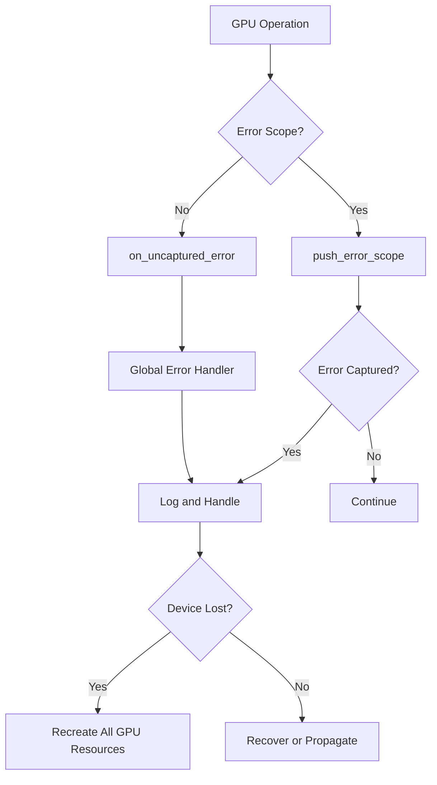
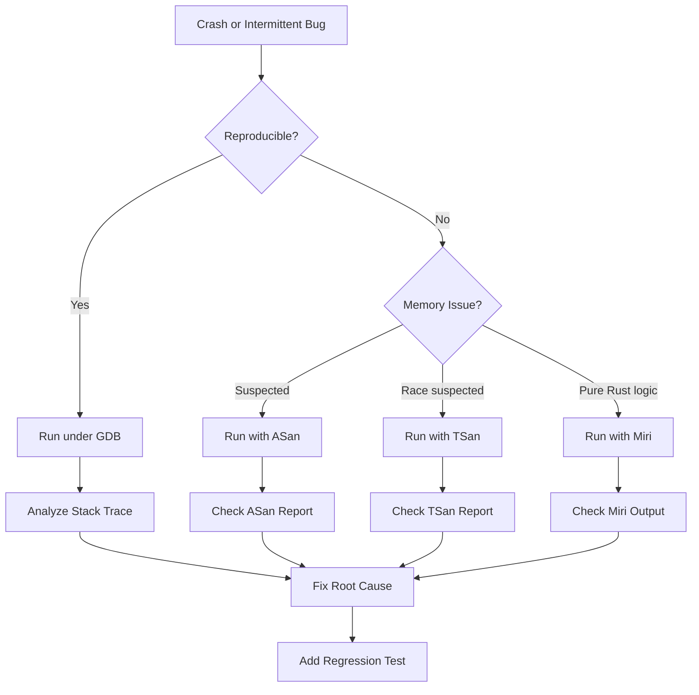
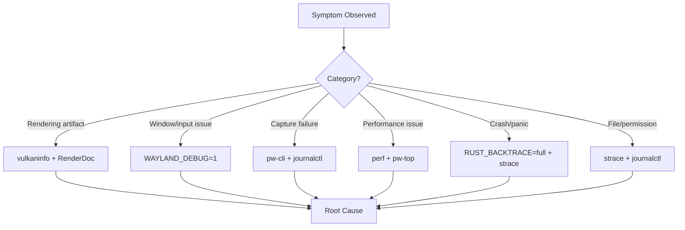
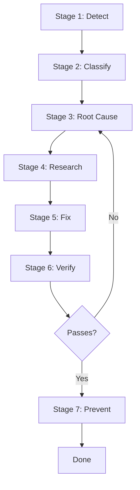

# Error Detection, Debugging, and Automated Testing

This document covers the tools and techniques for detecting GPU errors, debugging memory issues, and running automated tests and dependency checks in Dock.

## Table of Contents

1. [GPU-Specific Error Detection](#1-gpu-specific-error-detection)
2. [Memory Errors, Crashes, and Race Conditions](#2-memory-errors-crashes-and-race-conditions)
3. [Automated Testing and Dependency Checking](#3-automated-testing-and-dependency-checking)

---

## 1. GPU-Specific Error Detection

GPU errors are one of the highest priorities for Dock because they can cause silent failures, corrupted rendering, or crashes that are difficult to diagnose. A Vulkan validation error can manifest as a black screen, while a buffer alignment issue may only appear under specific workloads.

### 1.1 wgpu Error Handling

wgpu provides three mechanisms for catching and reporting GPU errors:

#### Error Scopes (`push_error_scope`)

Wrap GPU operations in error scopes to catch validation, OOM, and internal errors:

```rust
use wgpu::ErrorFilter;

// Push an error scope before GPU operations
let scope = device.push_error_scope(ErrorFilter::all());

// Perform GPU operations that may fail
let texture = device.create_texture(&desc);
encoder.copy_buffer_to_texture(..., &texture);

// Pop the scope asynchronously to check for errors
let device = device.clone();
scope.pop().then(move |result| {
    match result {
        Ok(None) => tracing::debug!("No GPU errors in scope"),
        Ok(Some(error)) => {
            tracing::error!(?error, "GPU error captured in scope");
            // Handle the error: log, report, or recover
        }
        Err(_) => {
            tracing::error!("Error scope pop failed");
        }
    }
    futures::future::ready(())
});
```

**Key points:**
- Scopes are thread-local and stack-based.
- Must be popped in reverse order of creation.
- If a guard is dropped without `pop()`, the scope is popped and errors are silently dropped.
- Use `ErrorFilter::all()` to catch all error types, or filter specifically:
  - `ErrorFilter::OutOfMemory` — GPU out of memory
  - `ErrorFilter::Validation` — API validation error (bug in code)
  - `ErrorFilter::Internal` — Internal GPU/driver error

#### Uncaptured Error Handler (`on_uncaptured_error`)

Set a global callback for errors not caught by any error scope:

```rust
use std::sync::Arc;
use wgpu::{Device, Error};

device.on_uncaptured_error(Arc::new(|error: Error| {
    match &error {
        Error::OutOfMemory { source } => {
            tracing::error!(?source, "GPU out of memory (uncaptured)");
        }
        Error::Validation { source, description } => {
            tracing::error!(?source, description = description.as_str(), "Validation error (uncaptured)");
        }
        Error::Internal { source, description } => {
            tracing::error!(?source, description = description.as_str(), "Internal GPU error (uncaptured)");
        }
    }
}));
```

**Key points:**
- This is a global fallback; errors caught by `push_error_scope` do not reach this handler.
- Shader compilation errors are NOT sent to this handler — use `ShaderModule::get_compilation_info()` instead.
- Set this early during device initialization.

#### Device Lost Callback (`set_device_lost_callback`)

Detect when the GPU device becomes unusable:

```rust
device.set_device_lost_callback(|reason, message| {
    tracing::error!(
        reason = ?reason,
        message = message.as_str(),
        "GPU device lost"
    );
    // Recovery: recreate device and all GPU resources
});
```

**Device lost reasons:**
- `Destroyed` — Device was explicitly destroyed.
- `Lost` — Device was lost by the backend (driver reset, GPU power management).
- `Unknown` — Unknown reason.

**Recovery strategy:** When the device is lost, all GPU resources (textures, buffers, pipelines) become invalid. The application must recreate the device and all resources from scratch.

### 1.2 wgpu Error Types

```rust
pub enum Error {
    OutOfMemory {
        source: ErrorSource,
    },
    Validation {
        source: ErrorSource,
        description: String,
    },
    Internal {
        source: ErrorSource,
        description: String,
    },
}
```

| Error Type | Cause | Severity | Recovery |
|------------|-------|----------|----------|
| `OutOfMemory` | GPU memory exhausted | Critical | Reduce resource usage, recreate with smaller budgets |
| `Validation` | Invalid API usage (bug in code) | Error | Fix the code — this indicates incorrect usage |
| `Internal` | Driver/hardware error | Critical | Recreate device, check driver status |

### 1.3 Shader Compilation Errors

Shader compilation errors are handled separately from the error scope system:

```rust
let shader = device.create_shader_module(wgpu::ShaderModuleDescriptor {
    label: Some("my_shader.wgsl"),
    source: wgpu::ShaderSource::Wgsl(std::borrow::Cow::Borrowed(shader_source)),
});

// Check for compilation errors
if let Some(compilation_info) = shader.get_compilation_info().await {
    if !compilation_info.messages.is_empty() {
        for message in compilation_info.messages {
            match message.severity {
                wgpu::CompilationMessageSeverity::Error => {
                    tracing::error!(
                        message = message.message.as_str(),
                        line = message.line,
                        byte_offset = message.byte_offset,
                        "Shader compilation error"
                    );
                }
                wgpu::CompilationMessageSeverity::Warning => {
                    tracing::warn!(
                        message = message.message.as_str(),
                        "Shader compilation warning"
                    );
                }
                _ => {}
            }
        }
    }
}
```

### 1.4 Common GPU Error Categories

| Category | Detection Method | Example |
|----------|-----------------|---------|
| Validation errors | `push_error_scope(ErrorFilter::Validation)` | Incorrect texture format usage |
| Out-of-memory | `push_error_scope(ErrorFilter::OutOfMemory)` | Texture allocation failure |
| Internal GPU errors | `push_error_scope(ErrorFilter::Internal)` | Driver crash, hardware fault |
| Uncaptured errors | `on_uncaptured_error()` | Errors outside any scope |
| Device lost | `set_device_lost_callback()` | Driver reset, GPU power management |
| Shader compilation | `ShaderModule::get_compilation_info()` | WGSL syntax error |
| Invalid resource usage | Validation layers | Using destroyed texture |
| Texture format incompatibility | Validation errors | Mismatched format between pipeline and texture |
| Buffer alignment problems | Validation errors | Buffer not aligned to required boundary |

### 1.5 Vulkan Validation Layers

Vulkan validation layers detect invalid API usage at runtime. Enable them during development:

```bash
# Enable Vulkan validation layers
export VK_LAYER_PATH=/usr/share/vulkan/explicit_layer.d
export VK_INSTANCE_LAYERS_ENABLE=VK_LAYER_KHRONOS_validation

# Run with validation
./dock
```

**What validation layers detect:**
- Invalid parameter values
- Resource usage errors (using destroyed resources)
- Synchronization errors (missing barriers)
- Memory binding errors
- Command buffer recording errors
- Pipeline creation errors

**Khronos Validation Layers:**
- Official documentation: https://github.com/KhronosGroup/Vulkan-ValidationLayers
- Synchronization validation: detects GPU resource access hazards
- Best practice layer: warns about suboptimal usage patterns

**Enable in development only:** Validation layers have significant performance overhead (2-10x slowdown). Never enable in production.

### 1.6 RenderDoc

RenderDoc is a frame debugging tool for graphics APIs including Vulkan:

**Installation:**
```bash
# Install RenderDoc
sudo pacman -S renderdoc  # Arch Linux
# or download from https://renderdoc.org
```

**Usage:**
1. Launch RenderDoc: `renderdoccmd`
2. Capture a frame from your application
3. Inspect textures, buffers, shaders, and draw calls
4. Analyze resource states and pipeline configurations

**Command-line capture:**
```bash
# Capture a single frame
renderdoccmd --captureonexit ./dock

# Or capture frame N
renderdoccmd --launch --captureframe 1 ./dock
```

**What to inspect:**
- Texture contents at each pipeline stage
- Buffer data before and after compute shaders
- Shader execution and register usage
- Pipeline state at each draw call
- Resource lifetime and transitions

### 1.7 GPU Error Detection Strategy



**Recommended pattern for Dock:**

1. Set `on_uncaptured_error` during device initialization as a safety net.
2. Set `set_device_lost_callback` to handle device loss recovery.
3. Wrap critical GPU operations in `push_error_scope` during development.
4. Enable Vulkan validation layers during development builds.
5. Use RenderDoc for frame-by-frame debugging of rendering issues.
6. In production, rely on error scopes for critical operations only (performance).

---

## 2. Memory Errors, Crashes, and Race Conditions

Dock uses FFI (PipeWire, Wayland, Vulkan), GPU buffers, and multithreading. Memory errors, use-after-free, and data races can cause intermittent crashes that are difficult to reproduce.

### 2.1 Miri — Undefined Behavior Detection

Miri is an interpreter for Rust's mid-level intermediate representation that detects undefined behavior:

**Installation:**
```bash
# Install Miri
rustup component add miri

# Verify installation
miri --version
```

**Usage:**
```bash
# Run tests under Miri
cd wgpu-api
cargo +nightly miri test

# Run a specific test
cargo +nightly miri test test_spring_solver

# Run the entire crate
cargo +nightly miri check
```

**What Miri detects:**
- Use-after-free
- Use-after-return
- Double-free
- Out-of-bounds memory access
- Uninitialized memory reads
- Invalid vtable calls
- Data races (in some cases)
- Invalid raw pointer dereferences
- Alignment violations

**Limitations:**
- Requires nightly Rust
- Very slow (100-1000x slower than normal execution)
- Cannot run code that uses certain FFI calls
- Best suited for testing pure Rust logic (physics, layout, scene graph)

**Recommended for Dock:**
```bash
# Test physics engine (pure Rust, no FFI)
cd wgpu-api && cargo +nightly miri test physics

# Test layout calculations
cd wgpu-api && cargo +nightly miri test layout

# Test scene graph operations
cd wgpu-api && cargo +nightly miri test scene
```

### 2.2 AddressSanitizer (ASan) — Memory Corruption Detection

ASan detects memory corruption and use-after-free at runtime with minimal overhead:

**Usage:**
```bash
# Run with ASan
RUSTFLAGS="-Z sanitizer=address" cargo +nightly run --target x86_64-unknown-linux-gnu

# Run tests with ASan
RUSTFLAGS="-Z sanitizer=address" cargo +nightly test --target x86_64-unknown-linux-gnu

# Set environment variables for ASan behavior
export ASAN_OPTIONS=detect_leaks=1:abort_on_error=1:print_stats=1
```

**What ASan detects:**
- Buffer overflows (heap, stack, global)
- Use-after-free
- Use-after-return
- Double-free
- Memory leaks (with `detect_leaks=1`)
- Heap-use-after-scope

**ASan options:**
| Option | Value | Effect |
|--------|-------|--------|
| `detect_leaks` | `1` | Enable leak detection |
| `abort_on_error` | `1` | Abort on first error (easier debugging) |
| `print_stats` | `1` | Print memory statistics |
| `halt_on_error` | `1` | Stop on error for GDB attachment |
| `log_path` | `/tmp/asan` | Write reports to file |

**Recommended for Dock:**
```bash
# Full test suite with ASan
RUSTFLAGS="-Z sanitizer=address" cargo +nightly test --target x86_64-unknown-linux-gnu 2>&1 | head -100

# Run the application with ASan
RUSTFLAGS="-Z sanitizer=address" cargo +nightly run --target x86_64-unknown-linux-gnu
```

### 2.3 ThreadSanitizer (TSan) — Data Race Detection

TSan detects data races in multithreaded programs:

**Usage:**
```bash
# Run with TSan
RUSTFLAGS="-Z sanitizer=thread" cargo +nightly run --target x86_64-unknown-linux-gnu

# Run tests with TSan
RUSTFLAGS="-Z sanitizer=thread" cargo +nightly test --target x86_64-unknown-linux-gnu
```

**What TSan detects:**
- Data races (unsynchronized concurrent access)
- Lock-order inversion (deadlock potential)
- Thread-sanitizer warnings on FFI boundaries

**Limitations:**
- Cannot be combined with other sanitizers
- Significant performance overhead (5-15x)
- May produce false positives on intentional unsafe code
- Requires `--target` specification

**Recommended for Dock:**
```bash
# Check for races in async code
RUSTFLAGS="-Z sanitizer=thread" cargo +nightly test --target x86_64-unknown-linux-gnu
```

### 2.4 Valgrind — Memory and Leak Analysis

Valgrind is a comprehensive memory analysis tool:

**Installation:**
```bash
sudo pacman -S valgrind  # Arch Linux
```

**Usage:**
```bash
# Run with Memcheck (memory error detection)
valgrind --tool=memcheck --leak-check=full --show-leak-kinds=all ./dock

# Run with Helgrind (thread error detection)
valgrind --tool=helgrind ./dock

# Run with DRD (thread error detection, faster than Helgrind)
valgrind --tool=drd ./dock
```

**What Valgrind Memcheck detects:**
- Use of uninitialized memory
- Reading/writing freed memory
- Reading/writing after end of allocated blocks
- Reading/writing inappropriate areas on stack
- Memory leaks (definite, indirect, possible)
- Mismatched malloc/free or new/delete
- Overlapping memory in memcpy/memset

**Valgrind limitations:**
- Very slow (10-50x overhead)
- May not work well with GPU applications (Vulkan/Wayland)
- Best for CPU-side memory issues

### 2.5 GDB — Crash Debugging

GDB is the primary tool for debugging crashes and inspecting stack traces:

**Usage:**
```bash
# Run under GDB
gdb ./dock

# Inside GDB:
(gdb) run
(gdb) bt          # Backtrace after crash
(gdb) bt full     # Backtrace with local variables
(gdb) frame N     # Select frame N
(gdb) print var   # Print variable
(gdb) info threads # List threads
(gdb) thread N    # Switch to thread N
```

**Core dump analysis:**
```bash
# Generate core dump on crash
ulimit -c unlimited
./dock  # crashes, generates core file

# Analyze core dump
gdb ./dock core
(gdb) bt
```

**Rust-specific GDB setup:**
```bash
# ~/.gdbinit for better Rust debugging
python
import sys
sys.path.insert(0, '/usr/share/gdb/python')
from libstdrust import *
end
```

### 2.6 LLDB — Alternative Debugger

LLDB is an alternative to GDB with better Rust support in some cases:

**Usage:**
```bash
lldb ./dock
(lldb) run
(lldb) bt
(lldb) frame variable
```

### 2.7 Sanitizer Comparison

| Tool | Detects | Speed | Best For | Nightly Required |
|------|---------|-------|----------|-----------------|
| **Miri** | UB, use-after-free, invalid pointers | Very slow (100-1000x) | Pure Rust logic | Yes |
| **ASan** | Memory corruption, use-after-free, leaks | Moderate (2-5x) | FFI, runtime errors | Yes |
| **TSan** | Data races, lock-order inversion | Slow (5-15x) | Multithreaded code | Yes |
| **Valgrind** | Memory errors, leaks, thread errors | Very slow (10-50x) | Comprehensive analysis | No |
| **GDB** | Crash debugging, stack traces | Native | Crash investigation | No |

### 2.8 Recommended Debugging Workflow



**Priority order for Dock:**
1. **Miri** for physics, layout, and scene graph (pure Rust, no FFI)
2. **ASan** for FFI boundaries (PipeWire, Wayland, Vulkan)
3. **TSan** for async/multithreaded code (tokio tasks, PipeWire threads)
4. **GDB** for crash investigation
5. **Valgrind** for comprehensive memory analysis when other tools don't find the issue

---

## 3. Automated Testing and Dependency Checking

These tools verify code changes, detect security vulnerabilities, and maintain dependency health.

### 3.1 cargo-nextest — Faster Test Execution

cargo-nextest is a test runner that provides faster, more organized test execution:

**Installation:**
```bash
cargo install cargo-nextest
```

**Usage:**
```bash
# Run all tests with nextest
cargo nextest run

# Run tests matching a pattern
cargo nextest run --filter-expr 'package(wgpu-api) & test(.*physics.*)'

# Run with faster output
cargo nextest run --failure-output immediate

# Show slow tests
cargo nextest run --show-output

# Run in release mode
cargo nextest run --release
```

**Advantages over `cargo test`:**
- Parallel test execution by default
- Faster test discovery
- Better output formatting
- Test filtering with expressions
- Reuse of build artifacts

### 3.2 cargo-audit — Security Vulnerability Checking

cargo-audit checks dependencies for known security vulnerabilities:

**Installation:**
```bash
cargo install cargo-audit
```

**Usage:**
```bash
# Check for security advisories
cargo audit

# Generate JSON report
cargo audit --json > audit-report.json

# Ignore specific advisories (add to Cargo.toml)
# [package.metadata.cargo-audit]
# ignores = ["RUSTSEC-2023-0001"]
```

**Integrate into CI:**
```yaml
# Example CI step
- name: Security audit
  run: cargo audit
```

### 3.3 cargo-deny — Dependency Policy and License Checking

cargo-deny enforces dependency policies including license compliance:

**Installation:**
```bash
cargo install cargo-deny
```

**Configuration** (`deny.toml`):
```toml
[licenses]
allow = ["MIT", "Apache-2.0", "BSD-3-Clause", "Unicode-DFS-2016"]
confidence-threshold = 0.8

[[licenses.clarify]]
name = "ring"
expression = "MIT AND ISC AND OpenSSL"
license-files = [
    { path = "LICENSE", hash = 0xbd0eed23 }
]

[sources]
unknown-registry = "deny"
unknown-git = "warn"

[advisories]
version = 2

[bans]
multiple-versions = "warn"
```

**Usage:**
```bash
# Check all policies
cargo deny check

# Check specific policies
cargo deny check licenses
cargo deny check bans
cargo deny check sources
cargo deny check advisories
```

### 3.4 cargo-machete — Unused Dependency Detection

cargo-machete finds unused dependencies in Cargo.toml:

**Installation:**
```bash
cargo install cargo-machete
```

**Usage:**
```bash
# Check for unused dependencies
cargo machete

# Check specific package
cargo machete -p wgpu-api
```

**Output:**
```
Unused dependencies:
- lazy_static (unused in wgpu-api)
```

### 3.5 cargo-outdated — Outdated Dependency Detection

cargo-outdated identifies dependencies with newer versions available:

**Installation:**
```bash
cargo install cargo-outdated
```

**Usage:**
```bash
# Show outdated dependencies
cargo outdated

# Show only direct dependencies
cargo outdated --root-only

# Show update path (what needs to be updated)
cargo outdated --depth 1

# JSON output for scripting
cargo outdated --json > outdated.json
```

### 3.6 Clippy — Code Quality Lints

Clippy detects suspicious code and common mistakes:

**Usage:**
```bash
# Run Clippy on all targets
cargo clippy --all-targets --all-features

# Apply suggested fixes
cargo clippy --fix --allow-dirty

# Run with stricter lints
RUSTFLAGS="-D warnings" cargo clippy --all-targets
```

**Recommended Clippy configuration** (`.clippy.toml`):
```toml
# Disallow certain patterns
disallowed-methods = [
    "std::vec::Vec::new",  # Use Vec::default() instead
]

# Allow larger type sizes where needed
type-complexity-threshold = 300
```

### 3.7 proptest — Property-Based Testing

proptest generates random test cases to find edge cases:

**Installation:**
```toml
# Cargo.toml dev-dependencies
proptest = "1.0"
```

**Example:**
```rust
use proptest::prelude::*;

proptest! {
    #[test]
    fn test_spring_force_always_finite(k in 0.0..1000.0, displacement in -100.0..100.0) {
        let force = -k * displacement;
        prop_assert!(force.is_finite());
    }

    #[test]
    fn test_mass_always_positive(mass in 0.001..100.0f32) {
        prop_assert!(mass > 0.0);
    }
}
```

**What proptest finds:**
- Edge cases (zero, negative, infinity, NaN)
- Boundary conditions
- Invariant violations
- Non-commutative operations that should be commutative

### 3.8 Automated Verification Commands

Run these commands after any code change:

```bash
# 1. Check compilation
cargo check --workspace --all-targets

# 2. Check formatting
cargo fmt --all --check

# 3. Run Clippy
cargo clippy --all-targets --all-features -- -D warnings

# 4. Run tests
cargo test --workspace

# 5. Check for duplicate dependency versions
cargo tree -d

# 6. Check for security vulnerabilities
cargo audit

# 7. Check for unused dependencies
cargo machete

# 8. Check for outdated dependencies
cargo outdated --root-only
```

### 3.9 Priority Dependency Checks

For Dock specifically, these dependency trees are critical to verify:

```bash
# Verify single wgpu version
cargo tree -i wgpu

# Verify SVG coupling (resvg depends on usvg)
cargo tree -i usvg
cargo tree -i resvg

# Verify physics math stack
cargo tree -i nalgebra
cargo tree -i glam

# Verify Wayland ecosystem consistency
cargo tree -i wayland-client
cargo tree -i smithay-client-toolkit

# Verify PipeWire stack alignment
cargo tree -i pipewire
cargo tree -i pipewire-sys
cargo tree -i libspa-sys

# Verify D-Bus stack alignment
cargo tree -i zbus
```

### 3.10 CI/CD Integration

Recommended CI pipeline:

```yaml
# Example GitHub Actions workflow
name: CI
on: [push, pull_request]

jobs:
  check:
    runs-on: ubuntu-latest
    steps:
      - uses: actions/checkout@v4
      - uses: dtolnay/rust-toolchain@stable
        with:
          components: clippy
      - run: cargo check --workspace --all-targets
      - run: cargo fmt --all --check
      - run: cargo clippy --all-targets -- -D warnings

  test:
    runs-on: ubuntu-latest
    steps:
      - uses: actions/checkout@v4
      - uses: dtolnay/rust-toolchain@stable
      - run: cargo test --workspace

  security:
    runs-on: ubuntu-latest
    steps:
      - uses: actions/checkout@v4
      - uses: dtolnay/rust-toolchain@stable
      - run: cargo install cargo-audit
      - run: cargo audit

  dependencies:
    runs-on: ubuntu-latest
    steps:
      - uses: actions/checkout@v4
      - uses: dtolnay/rust-toolchain@stable
      - run: cargo tree -d
```

### 3.11 Tool Summary

| Tool | Purpose | Install Command | Run Command |
|------|---------|----------------|-------------|
| **cargo-nextest** | Faster test execution | `cargo install cargo-nextest` | `cargo nextest run` |
| **cargo-audit** | Security vulnerabilities | `cargo install cargo-audit` | `cargo audit` |
| **cargo-deny** | Dependency policy | `cargo install cargo-deny` | `cargo deny check` |
| **cargo-machete** | Unused dependencies | `cargo install cargo-machete` | `cargo machete` |
| **cargo-outdated** | Outdated dependencies | `cargo install cargo-outdated` | `cargo outdated` |
| **Clippy** | Code quality lints | `rustup component add clippy` | `cargo clippy` |
| **proptest** | Property-based testing | Add to `Cargo.toml` | `cargo test` |
| **Miri** | Undefined behavior | `rustup component add miri` | `cargo +nightly miri test` |
| **ASan** | Memory corruption | Built into nightly | `RUSTFLAGS="-Z sanitizer=address"` |
| **TSan** | Data races | Built into nightly | `RUSTFLAGS="-Z sanitizer=thread"` |
| **Valgrind** | Memory analysis | `sudo pacman -S valgrind` | `valgrind ./dock` |
| **GDB** | Crash debugging | `sudo pacman -S gdb` | `gdb ./dock` |
| **RenderDoc** | GPU frame debugging | `sudo pacman -S renderdoc` | `renderdoccmd ./dock` |

---

## 5. Linux Subsystem Debugging Tools

Dock runs on Linux with Wayland, PipeWire, Vulkan, and D-Bus integration. Errors can originate in any of these subsystems but manifest as rendering failures, frozen UI, or crashes in completely different parts of the application. Your AI must know how to diagnose the actual Linux environment, not just Rust code.

### 5.1 Wayland Protocol Debugging

Wayland errors cause window creation failures, input event loss, and surface lifecycle issues. The `WAYLAND_DEBUG` environment variable dumps all protocol messages between client and compositor.

**Environment variable:**
```bash
# Dump all Wayland protocol messages to stderr
WAYLAND_DEBUG=1 cargo run

# Redirect to file for analysis
WAYLAND_DEBUG=1 cargo run 2> wayland.log

# Filter specific protocol messages
WAYLAND_DEBUG=1 cargo run 2>&1 | grep -i "layer_shell"
```

**What it diagnoses:**
- Surface creation and destruction
- Layer-shell registration
- Input event routing (pointer, keyboard, touch)
- Output management (monitor detection, scale factor changes)
- Protocol errors and rejected requests
- Roundtrip timing and event queue state

**Common patterns:**
```
→ wl_compositor@3.create_surface(new id wl_surface@4)
→ wl_surface@4.destroy()
→ zwlr_layer_shell_v1@12.get_layer_surface(new id zwlr_layer_surface_v1@13, wl_surface@4, ...)
← wl_display@1.error(zwlr_layer_surface_v1@13, 2, "invalid layer")
```

**Diagnostic commands:**
```bash
# Check Wayland socket availability
ls -la /run/user/$(id -u)/wayland-*

# Check compositor globals
WAYLAND_DEBUG=1 cargo run 2>&1 | grep "global"

# Check surface lifecycle
WAYLAND_DEBUG=1 cargo run 2>&1 | grep -E "(create_surface|destroy)"
```

### 5.2 PipeWire Diagnostics

PipeWire errors cause screen capture failures, stream negotiation issues, and DMA-BUF problems. The `pw-cli` and `pw-top` tools provide real-time insight into PipeWire state.

**`pw-cli` — Object and Node Inspection:**
```bash
# List all PipeWire nodes (capture sources, outputs, etc.)
pw-cli ls Node

# List all PipeWire devices (hardware and virtual)
pw-cli ls Device

# List all PipeWire properties
pw-cli ls Props

# Inspect a specific node's properties
pw-cli info Node <node-id>

# List properties of a specific node
pw-cli ls Props node:<node-id>

# Check for screen capture nodes
pw-cli ls Node | grep -i "screen\|capture\|portal"
```

**`pw-top` — Performance Monitoring:**
```bash
# Real-time PipeWire performance monitor
pw-top
```

**What `pw-top` shows:**
- Active streams and their CPU usage
- Buffer allocation and latency
- Format negotiation status
- Node connections and data flow
- Real-time frame rate and dropped frames

**Diagnostic commands:**
```bash
# Check PipeWire service status
systemctl --user status pipewire
systemctl --user status pipewire-pulse
systemctl --user status wireplumber

# Check for active capture sessions
pw-cli ls Node | grep -i "screen\|capture"

# Check PipeWire log output
journalctl --user -u pipewire -n 50

# Restart PipeWire (if stuck)
systemctl --user restart pipewire wireplumber
```

**Common PipeWire error patterns:**
- `Permission denied` — Screen capture portal permission not granted
- `No such device` — Capture source disconnected
- `Format negotiation failed` — Incompatible format between producer and consumer
- `Buffer underrun` — Processing too slow, frames dropped

### 5.3 System Logs (journalctl)

Systemd journal captures all system and service logs, including Wayland compositor, PipeWire, and D-Bus messages.

**Diagnostic commands:**
```bash
# Show warnings and errors from current boot
journalctl -b -p warning

# Show only errors from current boot
journalctl -b -p err

# Show PipeWire logs
journalctl --user -u pipewire -n 100

# Show compositor logs (e.g., labwc, sway)
journalctl -b | grep -i "labwc\|sway\|wayland"

# Show D-Bus logs
journalctl -b | grep -i "dbus"

# Follow logs in real-time
journalctl -b -f

# Show logs from last hour
journalctl --since "1 hour ago"

# Show specific unit logs
journalctl -u pipewire -u wireplumber --since "10 minutes ago"
```

**What it diagnoses:**
- Service startup failures
- Segmentation faults and crashes
- Permission denied errors
- Resource exhaustion (OOM killer)
- D-Bus registration failures
- PipeWire stream negotiation failures

### 5.4 System Call Tracing (strace)

`strace` intercepts and logs system calls made by the application, revealing file descriptor leaks, permission issues, and blocking operations.

**Diagnostic commands:**
```bash
# Trace all system calls
strace -f -o trace.log cargo run

# Trace only specific syscalls
strace -f -e trace=open,openat,read,write,connect,sendto,recvfrom -o trace.log cargo run

# Trace with timestamps
strace -f -tt -o trace.log cargo run

# Trace file descriptor operations
strace -f -e trace=network -o trace.log cargo run

# Trace specific process by PID
strace -f -p <PID> -o trace.log

# Count syscall frequency
strace -c -f cargo run
```

**What it diagnoses:**
- File descriptor leaks (too many open files)
- Permission denied on specific files
- Blocking I/O operations (Wayland queue, PipeWire)
- Socket connection failures
- Memory mapping failures
- Signal delivery and handling

**Common patterns:**
```
# Wayland socket connection
connect(5, {sa_family=AF_UNIX, sun_path="/run/user/1000/wayland-0"}, ...) = 0

# PipeWire connection
connect(6, {sa_family=AF_UNIX, sun_path="/run/user/1000/pipewire-0"}, ...) = 0

# File not found
openat(AT_FDCWD, "/usr/share/icons/hicolor/...", O_RDONLY) = -1 ENOENT

# Permission denied
openat(AT_FDCWD, "/home/user/.config/...", O_RDONLY) = -1 EACCES
```

### 5.5 CPU Performance Profiling (perf)

`perf` is the Linux kernel performance counter tool for CPU profiling, identifying hotspots and bottlenecks.

**Diagnostic commands:**
```bash
# Record CPU profile
perf record -g cargo run

# Analyze profile
perf report

# Record for specific process
perf record -g -p <PID>

# Flamegraph generation
perf record -g --call-graph dwarf cargo run
perf script | stackcollapse-perf.pl | flamegraph.pl > flamegraph.svg

# Monitor CPU frequency
perf stat -a sleep 10

# Count cache misses
perf stat -e cache-references,cache-misses cargo run
```

**What it diagnoses:**
- CPU hotspots (functions consuming most time)
- Cache miss patterns
- Branch prediction failures
- System call overhead
- Context switch frequency

### 5.6 Vulkan Device Capabilities (vulkaninfo)

`vulkaninfo` reports Vulkan device capabilities, driver version, and supported features — essential for diagnosing GPU compatibility issues.

**Diagnostic commands:**
```bash
# Summary of Vulkan capabilities
vulkaninfo --summary

# Full device information
vulkaninfo

# Check specific device
vulkaninfo --device <device-index>

# Check supported extensions
vulkaninfo | grep -i "extension"

# Check memory properties
vulkaninfo | grep -i "memory"

# Check queue families
vulkaninfo | grep -i "queue"
```

**What it diagnoses:**
- GPU device availability and type (discrete vs integrated)
- Vulkan driver version and conformance
- Supported extensions (DMA-BUF, swapchain, etc.)
- Memory heap sizes and types
- Queue family capabilities (graphics, compute, transfer)
- Texture format support
- Maximum texture dimensions

**Key output fields for Dock:**
```
GPU0:
  apiVersion = 1.3.260
  driverVersion = 26.0.0.0
  vendorID = 0x1002
  deviceID = 0x1681
  deviceType = DISCRETE_GPU
  driverID = AMD_PROPRIETARY
  driverInfo = 26.x.x.xx
  memoryHeap 0: size = 8 GiB (device local)
  memoryHeap 1: size = 32 GiB (host visible)
```

### 5.7 DRM Device Capabilities (drm_info)

`drm_info` (from `drm-info` tool) reports Linux DRM (Direct Rendering Manager) device capabilities, including DMA-BUF support.

**Diagnostic commands:**
```bash
# Install drm_info (if not available)
cargo install drm-info

# Show DRM device information
drm_info

# Check DMA-BUF support
drm_info | grep -i "dma\|prime"

# Check connector status
drm_info | grep -i "connector"
```

**What it diagnoses:**
- DRM device availability
- DMA-BUF sharing support
- Connector status (connected monitors)
- CRTC and plane configuration
- DRM driver version

### 5.8 Rust Backtraces

Rust backtraces reveal the call stack at the point of panic or crash.

**Diagnostic commands:**
```bash
# Full backtrace on panic
RUST_BACKTRACE=full cargo run

# Short backtrace
RUST_BACKTRACE=1 cargo run

# With GDB for native crashes
gdb --args cargo run
(gdb) run
(gdb) bt
```

**What it diagnoses:**
- Panic location and message
- Call stack leading to the crash
- Function arguments and local variables (with debug symbols)
- Thread state at crash time

### 5.9 Diagnostic Command Summary

| Tool | Command | Diagnoses |
|------|---------|-----------|
| **WAYLAND_DEBUG** | `WAYLAND_DEBUG=1 cargo run` | Wayland protocol messages, surface lifecycle |
| **pw-cli** | `pw-cli ls Node` | PipeWire objects, nodes, devices |
| **pw-top** | `pw-top` | PipeWire performance, active streams |
| **journalctl** | `journalctl -b -p warning` | System and service logs |
| **strace** | `strace -f -o trace.log cargo run` | System calls, file descriptors |
| **perf** | `perf record -g cargo run` | CPU performance, profiling |
| **vulkaninfo** | `vulkaninfo --summary` | Vulkan device and driver capabilities |
| **drm_info** | `drm_info` | Linux DRM device capabilities |
| **RUST_BACKTRACE** | `RUST_BACKTRACE=full cargo run` | Rust backtraces on panic |

### 5.10 Cross-Subsystem Diagnosis Flow



---

## 6. AI Error Resolution Workflow

This section defines a strict error-resolution pipeline that must be followed when diagnosing and fixing errors in Dock. The goal is to ensure errors are resolved correctly, not suppressed or worked around.

### 6.1 The Seven-Stage Pipeline

Every error must pass through these seven stages in order:

#### Stage 1: Error Detection

**Goal:** Capture the complete error information before any analysis.

**Actions:**
- Capture the full error message, including all context and details.
- Capture the complete backtrace (`RUST_BACKTRACE=full`).
- Note the subsystem where the error was observed (GPU, Wayland, PipeWire, etc.).
- Record the environment: Rust version, dependency versions, OS version.
- For GPU errors, check `push_error_scope` results and uncaptured error handler output.
- For Wayland errors, capture `WAYLAND_DEBUG=1` output.
- For PipeWire errors, capture `pw-cli` and `journalctl` output.

**Do not skip:** Even if the error seems obvious, capture all information first.

#### Stage 2: Error Classification

**Goal:** Determine the error category to focus the diagnosis.

**Categories:**

| Category | Indicators | Tools |
|----------|-----------|-------|
| **Rust compilation** | Compiler errors, type mismatches | `cargo check`, `cargo clippy` |
| **Rust runtime** | Panics, assertions, unwinds | `RUST_BACKTRACE=full` |
| **GPU/wgpu** | Device lost, validation errors, OOM | Error scopes, Vulkan layers, RenderDoc |
| **Wayland** | Surface errors, protocol errors | `WAYLAND_DEBUG=1`, journalctl |
| **PipeWire** | Stream errors, format negotiation | `pw-cli`, `pw-top`, journalctl |
| **Memory** | Use-after-free, leaks, UB | ASan, Miri, Valgrind |
| **Concurrency** | Data races, deadlocks | TSan, Helgrind |
| **Dependency** | Version conflicts, missing features | `cargo tree -d`, `cargo outdated` |
| **D-Bus** | Registration failures, type errors | journalctl, strace |
| **UI/Slint** | Widget errors, rendering failures | Slint logs, visual inspection |

#### Stage 3: Root-Cause Analysis

**Goal:** Identify the actual underlying cause, not just the symptom.

**Actions:**
- Inspect the complete error message and backtrace.
- Identify the affected source files and functions.
- Check dependency versions for compatibility issues.
- Examine subsystem interactions: does the error cross boundaries?
- For GPU errors: check texture format, dimensions, usage flags, device limits.
- For Wayland errors: check surface lifecycle, protocol version, compositor compatibility.
- For PipeWire errors: check stream state, format negotiation, buffer lifetime.
- For memory errors: check ownership, lifetimes, FFI boundaries.
- For concurrency errors: check lock ordering, shared state access.

**Key principle:** The error location is not always the error source. A Vulkan validation error may originate from incorrect buffer setup code, not the draw call.

#### Stage 4: Solution Research

**Goal:** Find the correct fix based on authoritative sources.

**Actions:**
- Check official documentation for the **exact installed version** of the affected library.
- Examine source code and changelogs if documentation is unclear.
- Check `docs/reference/` for Dock-specific integration notes.
- Check `docs/decisions/` for ADRs that constrain the solution.
- Check `docs/contracts/` for subsystem boundary rules.
- Verify the fix against architectural invariants.

**Do not:**
- Guess based on similar-looking APIs.
- Assume the latest API is compatible with the installed version.
- Invent APIs or functions that don't exist.
- Suppress errors to make the application continue running.

#### Stage 5: Implement the Fix

**Goal:** Apply the smallest correct change.

**Actions:**
- Make the minimal change that resolves the root cause.
- Avoid unrelated refactoring.
- Preserve existing functionality.
- Update documentation if the fix changes behavior.
- Add comments only if the fix is non-obvious.

**Key principle:** The smallest correct change is better than a large refactoring that introduces new risks.

#### Stage 6: Verification

**Goal:** Confirm the fix works and doesn't introduce regressions.

**Actions:**
- Run `cargo fmt --check` — verify formatting.
- Run `cargo check` — verify compilation.
- Run `cargo clippy` — verify code quality.
- Run relevant tests — verify behavior.
- Run subsystem-specific validation:
  - GPU: Check error scopes, validation layers.
  - Wayland: Check `WAYLAND_DEBUG=1` output.
  - PipeWire: Check `pw-cli` and stream state.
- Check for regressions in related subsystems.
- Report any unverified behavior.

**Do not skip:** Even a simple fix must be verified.

#### Stage 7: Regression Prevention

**Goal:** Prevent the same problem from returning.

**Actions:**
- Add a test that reproduces the original error.
- Add a diagnostic check if the error is intermittent.
- Update `docs/architecture/known_issues.md` if the issue is not fully resolved.
- Update `docs/contracts/` if the fix changes subsystem boundaries.
- Create an ADR if the fix changes a foundational decision.

### 6.2 Error Resolution Pipeline Diagram



### 6.3 Example: GPU Texture Creation Error

**Scenario:** The application crashes when creating a texture.

**Stage 1 — Detect:**
```bash
RUST_BACKTRACE=full cargo run 2>&1 | tee error.log
```
Capture: Full error message, backtrace, wgpu error type, texture parameters.

**Stage 2 — Classify:**
Error originates in wgpu → **GPU/wgpu** category.

**Stage 3 — Root Cause:**
- Check texture format: is it supported by the GPU?
- Check dimensions: do they exceed device limits?
- Check usage flags: are they compatible with the pipeline?
- Check memory requirements: is GPU memory available?
- Inspect `vulkaninfo --summary` for format support.
- Check wgpu 30.0 documentation for texture creation rules.

**Stage 4 — Research:**
- Read wgpu 30.0 `TextureDescriptor` documentation.
- Check `docs/reference/gpu-rendering.md` for Dock-specific texture rules.
- Verify format compatibility with the rendering pipeline.

**Stage 5 — Fix:**
- Apply the correction (e.g., change format, adjust dimensions, fix usage flags).
- No unrelated refactoring.

**Stage 6 — Verify:**
- Rebuild and test texture creation.
- Check error scopes for new errors.
- Run `cargo test` for regressions.

**Stage 7 — Prevent:**
- Add a test that creates a texture with the same parameters.
- Document the format/dimension limits in `docs/contracts/renderer.md`.

### 6.4 Error Severity and Recovery

| Severity | Example | Recovery Strategy |
|----------|---------|-------------------|
| **Recoverable** | Temporarily unavailable capture stream | Retry, fallback, or graceful degradation |
| **Warning** | Shader compilation warning | Log and continue, fix in next iteration |
| **Error** | Invalid GPU resource usage | Stop the affected operation, fix the code |
| **Critical** | GPU device lost, OOM | Recreate device and all resources |
| **Fatal** | Unrecoverable system error | Log, clean up, and exit |

**Key rule:** Some errors are recoverable (e.g., temporarily unavailable capture stream). Others, such as invalid GPU resource usage, should stop the affected operation. **Never suppress errors, ignore validation messages, or replace errors with default values just to make the application continue running.**

### 6.5 Quick Reference: Diagnostic Commands by Subsystem

```bash
# GPU/wgpu
vulkaninfo --summary
renderdoccmd --captureonexit cargo run
VK_INSTANCE_LAYERS_ENABLE=VK_LAYER_KHRONOS_validation cargo run

# Wayland
WAYLAND_DEBUG=1 cargo run 2> wayland.log
journalctl -b | grep -i wayland

# PipeWire
pw-cli ls Node
pw-cli ls Device
pw-top
journalctl --user -u pipewire -n 50

# D-Bus
journalctl -b | grep -i dbus
strace -f -e trace=network -o dbus.log cargo run

# Memory
RUSTFLAGS="-Z sanitizer=address" cargo +nightly run --target x86_64-unknown-linux-gnu
cargo +nightly miri test physics

# Concurrency
RUSTFLAGS="-Z sanitizer=thread" cargo +nightly run --target x86_64-unknown-linux-gnu

# General
RUST_BACKTRACE=full cargo run
strace -f -o trace.log cargo run
perf record -g cargo run
```

---

## Related Documentation

- **Error Handling**: `docs/architecture/error-handling.md` — Error types, propagation, and recovery
- **Memory**: `docs/architecture/memory.md` — GPU/CPU memory management
- **Threading**: `docs/architecture/threading.md` — Thread ownership and synchronization
- **Testing**: `docs/architecture/testing.md` — Build, test, and regression procedures
- **Known Issues**: `docs/architecture/known_issues.md` — Existing bugs and limitations
- **Reference**: `docs/reference/rust-engineering.md` — Rust engineering best practices
