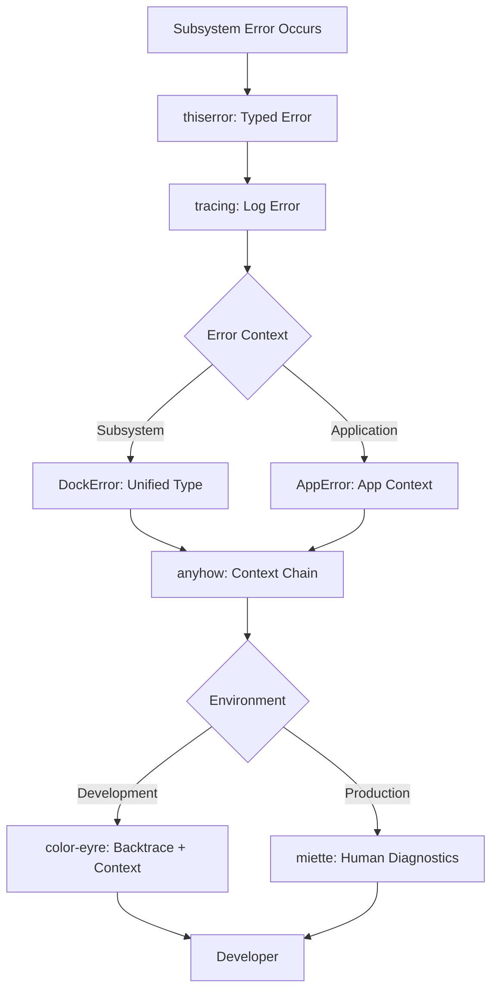
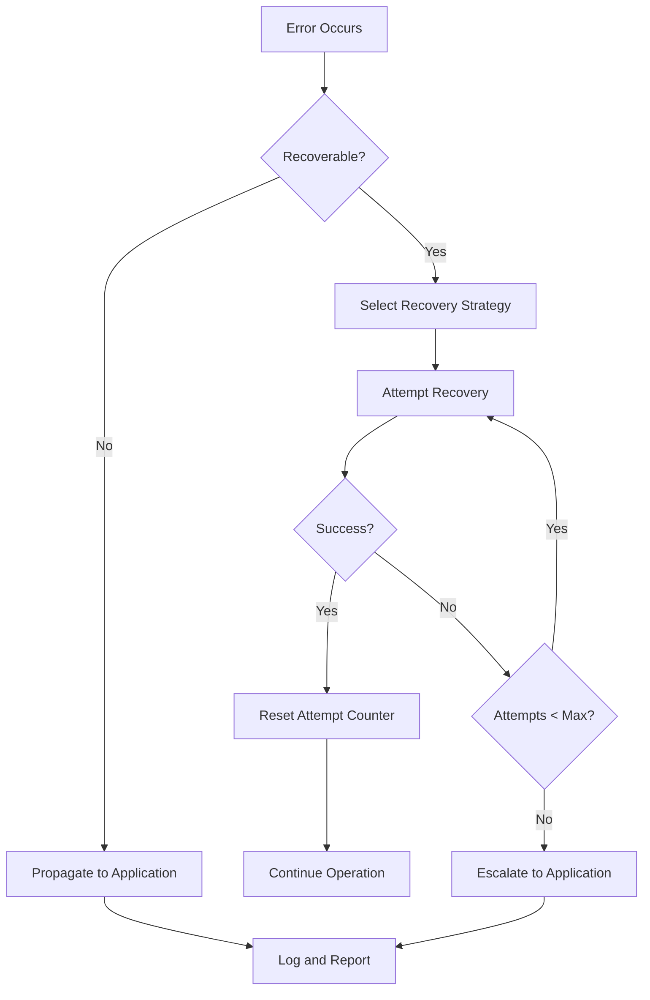

# Error Handling Architecture

This document describes the error detection, diagnosis, recovery, and prevention subsystem for Dock.

## Overview

Dock combines Vulkan, wgpu, Wayland, PipeWire, DMA-BUF, Slint, and multithreaded Rust. Errors can originate in one subsystem but manifest in a completely different one:

- A **Vulkan validation error** can manifest as a rendering failure.
- A **PipeWire buffer problem** can cause frozen screen capture.
- A **Wayland event-loop issue** can make the UI appear unresponsive.
- A **synchronization bug** can cause intermittent GPU crashes.
- An **incorrect dependency version** can produce confusing compiler errors.

The error handling subsystem provides tools and patterns for five stages:

1. **Detect** — Find errors before they become crashes.
2. **Diagnose** — Identify the actual underlying cause.
3. **Resolve** — Apply the smallest correct fix.
4. **Verify** — Test that the fix actually works.
5. **Prevent** — Add regression tests and monitoring.

## Library Stack

| Library | Role | Scope |
|---------|------|-------|
| **thiserror** | Define strongly-typed errors | Subsystem error types |
| **anyhow** | Propagate application errors | Application-level context |
| **tracing** | Record what happened | Structured logging and spans |
| **tracing-subscriber** | Collect and format logs | Log filtering and output |
| **miette** | Present understandable diagnostics | Human-readable error reports |
| **color-eyre** | Detailed error reports with backtraces | Development diagnostics |

## Architecture



## Error Type Hierarchy

### wgpu-api Errors (`wgpu-api/src/error.rs`)

The `DockError` enum is the unified error type for the wgpu-api crate, wrapping all subsystem-specific errors:

| Error Type | Subsystem | Examples |
|------------|-----------|----------|
| `GpuError` | GPU backend | Device lost, out of memory, DMA-BUF import failed |
| `RendererError` | Renderer | Surface recreation, frame rendering, texture upload |
| `PhysicsError` | Physics engine | Body not found, constraint resolution, spring divergence |
| `VideoError` | PipeWire/video | Connection failed, buffer format mismatch, stream negotiation |
| `WaylandError` | Wayland | Display not found, surface creation, protocol error |
| `SceneError` | Scene graph | Node not found, cycle detected, traversal error |
| `LayoutError` | Layout | Calculation failed, invalid insertion index |
| `TextError` | Text/fonts | Font not found, shaping failed, glyph not found |
| `InteractionError` | Input | Target not found, gesture transition, hit test |
| `AnimationError` | Animation | Not found, easing error, keyframe interpolation |

### Application Errors (`src/error.rs`)

The `AppError` enum wraps wgpu-api errors and adds application-level context:

| Error Type | Scope | Examples |
|------------|-------|----------|
| `WgpuApi` | wgpu-api wrapper | Any DockError with app context |
| `InitFailed` | Startup | Application initialization failure |
| `ConfigurationError` | Config | Invalid configuration files |
| `ServiceError` | Services | Background service failures |
| `ListenerError` | Listeners | Wayland/DBus listener errors |
| `StateError` | State | State management errors |
| `EventError` | Events | Event handling errors |
| `ResolverError` | Resolvers | Icon/process resolution |
| `DbusError` | D-Bus | D-Bus communication failures |
| `SystemMonitorError` | Monitoring | System resource monitoring |
| `IconError` | Icons | Icon loading failures |
| `ProcessError` | Processes | Process resolution errors |

## Five-Stage Error Framework

### Stage 1: Detect

Find errors before they become crashes.

**Tools:**

- **tracing spans**: Wrap critical operations in tracing spans to capture context.
- **Resource monitoring**: Use `ResourceMonitor` to detect GPU/CPU memory pressure.
- **Health checks**: Periodic validation of subsystem state.

**Patterns:**

```rust
// Wrap operations in tracing spans
tracing::info!(target: "dock::gpu", "Creating GPU device");
let device = create_device().map_err(|e| {
    tracing::error!(error = %e, "GPU device creation failed");
    GpuError::DeviceCreationFailed(e.to_string())
})?;
```

### Stage 2: Diagnose

Identify the actual underlying cause.

**Tools:**

- **miette diagnostics**: Error codes, severity levels, and help messages.
- **color-eyre**: Backtraces with source context (development only).
- **tracing logs**: Structured logs with field-based filtering.

**Patterns:**

```rust
// Miette provides error codes and help messages
impl miette::Diagnostic for DockError {
    fn code(&self) -> &str {
        match self {
            DockError::Gpu(_) => "GPU_ERROR",
            // ...
        }
    }

    fn help(&self) -> Option<&str> {
        match self {
            DockError::Gpu(GpuError::DeviceLost(_)) => {
                Some("GPU device was lost. Check Vulkan driver status.")
            }
            _ => None,
        }
    }
}
```

### Stage 3: Resolve

Apply the smallest correct fix.

**Recovery strategies:**

| Error Type | Recovery Strategy |
|------------|-------------------|
| GPU device lost | Recreate device and all GPU resources |
| PipeWire connection lost | Reconnect with exponential backoff |
| Wayland surface lost | Recreate surface and reconfigure |
| Buffer format mismatch | Fall back to CPU upload path |
| Spring solver divergence | Reduce stiffness, increase damping |
| Font not found | Use fallback font |

**Patterns:**

```rust
// Use log_err to record errors before propagation
result.map_err(|e| wgpu_api::error::log_err(&e, "operation failed"))
```

### Stage 4: Verify

Test that the fix actually works.

**Methods:**

- **Unit tests**: Test error type conversions and miette integration.
- **Integration tests**: Test error recovery paths.
- **Visual verification**: For rendering errors, verify frame output.

### Stage 5: Prevent

Add regression tests and monitoring.

**Strategies:**

- **Resource limits**: Set GPU memory budgets and enforce them.
- **Health monitoring**: Track error rates and alert on anomalies.
- **Regression tests**: Add tests for previously encountered errors.
- **Documentation**: Update known_issues.md with new error patterns.

## Error Propagation Patterns

### Subsystem → Application

```rust
// In wgpu-api: return typed errors
pub fn create_texture(&mut self, data: &[u8]) -> DockResult<TextureId> {
    // ... implementation
    Ok(texture_id)
}

// In application: wrap with context
fn load_icon(path: &str) -> AppResult<TextureId> {
    let data = std::fs::read(path)
        .map_err(|e| AppError::IconError(e.to_string()))?;
    renderer.create_texture(&data)
        .map_err(|e| AppError::WgpuApi(e))
}
```

### anyhow Integration

Both `DockError` and `AppError` implement `Into<anyhow::Error>` for seamless propagation:

```rust
async fn initialize() -> anyhow::Result<()> {
    let renderer = Renderer::new().await?;
    // DockError automatically converts to anyhow::Error
    Ok(())
}
```

## Tracing Integration

### Log Levels

| Level | Usage |
|-------|-------|
| `error!` | Unrecoverable errors that propagate |
| `warn!` | Recoverable errors or degraded functionality |
| `info!` | Normal operations (surface creation, stream start) |
| `debug!` | Detailed operation traces |
| `trace!` | Verbose debugging information |

### Structured Fields

Use structured fields for filterable logs:

```rust
tracing::error!(
    error = %err,
    error.debug = ?err,
    subsystem = "gpu",
    operation = "device_creation",
    "GPU device creation failed"
);
```

### Environment Configuration

```bash
# Development: verbose logging
RUST_LOG=dock=debug,wgpu_api=info ./dock

# Production: errors and warnings only
RUST_LOG=dock=warn,wgpu_api=error ./dock
```

## Cross-Subsystem Error Scenarios

### Scenario 1: Vulkan Error → Rendering Failure

```
Root cause: Vulkan validation layer error
Manifestation: Black screen or corrupted rendering
Detection: wgpu device loss callback
Diagnosis: color-eyre backtrace shows Vulkan call
Recovery: Recreate GPU device and all resources
Prevention: Resource monitoring, budget enforcement
```

### Scenario 2: PipeWire Buffer → Frozen Capture

```
Root cause: PipeWire buffer not released promptly
Manifestation: Screen capture freezes
Detection: Frame acquisition timeout
Diagnosis: tracing logs show buffer release delay
Recovery: Force buffer release, reconnect stream
Prevention: Buffer lifetime tracking, ADR 004 compliance
```

### Scenario 3: Wayland Event Loop → Unresponsive UI

```
Root cause: Blocking operation in Wayland event handler
Manifestation: UI becomes unresponsive
Detection: Event queue timeout
Diagnosis: tracing spans show blocking operation
Recovery: Move blocking operation to background task
Prevention: Event loop discipline, async patterns
```

## Error Codes

| Code | Subsystem | Severity |
|------|-----------|----------|
| `GPU_ERROR` | GPU backend | Error (critical) |
| `RENDERER_ERROR` | Renderer | Warning |
| `PHYSICS_ERROR` | Physics | Warning |
| `VIDEO_ERROR` | PipeWire/video | Error (critical) |
| `WAYLAND_ERROR` | Wayland | Error (critical) |
| `SCENE_ERROR` | Scene graph | Warning |
| `LAYOUT_ERROR` | Layout | Warning |
| `TEXT_ERROR` | Text/fonts | Warning |
| `INTERACTION_ERROR` | Input | Warning |
| `ANIMATION_ERROR` | Animation | Warning |
| `IO_ERROR` | I/O | Warning |
| `INIT_FAILED` | Application | Error (critical) |
| `CONFIG_ERROR` | Configuration | Error (critical) |
| `DBUS_ERROR` | D-Bus | Warning |

## Development Workflow

### Initializing Error Handling

```rust
use dock::error::init_development;

#[tokio::main]
async fn main() -> anyhow::Result<()> {
    // Initialize tracing + color-eyre
    init_development()?;

    // ... rest of application
    Ok(())
}
```

### Adding a New Error Type

1. Define the error variant in the appropriate subsystem error type.
2. Add `#[error("...")]` message with `thiserror`.
3. Add to `DockError` or `AppError` enum with `#[from]` conversion.
4. Implement `miette::Diagnostic` code, severity, and help.
5. Add unit test for the error conversion.
6. Update this documentation.

## Known Error Patterns

### GPU Device Loss

**Cause**: Vulkan driver reset, GPU power management, or out-of-memory.
**Detection**: wgpu device loss callback.
**Recovery**: Full GPU resource recreation.
**Prevention**: Monitor GPU memory usage, set budgets.

### PipeWire Stream Negotiation Failure

**Cause**: Format mismatch, missing capabilities, or compositor restrictions.
**Detection**: Stream negotiation error.
**Recovery**: Try alternative formats or fall back to CPU upload.
**Prevention**: Capability negotiation before stream creation.

### Wayland Protocol Error

**Cause**: Invalid protocol usage or missing globals.
**Detection**: Wayland protocol error event.
**Recovery**: Reconnect to Wayland display.
**Prevention**: Validate protocol usage, check globals before use.

## Testing

Run error handling tests:

```bash
# Test wgpu-api error types
cd wgpu-api && cargo test error

# Test application error types
cargo test error
```

## Modular Error Architecture

The error handling system is organized into three modules:

### `src/errors/` — Subsystem-Specific Error Types

| File | Subsystem | Recovery Strategies |
|------|-----------|-------------------|
| `gpu.rs` | GPU/wgpu | Device reinit, memory release, presentation retry |
| `wayland.rs` | Wayland | Surface recreation, output requery, scale factor resize |
| `pipewire.rs` | PipeWire | Stream reconnect, buffer wait, format fallback |
| `ui.rs` | UI/Slint | Rendering path restart, layout recalc, state resync |
| `memory.rs` | Memory | Cache eviction, pool expansion, fallback handling |
| `system.rs` | System/D-Bus | Connection retry with backoff, default fallback |

Each error type implements `is_recoverable()` and `recovery_strategy()` methods.

### `src/diagnostics/` — Monitoring and Reporting

| File | Purpose |
|------|---------|
| `logger.rs` | Structured logging with subsystem-specific filters |
| `crash_report.rs` | Crash report generation with backtraces |
| `performance.rs` | Frame rate and rendering time tracking |
| `gpu_validation.rs` | GPU error scope monitoring and validation |
| `health_monitor.rs` | Periodic health checks across all subsystems |

### `src/recovery/` — Automatic Recovery Strategies

| File | Recovery Type |
|------|---------------|
| `gpu_recovery.rs` | GPU device reinit, memory pressure, presentation |
| `capture_recovery.rs` | PipeWire stream reconnect, buffer wait, format fallback |
| `resource_recovery.rs` | Texture cache eviction, buffer pool, quality reduction |
| `service_recovery.rs` | D-Bus reconnect, service restart, listener reconnect |

All recovery strategies use bounded attempts with exponential backoff to prevent infinite loops.

### Recovery Flow



## Related Documentation

- **Error Detection**: `docs/architecture/error-detection.md` — GPU error detection, memory debugging tools, automated testing
- **ADRs**: `docs/decisions/` for architectural constraints on error handling
- **Known Issues**: `docs/architecture/known_issues.md` for existing error patterns
- **Memory**: `docs/architecture/memory.md` for GPU/CPU resource lifetimes
- **Threading**: `docs/architecture/threading.md` for cross-thread error propagation
- **Reference**: `docs/reference/rust-engineering.md` for Rust error handling patterns
