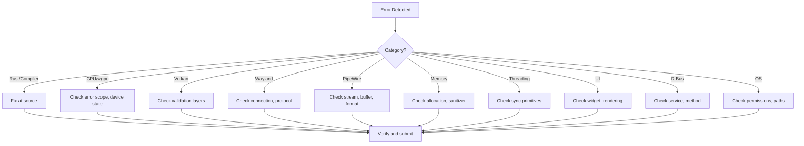

# Error Detection, Diagnosis and Recovery Policy

**Status**: Active
**Scope**: All subsystems (GPU, Wayland, PipeWire, UI, Physics, System)
**Audience**: AI coding agents and human developers

This document defines the mandatory error handling policy for the Dock project. It governs how errors are detected, classified, diagnosed, fixed, recovered from, verified, and reported across all subsystems.

---

## 1. Error Detection

Detect errors in every subsystem before they become crashes or data corruption.

### Requirements

- **Use structured logging**: All errors must be logged via `tracing` with structured fields (`subsystem`, `error`, `source`).
- **Capture relevant error context**: Include subsystem name, operation being performed, and relevant state (e.g., texture dimensions, stream ID, body ID).
- **Preserve original error sources**: Use `thiserror` `#[source]` attribute to chain errors. Never swallow the original cause.
- **Generate useful backtraces**: Enable `RUST_BACKTRACE=1` in development. Use `color-eyre` for development-mode backtraces.
- **Never silently discard unexpected errors**: Every `Err` variant must either be handled, logged, or propagated. Silent `.unwrap()` or `.expect()` without context is prohibited.

### Subsystem-Specific Detection

| Subsystem | Detection Method | Tool |
|-----------|-----------------|------|
| GPU/wgpu | `push_error_scope()`, `on_uncaptured_error()`, device-lost callback | wgpu error scopes |
| Vulkan | Validation layers, synchronization validation | Khronos layers, RenderDoc |
| Wayland | Protocol error handlers, connection-lost events | `WAYLAND_DEBUG=1` |
| PipeWire | Stream disconnect callbacks, buffer availability checks | `pw-cli`, `pw-top` |
| Memory | AddressSanitizer, Miri, allocation failure handlers | Sanitizers, Miri |
| Threading | ThreadSanitizer, panic hooks | Sanitizers, `std::panic` |
| UI/Slint | Widget creation errors, rendering failures | Slint error callbacks |
| D-Bus | Method call timeouts, service-not-found errors | `journalctl` |

### Structured Logging Pattern

```rust
use tracing::{error, warn, info};

// Error with structured context
error!(
    subsystem = "gpu",
    error = %message,
    texture_width = width,
    texture_height = height,
    "GPU texture creation failed"
);

// Warning with recovery intent
warn!(
    subsystem = "pipewire",
    stream_id = %stream_id,
    "Capture stream disconnected; attempting recovery"
);

// Info for lifecycle events
info!(
    subsystem = "renderer",
    "Renderer initialized successfully"
);
```

---

## 2. Error Classification

Classify every error into one of the following categories to determine the appropriate diagnosis and recovery path.

### Error Categories

| Category | Examples | Recovery Potential |
|----------|----------|-------------------|
| **Rust/compiler errors** | Type mismatches, borrow checker, trait bounds | Fix at compile time |
| **GPU/wgpu errors** | Device lost, OOM, validation failure, shader compile | Partial (resource recreation) |
| **Vulkan validation errors** | Invalid API usage, sync hazards | Fix usage pattern |
| **Shader errors** | Compilation failure, invalid operations | Fix shader code |
| **Wayland protocol errors** | Connection lost, surface destroyed, version mismatch | Partial (reconnect) |
| **PipeWire stream errors** | Stream disconnect, buffer unavailable, format negotiation | High (reconnect, fallback) |
| **DMA-BUF errors** | Mapping failure, format modifier mismatch | Fallback to CPU upload |
| **Memory errors** | Allocation failure, OOM, use-after-free | Low (release resources) |
| **Threading/sync errors** | Data races, deadlocks, poison errors | Fix synchronization |
| **UI errors** | Widget creation, rendering failure, state sync | Partial (recreate widget) |
| **Dependency compatibility** | Version mismatch, API breakage | Update or pin versions |
| **Operating system errors** | Permission denied, file not found, D-Bus unavailable | Partial (retry, fallback) |

### Classification Workflow



---

## 3. Root-Cause Analysis

Before modifying code to fix an error, perform systematic root-cause analysis.

### Steps

1. **Identify the exact failure**: Read the complete error message, including all chained sources.
2. **Inspect the relevant source code**: Open the file and line referenced in the error. Examine the surrounding 20-50 lines for context.
3. **Inspect the dependency versions**: Run `cargo tree -i <dependency>` to check the exact version in use.
4. **Examine the complete error message**: Include backtraces, validation output, and related log lines.
5. **Check the relevant official documentation**: Use version-specific docs from `docs/reference/`.
6. **Identify the underlying cause**: Distinguish between the symptom (what you see) and the root cause (why it happens).
7. **Distinguish symptoms from root causes**: A rendering crash may be caused by a texture format mismatch, which may be caused by a PipeWire format negotiation failure.

### Root-Cause Analysis Checklist

- [ ] Full error message captured and understood
- [ ] Backtrace examined (if available)
- [ ] Relevant source code inspected
- [ ] Dependency versions verified
- [ ] Official documentation checked for the installed version
- [ ] Related log lines reviewed (5 lines before and after the error)
- [ ] Hypothesis about root cause formulated
- [ ] Hypothesis distinguished from symptoms

### Example: GPU Texture Error

**Symptom**: Application crashes when creating a texture.

**Root-cause analysis**:
1. Capture full error: `Validation Error: Texture format RGBA8UnormSrgb not supported for usage RENDER_ATTACHMENT`
2. Inspect source: `texture.rs:142` — texture creation with `RGBA8UnormSrgb` format
3. Check dependency: `cargo tree -i wgpu` → wgpu 30.0.1
4. Check docs: wgpu 30.0.1 format support table
5. Root cause: `RGBA8UnormSrgb` is a sRGB format; use `RGBA8Unorm` for render attachments, then apply sRGB conversion in the shader
6. Symptom: Crash. Root cause: Incorrect texture format for the intended usage.

---

## 4. Fixing Errors

Apply the smallest correct fix that addresses the root cause.

### Rules

- **Apply the smallest correct fix**: Modify only the code necessary to fix the identified root cause.
- **Do not suppress validation errors**: Never comment out, disable, or ignore validation checks.
- **Do not use arbitrary delays to hide race conditions**: `std::thread::sleep()` is not a fix for synchronization issues.
- **Do not replace meaningful errors with default values**: `.unwrap_or_default()` on a critical value hides the error.
- **Do not introduce unsafe code without justification**: Every `unsafe` block must have a comment explaining the safety invariant.
- **Do not change unrelated working functionality**: Keep fixes scoped to the affected area.

### Fix Quality Checklist

- [ ] Fix addresses the root cause, not just the symptom
- [ ] No validation errors suppressed
- [ ] No arbitrary delays introduced
- [ ] No meaningful errors replaced with defaults
- [ ] No unjustified `unsafe` blocks
- [ ] No unrelated code modified
- [ ] Fix is minimal and focused

---

## 5. Recovery

Implement recovery only when it is safe to do so. Not all errors are recoverable.

### Recoverable Errors

| Error | Recovery Strategy | Safety Condition |
|-------|------------------|-----------------|
| PipeWire stream disconnected | Recreate the affected stream | PipeWire daemon is running |
| PipeWire buffer unavailable | Wait or request another frame | Stream is still connected |
| PipeWire DMA-BUF unavailable | Fall back to CPU upload | CPU upload path is available |
| Wayland output configuration changed | Requery outputs and resize surfaces | Connection is still valid |
| Wayland scale factor changed | Resize all surfaces | Connection is still valid |
| GPU device lost | Recreate GPU resources | Backend and app state permit reinit |
| GPU memory pressure | Release unused textures and buffers | Enough resources can be freed |
| D-Bus service temporarily unavailable | Retry with bounded exponential backoff | Service is expected to return |
| UI rendering failure | Restart the affected rendering path | Widget state is still valid |
| Texture cache overflow | Evict least-recently-used textures | Cache has eviction policy |

### Non-Recoverable Errors

| Error | Action |
|-------|--------|
| Wayland connection lost | Handle application shutdown |
| GPU OOM (cannot free resources) | Propagate failure, do not continue |
| Memory allocation failure | Propagate failure, do not continue |
| Memory leak detected | Report and fix the source |
| PipeWire permission denied | Report to user, do not retry |
| Shader compilation failure | Fix shader code |
| Vulkan validation error | Fix API usage |
| Data race detected | Fix synchronization |
| Dependency version mismatch | Update or pin versions |

### Recovery Implementation Rules

- **Bounded retries**: All recovery attempts must have a maximum retry count (e.g., 3-5 attempts).
- **Exponential backoff**: Retry delays should increase exponentially (e.g., 100ms, 200ms, 400ms).
- **Respect resource ownership**: Recovery must not violate the renderer's ownership of GPU resources.
- **No infinite loops**: Recovery must eventually give up and report failure.
- **Log recovery attempts**: Each recovery attempt must be logged with the attempt number and delay.

### Recovery Pattern

```rust
use tracing::warn;

const MAX_RETRIES: u32 = 3;
const BASE_DELAY_MS: u64 = 100;

fn recover_with_retry<F, T>(operation: F, context: &str) -> Option<T>
where
    F: Fn() -> Option<T>,
{
    for attempt in 0..MAX_RETRIES {
        if let Some(result) = operation() {
            return Some(result);
        }
        let delay = BASE_DELAY_MS * 2u64.pow(attempt);
        warn!(
            subsystem = "recovery",
            attempt = attempt + 1,
            max_attempts = MAX_RETRIES,
            delay_ms = delay,
            context = context,
            "Recovery attempt failed; retrying"
        );
        std::thread::sleep(std::time::Duration::from_millis(delay));
    }
    warn!(
        subsystem = "recovery",
        context = context,
        "Recovery failed after {} attempts", MAX_RETRIES
    );
    None
}
```

---

## 6. Verification

After every fix, verify that the fix works and does not introduce regressions.

### Mandatory Verification Steps

1. **Run `cargo fmt`**: Ensure code is formatted correctly.
2. **Run `cargo check`**: Ensure code compiles without errors.
3. **Run relevant unit tests**: Run tests for the affected module.
4. **Run integration tests**: Run integration tests if applicable.
5. **Run GPU validation**: Enable wgpu error scopes for GPU-related changes.
6. **Check for regressions**: Run the full test suite for the affected subsystem.
7. **Report unverified behavior**: If a fix cannot be fully verified, document the limitation.

### Verification Commands

```bash
# Format check
cargo fmt --all -- --check

# Compilation check
cargo check --workspace --all-targets

# Unit tests for affected module
cargo test --lib <module_name>

# Full test suite
cargo test --workspace

# Dependency check
cargo tree -d

# Clippy lint check
cargo clippy --workspace --all-targets
```

### Verification Checklist

- [ ] `cargo fmt --all -- --check` passes
- [ ] `cargo check --workspace --all-targets` passes
- [ ] Relevant unit tests pass
- [ ] Integration tests pass (if applicable)
- [ ] GPU validation passes (if GPU-related)
- [ ] No new compiler warnings introduced
- [ ] No regressions in existing tests
- [ ] Unverified behavior documented (if any)

---

## 7. Reporting

For every resolved issue, provide a structured report.

### Report Template

```markdown
## Error Resolution Report

**Original Error**: [Full error message, including backtrace if available]

**Root Cause**: [What caused the error, distinguished from symptoms]

**Affected Subsystem**: [GPU, Wayland, PipeWire, UI, Physics, System, Memory, Threading]

**Files Changed**:
- `path/to/file1.rs`: [Brief description of change]
- `path/to/file2.rs`: [Brief description of change]

**Implemented Solution**: [What was changed and why]

**Tests Performed**:
- `cargo test --lib <module>`: [Result]
- `cargo check`: [Result]
- [Other relevant tests]

**Verification Result**: [Pass/Fail with details]

**Remaining Risks**: [Any known limitations or unverified aspects]
```

### Reporting Rules

- **Never claim an error is fixed without verification**: Every fix must be accompanied by test results.
- **Include the full error message**: Truncated errors make it hard to verify the fix.
- **Distinguish root cause from symptoms**: The report should make clear what was actually wrong.
- **List all files changed**: Even documentation-only changes should be listed.
- **Document remaining risks**: If the fix is partial or has known limitations, state them clearly.

---

## Error Type Hierarchy

The project uses a two-level error type hierarchy:

### Library Level (wgpu-api)

Defined in `wgpu-api/src/error.rs`:

- `GpuError` — GPU-specific errors (device loss, OOM, validation)
- `RendererError` — Renderer-specific errors (surface, texture, buffer)
- `PhysicsError` — Physics engine errors (body not found, invalid state)
- `VideoError` — Video/PipeWire errors (stream, buffer, format)
- `WaylandError` — Wayland errors (connection, surface, protocol)
- `SceneError` — Scene graph errors (node not found, parent-child)
- `LayoutError` — Layout errors (arrangement, insertion)
- `TextError` — Text rendering errors (font, shaping, layout)
- `InteractionError` — Interaction errors (input, picking, gestures)
- `AnimationError` — Animation errors (timeline, easing, keyframes)
- `DockError` — Unified error type (wraps all subsystem errors)
- `DockResult<T>` — Alias for `Result<T, DockError>`

### Application Level (src)

Defined in `src/errors/`:

- `GpuAppError` — Application-level GPU errors with recovery
- `WaylandAppError` — Application-level Wayland errors with recovery
- `PipeWireAppError` — Application-level PipeWire errors with recovery
- `UiAppError` — Application-level UI errors with recovery
- `MemoryAppError` — Application-level memory errors with recovery
- `SystemAppError` — Application-level system errors with recovery
- `AppError` — Unified application error type

### Error Propagation

```
Subsystem error (thiserror)
    → DockError (miette Diagnostic)
        → anyhow::Error (context)
            → AppError (application-level)
                → User-facing message
```

---

## Cross-Subsystem Error Scenarios

Errors in one subsystem can manifest as failures in another. The following table maps common cross-subsystem error patterns:

| Origin Subsystem | Manifests As | Example |
|-----------------|--------------|---------|
| Vulkan validation | Rendering crash | Invalid texture format causes GPU hang |
| PipeWire buffer | Frozen capture | Buffer not released causes stream stall |
| Wayland event loop | Unresponsive UI | Blocking in event handler freezes input |
| GPU sync bug | Intermittent crash | Race between compute and render passes |
| Dependency version | Compiler errors | API mismatch between wgpu versions |
| Memory leak | GPU OOM | Leaked textures exhaust GPU memory |
| D-Bus timeout | Missing data | System monitor shows stale values |

---

## Quick Reference: Diagnostic Commands by Subsystem

| Subsystem | Command |
|-----------|---------|
| GPU/wgpu | `WGPU_VALIDATION=1 cargo run` |
| Vulkan | `vulkaninfo --summary` |
| Wayland | `WAYLAND_DEBUG=1 cargo run` |
| PipeWire | `pw-cli ls Node` / `pw-top` |
| Memory | `cargo +nightly run --target x86_64-unknown-linux-gnu -Z sanitizer=address` |
| Threading | `cargo +nightly run -Z sanitizer=thread` |
| System | `journalctl -b -p warning` |
| Backtraces | `RUST_BACKTRACE=full cargo run` |
| Dependencies | `cargo tree -d` |

---

## References

- **Error Handling Architecture**: `docs/architecture/error-handling.md`
- **Error Detection Tools**: `docs/architecture/error-detection.md`
- **Error Types (Library)**: `wgpu-api/src/error.rs`
- **Error Types (App)**: `src/errors/`
- **Diagnostics**: `src/diagnostics/`
- **Recovery**: `src/recovery/`
- **AI Instructions**: `docs/AI_INSTRUCTIONS.md`
- **System Map**: `docs/architecture/SYSTEM_MAP.md`
