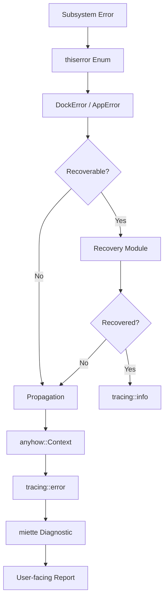

# Final Error-Handling Stack

**Status**: Active  
**Scope**: All subsystems (GPU, Wayland, PipeWire, UI, Physics, System)  
**Audience**: AI coding agents and human developers

This document defines the final, recommended error-handling stack for the Dock project. It maps each error-handling category to a specific tool, justifies the choice, and describes how the components integrate.

---

## Recommended Stack

| Category | Tool | Version | Role |
|----------|------|---------|------|
| **Error types** | `thiserror` | 2 | Define strongly-typed, subsystem-specific error enums |
| **Error propagation** | `anyhow` | 1 | Application-level error chaining with context |
| **Logging** | `tracing` | 0.1 | Structured logging, spans, async task tracking |
| **Log collection** | `tracing-subscriber` | 0.3 | Configure log filtering, formatting, file output |
| **Error presentation** | `miette` | 7 | Human-readable diagnostic reports with error codes |
| **GPU validation** | `wgpu` error scopes + Vulkan validation layers | — | Catch GPU errors before they crash |
| **GPU inspection** | RenderDoc | — | Frame-by-frame GPU debugging |
| **Memory diagnostics** | Miri + AddressSanitizer | — | Detect UB, memory corruption, use-after-free |
| **Native debugging** | GDB | — | Crash investigation, stack traces |
| **Testing** | `cargo-nextest` | — | Faster, organized test execution |
| **Security checking** | `cargo-audit` | — | Known vulnerability detection |
| **Dependency checking** | `cargo-deny` | — | License and policy enforcement |
| **Performance diagnostics** | `perf` | — | CPU profiling and hotspot analysis |
| **Benchmarking** | `criterion` | 0.5 | Microbenchmarks for physics, text, image ops |
| **Development backtraces** | `color-eyre` | 0.6 | Colored backtraces with diagnostic context |

---

## Stack Architecture



---

## Component Justification

### 1. thiserror (Error Types)

**Why**: Defines strongly-typed error enums for each subsystem. Each error variant carries the specific context needed for diagnosis and recovery.

**In Dock**:
- `wgpu-api/src/error.rs`: 11 subsystem error types (`GpuError`, `RendererError`, `PhysicsError`, `VideoError`, `WaylandError`, `SceneError`, `LayoutError`, `TextError`, `InteractionError`, `AnimationError`) unified under `DockError`
- `src/errors/`: Application-level errors with recovery strategies (`GpuAppError`, `WaylandAppError`, `PipeWireAppError`, `UiAppError`, `MemoryAppError`, `SystemAppError`) unified under `AppError`

**Pattern**:
```rust
use thiserror::Error;

#[derive(Debug, Error)]
pub enum GpuError {
    #[error("GPU device lost: {0}")]
    DeviceLost(String),

    #[error("GPU out of memory")]
    OutOfMemory,

    #[error("Validation failed: {0}")]
    Validation(String),
}
```

### 2. anyhow (Error Propagation)

**Why**: Application-level error chaining with `.context()` adds human-readable context at each call site without defining new types.

**In Dock**:
- `src/error.rs`: `AppError` converts from `DockError` via `anyhow::Error`
- `log_and_context()` helper wraps any error with tracing context

**Pattern**:
```rust
use anyhow::{Context, Result};

fn initialize_renderer() -> Result<()> {
    setup_gpu().context("Failed to initialize GPU renderer")?;
    Ok(())
}
```

### 3. tracing (Structured Logging)

**Why**: Async-aware, structured logging with spans that track request lifecycle across async boundaries. Essential for diagnosing concurrent GPU, Wayland, and PipeWire operations.

**In Dock**:
- `src/diagnostics/logger.rs`: `SubsystemLogger` with 14 subsystems
- All error types implement tracing integration via helper methods
- `color-eyre::initialize()` sets up tracing in development mode

**Pattern**:
```rust
use tracing::{error, warn, info, instrument};

#[instrument(skip(self), fields(body_id = %id))]
pub fn apply_force(&mut self, id: BodyId, force: Vec2) {
    info!(subsystem = "physics", "Applying force");
}
```

### 4. tracing-subscriber (Log Collection)

**Why**: Configure log filtering (`RUST_LOG`), formatting (JSON for CI, pretty for dev), and output (stdout, file).

**In Dock**:
- Both crates depend on `tracing-subscriber` with `env-filter` feature
- `color-eyre::initialize()` configures the subscriber automatically in dev mode

**Configuration**:
```bash
# Development: pretty output, all levels
RUST_LOG=dock=debug,wgpu_api=info cargo run

# Production: JSON output, warn+ only
RUST_LOG=warn cargo run
```

### 5. miette (Error Presentation)

**Why**: Human-readable diagnostic reports with error codes, severity levels, help messages, and source locations. Converts programmatic errors into actionable reports.

**In Dock**:
- `wgpu-api/src/error.rs`: All error types implement `miette::Diagnostic`
- Error codes follow pattern: `GPU001`, `WAYLAND001`, `PIPEWIRE001`, etc.

**Pattern**:
```rust
#[derive(Debug, Error, Diagnostic)]
#[error("GPU device lost")]
#[diagnostic(code(dock::gpu::device_lost), help("Try reinitializing the renderer"))]
DeviceLost(String),
```

### 6. wgpu Error Scopes (GPU Validation)

**Why**: Catch GPU errors (validation, OOM, internal) at the point of command submission rather than at an arbitrary later time.

**In Dock**:
- `src/diagnostics/gpu_validation.rs`: `GpuValidator` for error scope monitoring
- Use `device.push_error_scope()` before GPU operations and `pop_error_scope()` after

**Pattern**:
```rust
device.push_error_scope(wgpu::ErrorFilter::Validation);
// ... GPU operations ...
let error = device.pop_error_scope().await;
if let Some(err) = error {
    error!(subsystem = "gpu", error = %err, "GPU validation error");
}
```

### 7. RenderDoc (GPU Inspection)

**Why**: Frame-by-frame inspection of Vulkan/wgpu rendering: textures, buffers, shaders, draw calls, pipeline state.

**Usage**:
```bash
# Capture a frame
renderdoccmd capture -f dock.exe
# Or use the RenderDoc GUI to hook the running process
```

### 8. Miri + AddressSanitizer (Memory Diagnostics)

**Why**: Detect undefined behavior (Miri) and memory corruption (ASan) that Rust's type system doesn't catch, especially in FFI boundaries.

**Usage**:
```bash
# Miri for UB detection (slow, run on specific modules)
cargo +nightly miri test --lib physics

# AddressSanitizer for memory corruption
cargo +nightly build -Z sanitizer=address
```

### 9. GDB (Native Debugging)

**Why**: Investigate crashes, segfaults, and panics at the native level. Essential for FFI, GPU driver, and PipeWire issues.

**Usage**:
```bash
gdb --args target/debug/dock
(gdb) run
(gdb) bt full
```

### 10. cargo-nextest (Testing)

**Why**: Faster test execution with parallel runs, better output organization, and failure-focused reporting.

**Usage**:
```bash
cargo install cargo-nextest
cargo nextest run --workspace
```

### 11. cargo-audit (Security)

**Why**: Check dependencies for known security vulnerabilities (RustSec advisories).

**Usage**:
```bash
cargo install cargo-audit
cargo audit
```

### 12. cargo-deny (Dependency Policy)

**Why**: Enforce license compliance, detect duplicate dependencies, and check for yanked crates.

**Usage**:
```bash
cargo install cargo-deny
cargo deny check
```

### 13. perf (Performance)

**Why**: Linux kernel profiler for CPU hotspots, cache misses, and branch mispredictions.

**Usage**:
```bash
# Flamegraph
perf record -F 99 -g -- cargo run
perf script | stackcollapse-perf | flamegraph > perf.svg

# Top-like view
perf top -p $(pgrep dock)
```

### 14. criterion (Benchmarking)

**Why**: Statistical microbenchmarks for CPU-bound operations: physics simulation, text layout, image processing.

**In Dock**:
- `wgpu-api/Cargo.toml`: `criterion` as dev-dependency
- Place benchmarks in `wgpu-api/benches/`

**Pattern**:
```rust
#[criterion::criterion_group](
    name = physics_bench;
    config = Criterion::default().sample_size(100);
    targets = bench_spring_step, bench_collision_detect
)
```

### 15. color-eyre (Development Backtraces)

**Why**: Colored, annotated backtraces with source locations and diagnostic context. Development-only; not for production.

**In Dock**:
- `src/error.rs`: `init_development()` sets up `color-eyre`
- Provides `eyre!` and `wrap_err!` macros for ergonomic error handling

---

## What We Deliberately Did Not Use

| Tool | Reason |
|------|--------|
| `catch_unwind` | Panics are not recoverable errors. GPU, Wayland, and PipeWire state may be unsafe after panic. |
| `panic!` for errors | Use `Result`-based error handling. Panics indicate programming errors, not runtime failures. |
| Full soft-body physics | Excessive for dock UI. Transform-based squash/stretch suffices. |
| General-purpose GPU physics | Overkill. Custom spring/field engine + Rapier2D covers all needs. |

---

## Error Flow: From Subsystem to User

```
1. Subsystem operation fails
2. thiserror enum variant created with specific context
3. Error logged via tracing with structured fields
4. Error converted to DockError/AppError
5. Recovery attempted if safe (bounded retries, exponential backoff)
6. If unrecoverable, error propagates with anyhow::context
7. miette formats diagnostic for user
8. color-eyre shows backtrace in development
```

---

## Dependency Verification

Run these commands to verify the stack:

```bash
# Check error handling dependencies
cargo tree -i thiserror
cargo tree -i anyhow
cargo tree -i miette
cargo tree -i tracing
cargo tree -i tracing-subscriber
cargo tree -i color-eyre

# Check for duplicate versions
cargo tree -d

# Check for security issues
cargo audit

# Check dependency policy
cargo deny check
```

---

## Integration with Existing Architecture

| Document | Relationship |
|----------|-------------|
| `error-handling.md` | Five-stage framework (Detect, Diagnose, Resolve, Verify, Prevent) |
| `error-detection.md` | GPU-specific, memory, and Linux debugging tools |
| `error-policy.md` | Mandatory AI workflow for error resolution |
| `wgpu-api/src/error.rs` | Library-level error types (11 subsystems) |
| `src/errors/` | Application-level error types with recovery |
| `src/diagnostics/` | Monitoring: logger, crash reporter, performance, GPU validation, health |
| `src/recovery/` | Recovery: GPU, capture, resource, service |

---

## Key Distinction: Result vs Panic

**Rust `Result`-based error handling is the primary mechanism.**

- `Result<T, E>` for expected failures (stream disconnect, texture not found, body not found)
- `panic!` only for programming errors (invariant violation, unreachable code, internal inconsistency)
- `catch_unwind` is not a substitute for proper error handling
- Panics do not guarantee safe GPU, Wayland, or PipeWire state

---

## References

- **Error Handling Architecture**: `docs/architecture/error-handling.md`
- **Error Detection Tools**: `docs/architecture/error-detection.md`
- **Error Policy**: `docs/architecture/error-policy.md`
- **Error Types (Library)**: `wgpu-api/src/error.rs`
- **Error Types (App)**: `src/errors/`
- **Diagnostics**: `src/diagnostics/`
- **Recovery**: `src/recovery/`
- **AI Instructions**: `docs/AI_INSTRUCTIONS.md`
- **System Map**: `docs/architecture/SYSTEM_MAP.md`
