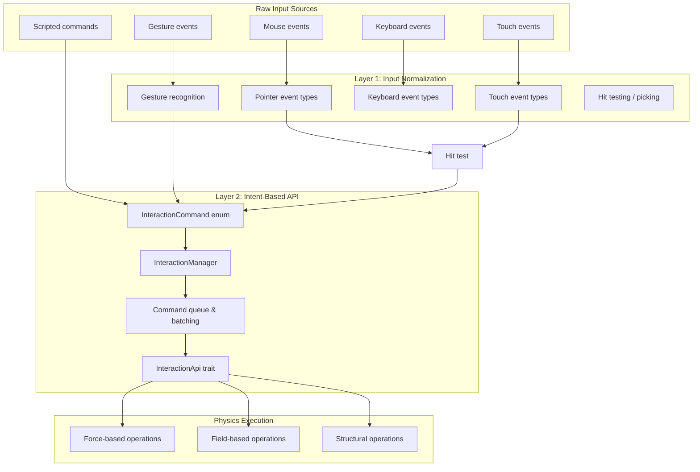

# Interaction System Architecture

## Purpose

The interaction system bridges raw input events (mouse, touch, keyboard) to the physics engine and application logic. It provides two layers:

1. **Input normalization** — converts raw Wayland events into standardized input types
2. **Intent-based commands** — high-level semantic operations (drag, push, pull) that the physics engine executes

## Location

- `wgpu-api/src/interaction/` — Input event processing and routing
- `wgpu-api/src/physics/interaction.rs` — High-level `InteractionApi` trait
- `wgpu-api/src/physics/commands.rs` — `InteractionCommand` enum and `InteractionManager`

## Architecture

## Two-Layer Design

### Layer 1: Input Normalization (`wgpu-api/src/interaction/`)

Converts raw Wayland events into standardized types:

| Module | Responsibility |
|--------|----------------|
| `input.rs` | Pointer, touch, keyboard event types and routing |
| `picking.rs` | Hit testing — which body/node is under the pointer |
| `drag.rs` | Drag state tracking |
| `gestures.rs` | Gesture recognition (pan, pinch, rotate) |
| `commands.rs` | Command dispatch from input events |

### Layer 2: Intent-Based API (`wgpu-api/src/physics/`)

High-level semantic operations that abstract away implementation details:

| Operation | Type | Description |
|-----------|------|-------------|
| `drag(target, pointer)` | Force-based | Spring-based pointer following |
| `push(target, direction, strength)` | Force-based | Apply directional force |
| `pull(target, destination, strength)` | Force-based | Apply attraction force |
| `attract(region, strength)` | Field-based | Attraction field in region |
| `repel(region, strength)` | Field-based | Repulsion field in region |
| `insert(target, index)` | Structural | Create slot, neighbors move aside |
| `remove(target)` | Structural | Remove body and adjust layout |
| `cut(group, position)` | Structural | Split group at boundary |
| `merge(group_a, group_b)` | Structural | Combine two groups |
| `concentrate(region, center)` | Field-based | Attraction toward center |
| `disperse(region, strength)` | Field-based | Separation within region |
| `project(target, axis)` | Structural | Align to axis |
| `anchor(target)` | Structural | Pin to fixed position |
| `apply_force(target, force)` | Force-based | Direct force application |
| `apply_impulse(target, impulse)` | Force-based | Instantaneous impulse |

## Key Types

| Type | Purpose |
|------|---------|
| `InteractionApi` | Trait with all semantic operations |
| `InteractionCommand` | Enum covering 25+ interaction variants |
| `InteractionManager` | Command queue, batching, history, replay |
| `PhysicsDragState` | Tracks active drag (target, pointer, spring state) |
| `DragConfig` | Drag parameters (spring stiffness, damping) |
| `PointerInputEvent` | Normalized pointer event |
| `TouchInputEvent` | Normalized touch event |
| `KeyInputEvent` | Normalized keyboard event |

## Coordinate Space

- **Input events**: Logical pixels (UI coordinates)
- **Physics operations**: Logical pixels (world coordinates)
- **Physical positions**: Device pixels (for high-DPI accuracy)

## Invariants

1. **Input events are converted to interaction commands.** Application code should not directly manipulate physics.
2. **Commands are dispatched through InteractionManager.** Direct physics manipulation bypasses the command system.
3. **Drag uses spring-based pointer following.** The dragged object does not teleport to the pointer.
4. **Force vs structural operations are distinct.** Insert, cut, merge change relationships, not just forces.

## Dependencies

- **Depends on**: `physics` (InteractionApi, PhysicsWorld), `geometry` (Point, Rect)
- **Depended on by**: Application layer, Wayland input handlers

## Safe to Modify

- Adding new InteractionCommand variants
- Adding new InteractionApi methods
- Adding new gesture types
- Tuning drag parameters
- Adding new keyboard shortcuts

## Requires Caution

- Changing the command dispatch order
- Modifying coordinate space conversions
- Altering drag state machine
- Changing the picking/hit test algorithm
