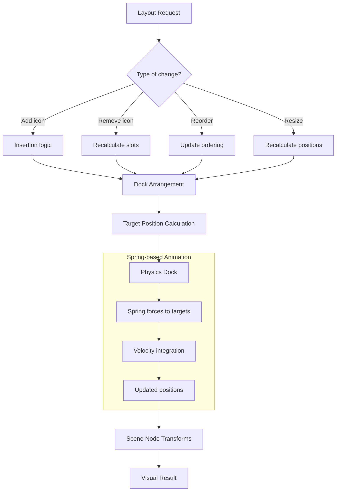

# Layout System Architecture

## Purpose

The layout system determines where dock items, widgets, and popups are positioned. It works with the physics engine to provide smooth, spring-based transitions between layout states.

## Location

`wgpu-api/src/layout/` (4 modules)

## Architecture

The layout system has two complementary layers:

1. **Visual layout** (`layout/dock.rs`) — Determines the logical arrangement of dock items
2. **Physical layout** (`physics/dock.rs`) — Provides spring-based animation for layout transitions

## Module Map

| Module | Responsibility |
|--------|----------------|
| `layout.rs` | Layout types (Insets, CornerRadius, Shadow) |
| `dock.rs` | Visual dock layout — item arrangement, spacing, axis |
| `arrangement.rs` | Layout arrangement algorithms |
| `insertion.rs` | Insertion logic — finding slots, making room |
| `projection.rs` | Projection — aligning items to axes/paths |

## Key Types

| Type | Purpose |
|------|---------|
| `Dock` (layout) | Visual dock layout configuration |
| `DockItem` (layout) | Visual dock item with slot and position |
| `DockConfig` (physics) | Physical dock parameters (spacing, springs, interaction) |
| `DockAxis` | Horizontal or vertical dock orientation |
| `DockDragState` | Drag state for dock items |
| `Insets` | Padding/margin values |
| `CornerRadius` | Corner radius for rounded rectangles |
| `Shadow` | Drop shadow configuration |

## Coordinate Space

- **All layout operates in logical pixel coordinates.**
- Layout positions are relative to the dock's origin.

## Invariants

1. **Layout determines target positions; physics animates to them.** Layout does not directly set visual transforms.
2. **Dock items have a logical ordering.** Position is derived from slot index, not stored directly.
3. **Insertion recalculates all target positions.** Neighboring items move aside through spring constraints.
4. **Projection aligns to axes.** Items constrained to the dock's axis cannot leave it.

## Dependencies

- **Depends on**: `geometry` (Point, Rect, Size, Vector2D)
- **Depended on by**: Application layer, physics dock model

## Safe to Modify

- Adding new layout algorithms
- Adding new insertion strategies
- Tuning spacing and padding
- Adding new projection types

## Requires Caution

- Changing the slot-to-position calculation
- Modifying the dock axis handling
- Altering the insertion algorithm
