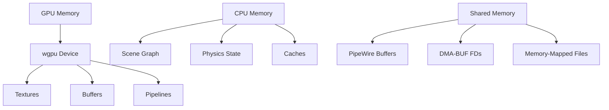

# Memory Management and Resource Lifetimes

## Memory Architecture

Dock manages three categories of memory resources:

1. **GPU memory** — textures, buffers, pipelines owned by wgpu
2. **CPU memory** — scene graph, physics state, caches
3. **Shared memory** — PipeWire buffers, DMA-BUF file descriptors



## GPU Memory (wgpu)

### Ownership Rules

- **The Renderer owns the wgpu device and queue.** No other subsystem creates or destroys wgpu resources directly.
- All GPU resource creation goes through the renderer's API.
- GPU resources are **not Send/Sync** by default — they must be accessed from the main thread.

### Texture Lifecycle

```
Create → Upload → Render → (Repeat) → Destroy
```

1. **Create**: Renderer allocates a texture via `device.create_texture()`.
2. **Upload**: Data is copied to GPU via `queue.write_texture()` or DMA-BUF import.
3. **Render**: Texture is bound in a render pass and used by shaders.
4. **Destroy**: Texture is dropped when no longer referenced; wgpu handles async cleanup.

### Key Types

- `wgpu::Texture` — GPU texture resource
- `wgpu::TextureView` — View of a texture for rendering
- `wgpu::Buffer` — GPU buffer for uniform data, vertex data, etc.
- `wgpu::RenderPipeline` — Compiled render pipeline state
- `wgpu::ComputePipeline` — Compiled compute pipeline state

### DMA-BUF Integration

- **Export**: wgpu renders to a texture, which is exported as a DMA-BUF FD to Wayland.
- **Import**: PipeWire provides frames via DMA-BUF FDs, which wgpu imports as textures.
- DMA-BUF sharing avoids CPU copies but requires format and modifier negotiation.

**Reference**: `docs/architecture/pipewire.md` (DMA-BUF section), `docs/reference/gpu-rendering.md`

## CPU Memory

### Scene Graph

- Hierarchical tree of nodes representing visual elements.
- Each node has transforms, opacity, and render commands.
- Grows with dock complexity but typically stays under 1000 nodes.

### Physics State

- `PhysicsWorld` maintains body positions, velocities, and constraints.
- Memory usage scales with the number of physics bodies (dock icons, popups).
- Fixed timestep means no per-frame allocation for simulation.

### Caches

#### Icon Cache
- **Type**: `dashmap::DashMap` for concurrent access.
- **Purpose**: Cache resolved icon paths and rendered icon images.
- **Eviction**: Manual cleanup when icons are removed; consider LRU for bounded growth.

#### Image Cache
- **Type**: `lru::LruCache` for bounded memory.
- **Purpose**: Cache decoded images (SVG, PNG) to avoid repeated decoding.
- **Size**: Configurable bound to prevent unbounded growth.

#### Font Cache
- **Type**: `fontdb::Database` with lazy loading.
- **Purpose**: Cache font metadata and glyph outlines.
- **Lifetime**: Fonts are loaded once and cached for the session.

### Memory-Mapped Files

- `memmap2` is used for zero-copy file access (e.g., font files, large assets).
- Mapped regions are released when the `Mmap` guard is dropped.
- **Caution**: Do not hold mmap guards longer than necessary — they prevent file deletion.

## Shared Memory (PipeWire)

### Buffer Borrowing

- PipeWire buffers are **borrowed**, not owned.
- The application must call `buffer.release()` promptly after use.
- Never retain a borrowed buffer beyond its valid lifetime.

### Stream vs Frame Lifetime

- **Stream lifetime**: The duration of a capture session (seconds to hours).
- **Frame lifetime**: A single frame buffer (milliseconds).
- Only the active stream's frames are uploaded to GPU each frame.

### DMA-BUF File Descriptors

- DMA-BUF FDs are shared between PipeWire, wgpu, and Wayland.
- FDs are cloned for sharing and closed when no longer needed.
- **Never close an FD while another subsystem still holds a clone.**

## Memory Invariants

1. **GPU resources** are owned by the renderer and accessed only from the main thread.
2. **PipeWire buffers** are released promptly after each frame.
3. **Caches** have bounded sizes to prevent unbounded memory growth.
4. **DMA-BUF FDs** are reference-counted via cloning, not manual tracking.
5. **mmap guards** are dropped before the underlying file is modified or deleted.
6. **No circular references** between scene nodes and physics bodies.

## Allocation Strategy

### mimalloc

The project now includes `mimalloc` as an optional fast allocator:

```rust
#[global_allocator]
static GLOBAL: mimalloc::MiMalloc = mimalloc::MiMalloc;
```

**When to use:**
- High-frequency allocation patterns (physics simulation, frame rendering).
- When benchmarking shows allocation overhead as a bottleneck.

**When to skip:**
- If the default allocator already meets performance targets.
- Always benchmark before and after to verify the benefit.

**Reference**: `docs/architecture/performance.md`

## Debugging Memory Issues

### Tools

- **`tracing`**: Add allocation tracing for GPU resource creation/destruction.
- **`criterion`**: Benchmark memory usage of specific operations.
- **Vulkan validation layers**: Detect GPU resource misuse.
- **Valgrind/AddressSanitizer**: Detect CPU memory leaks and use-after-free.

### Common Issues

| Issue | Symptom | Fix |
|-------|---------|-----|
| GPU texture leak | Growing VRAM usage | Ensure textures are dropped when no longer needed |
| PipeWire buffer retention | Stream stalls | Release buffers promptly after frame upload |
| Cache unbounded growth | OOM over time | Add LRU eviction or size limits |
| mmap guard leak | File cannot be deleted | Drop mmap guards in scope |
| Channel buffer growth | Memory grows under load | Use bounded channels with backpressure |

## Reference

- **GPU rendering**: `docs/reference/gpu-rendering.md`
- **PipeWire buffers**: `docs/architecture/pipewire.md`
- **Async concurrency**: `docs/reference/async-concurrency.md`
- **Serialization**: `docs/reference/serialization-utils.md`
