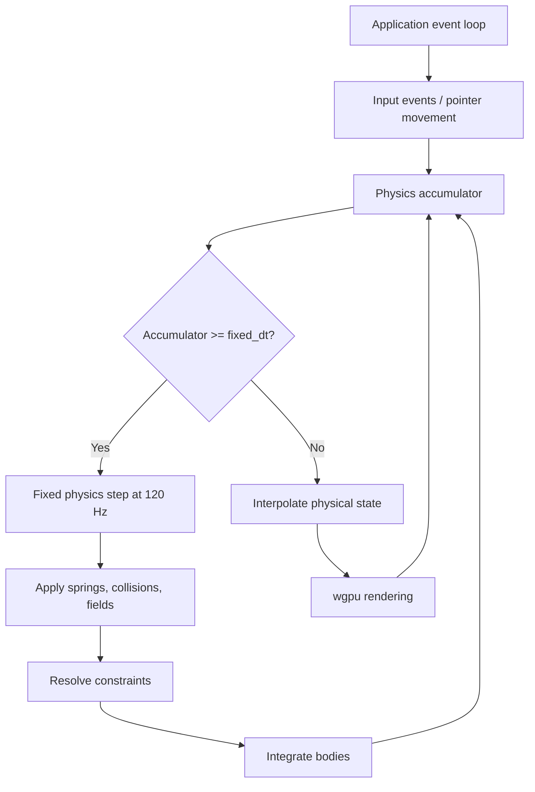
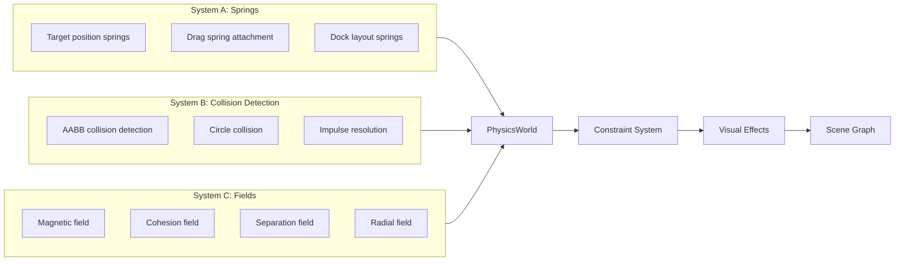

# Physics Engine Architecture

## Purpose

The physics engine provides natural, expressive UI animation through three distinct physical systems working together. It is **pure Rust** with no dependency on wgpu, Wayland, or PipeWire.

## Location

`wgpu-api/src/physics/` (16 modules, ~4000+ lines)

## Three-System Architecture

```
┌──────────────────────────────────────────────────────────────┐
│                    PhysicsWorld                              │
│                                                              │
│  System A: Springs  (custom)                                │
│  ─────────────────────────────────                          │
│  Damped springs for natural UI behavior                      │
│  F = -k(x - x_target) - c·v                                │
│                                                              │
│  · Dock icons returning to preferred positions               │
│  · Smooth dragging and magnetic snapping                     │
│  · Elastic resizing and window expansion                     │
│                                                              │
│  System B: Collision Detection  (custom)                    │
│  ─────────────────────────────────                          │
│  Lightweight collision detection for icon separation         │
│                                                              │
│  · AABB and circle collision detection                       │
│  · Simple impulse-based resolution                           │
│  · No rotating bodies, joints, or CCD                        │
│                                                              │
│  System C: Fields  (custom)                                 │
│  ─────────────────────────────────                          │
│  Expressive force fields for group behavior                  │
│  F_i = k · (p - x_i) / (‖p - x_i‖ + ε)^n                   │
│                                                              │
│  · Attraction and repulsion fields                           │
│  · Magnetic fields centered at interaction points            │
│  · Group cohesion and separation                             │
└──────────────────────────────────────────────────────────────┘
```

## Module Map

| Module | Responsibility |
|--------|----------------|
| `body.rs` | `PhysicsBody`, `PhysicsObject`, `PhysicalProperties` |
| `world.rs` | `PhysicsWorld` — orchestrates all three systems |
| `springs.rs` | Spring constraints, chains, radial systems |
| `forces.rs` | Force generators (spring, drag, repulsion, attraction, wind, push) |
| `collision.rs` | AABB/circle collision detection and resolution |
| `solver.rs` | Impulse-based contact resolution |
| `constraints.rs` | Constraint system (9 types: spring, fixed, distance, axis, path, alignment, separation, attraction, group) |
| `fields.rs` | Force fields (magnetic, cohesion, separation, radial, directional) |
| `groups.rs` | Body groups with cohesion and separation behavior |
| `spatial_index.rs` | Spatial hash grid for broad-phase collision |
| `interaction.rs` | High-level `InteractionApi` trait (drag, push, pull, insert, cut, merge, etc.) |
| `commands.rs` | `InteractionCommand` enum and `InteractionManager` |
| `dock.rs` | Physical dock layout model (1D ordered layout with springs) |
| `visual_effects.rs` | MotionState → VisualTransform bridge (squash, stretch, glow) |
| `timestep.rs` | Fixed timestep simulation with interpolation |

## Key Types

| Type | Purpose |
|------|---------|
| `PhysicsWorld` | Central orchestrator; holds all bodies, springs, fields |
| `PhysicsBody` | Physical representation (position, velocity, mass, shape) |
| `PhysicsObject` | Bridges `NodeId` (visual) to `PhysicsBody` (physical) |
| `PhysicalProperties` | Mass, friction, restitution, damping, stiffness |
| `InteractionApi` | Trait with semantic operations (drag, push, pull, etc.) |
| `InteractionCommand` | First-class command enum for all interaction types |
| `InteractionManager` | Command queue, batching, history, replay |
| `FixedTimestepSimulator` | Decouples physics from rendering frame rate |
| `VisualEffects` | Derives visual transforms from physical state |
| `Dock` | 1D ordered layout with spring-based animation |

## Coordinate Space

- **All physics operates in logical pixel coordinates.**
- Physics world coordinates = logical UI coordinates.
- No physical units (meters, kilograms); mass and distance are design parameters.

## Units

- **Position**: Logical pixels
- **Velocity**: Pixels per second
- **Acceleration**: Pixels per second²
- **Time**: Seconds
- **Mass**: Arbitrary design units (heavier icons displace neighbors more)
- **Stiffness**: Arbitrary spring constant
- **Damping**: Coefficient (0.0–1.0 typical range)

## Fixed Timestep Architecture



- Default: **120 Hz** fixed simulation timestep
- `max_substeps` prevents spiral-of-death when frame rates drop
- Interpolation alpha derived from accumulator's remaining time

## Three-System Interaction



## Invariants

1. **Physics never accesses wgpu resources.** It is pure Rust.
2. **Physics never directly modifies scene nodes.** Synchronization happens through an explicit interface.
3. **Physics uses fixed timestep.** Never tie physics calculations to rendering frame rate.
4. **Static bodies ignore applied forces.**
5. **Body must exist before force application.**
6. **Acceleration is reset after each integration step.** Forces don't accumulate across frames.

## Dependencies

- **Depends on**: `geometry` (Point, Rect, Vector2D, Size, NodeId)
- **Depended on by**: Interaction, layout, animation, application layer
- **Must NOT depend on**: wgpu, Wayland, PipeWire, scene graph

## Safe to Modify

- Adding new force types
- Adding new constraint types
- Adding new field types
- Tuning spring/damping parameters
- Adding new InteractionApi methods
- Adding new InteractionCommand variants
- Adding new visual effects

## Requires Caution

- Changing the fixed timestep architecture
- Modifying body integration (position/velocity update)
- Altering collision resolution order
- Changing coordinate space assumptions
- Modifying the constraint resolution system

## Testing

Run `cargo test physics` in `wgpu-api/`. Currently 320 tests pass, 5 pre-existing failures in edge-case tests with incorrect assertions.

## ADR 005: No General-Purpose Physics Engine

Per [ADR 005](../decisions/005-waydock-priorities.md), Rapier2D and nalgebra are explicitly not used. The dock's physics needs are simple: damped springs for icon positioning and proximity fields for interaction effects. A general-purpose physics engine would increase CPU, RAM, and VRAM usage without benefit.
