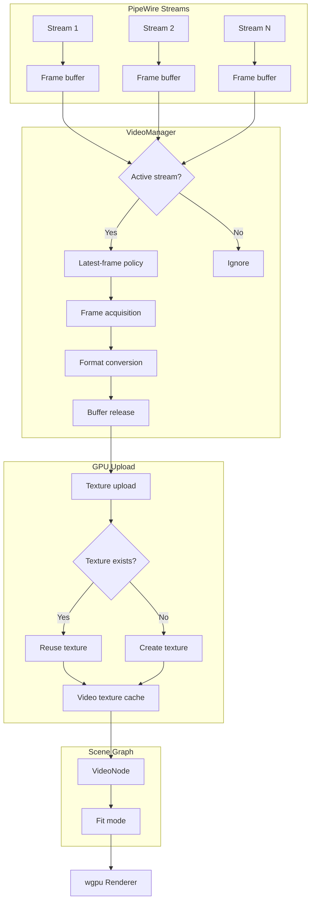

# PipeWire Video Architecture

## Purpose

The video module provides PipeWire stream management, frame acquisition, and GPU texture uploads. It is designed for the dock's use case: ~20 independent video streams where only one is rendered at a time.

## Location

`wgpu-api/src/video.rs` (~1900 lines)

## Architecture

## Key Design Decisions

### 1. Stream Lifetime ≠ Frame Lifetime

A stream can exist for hours without being rendered. Only the active stream's frames are uploaded to GPU each frame.

### 2. Latest-Frame Policy

When frames arrive faster than they are rendered, only the newest frame is kept. Obsolete frames are immediately discarded to avoid latency buildup.

### 3. Texture Reuse

When a stream's dimensions and format haven't changed, the existing GPU texture is reused — no destroy/recreate cycle on stream switch.

### 4. Frame Buffer Source Abstraction

The `FrameBufferSource` enum distinguishes two paths:

- **Path A (DMA-BUF)**: Zero-copy GPU import from PipeWire buffer. Requires Vulkan interop, format/modifier negotiation, and synchronization.
- **Path B (CPU upload)**: Copy frame data to CPU memory, then upload to GPU texture. Simpler, more portable, but more CPU/memory expensive.

The `FrameBuffer` struct holds fields for both paths (`data` for CPU, `dma_buf_fd`/`dma_buf_modifier` for DMA-BUF), allowing the implementation to switch without API changes.

### 5. DMA-BUF Sharing Procedure

When implementing Path A (DMA-BUF GPU sharing), follow the PipeWire DMA-BUF sharing procedure exactly. Reference: [PipeWire DMA-BUF Sharing](https://docs.pipewire.org/devel/page_dma_buf.html).

#### 5.1. What is DMA-BUF?

A DMA-BUF is a Linux kernel file descriptor that represents shared memory, typically GPU-accessible memory. PipeWire uses `SPA_DATA_DmaBuf` to share video frames via DMA-BUFs between producer (screen capture) and consumer (Dock).

#### 5.2. Capability Negotiation

Before any DMA-BUF frames flow, both producer and consumer must negotiate capabilities:

**For Consumers (Dock as consumer of screen capture):**

1. Query the list of all supported DRM format modifiers from your graphics API (Vulkan via wgpu).
2. Add a `SPA_FORMAT_VIDEO_modifier` property to the first stream parameter with flags `SPA_POD_PROP_FLAG_MANDATORY | SPA_POD_PROP_FLAG_DONT_FIXATE`.
3. The value should be a `SPA_CHOICE_Enum` containing one `long` choice per supported modifier, plus `DRM_FORMAT_MOD_INVALID` if the graphics API supports modifier-less buffers.
4. The second stream parameter should **not** contain any `SPA_FORMAT_VIDEO_modifier` property.
5. To prioritize DMA-BUFs, place `SPA_PARAM_EnumFormat` entries containing modifiers first when emitting them to PipeWire.

**For Producers:**

- The producer fixates onto a single format-modifier pair from the announced capabilities.
- The producer checks if all clients announce sufficient capabilities, or falls back to shared memory buffers when possible.

#### 5.3. DMA-BUF Mapping Warning

Most DMA-BUFs **cannot** be treated like shared memory:

- DMA-BUFs from discrete GPUs may not be mappable to CPU memory.
- Accessing an unmappable DMA-BUF via `mmap()` will fail.
- Always check the buffer's modifier and device ID before attempting CPU access.
- Use GPU-side imports (Vulkan `VK_KHR_external_memory_fd`) instead of CPU mapping.

#### 5.4. Format and Modifier Handling

**For Consumers:**

- Use `spa_format_video_raw_parse` to extract the format and modifier from the negotiated `SPA_PARAM_Format`.

**For Producers:**

- Handle three cases: modifier-less API only, modifier-aware API only, or both.
- If a producer only supports modifier-less buffers, it can omit `SPA_POD_PROP_FLAG_DONT_FIXATE`.

#### 5.5. v4l2 Special Case

For camera feeds from v4l2 exported as DMA-BUFs:

- Neither producer nor consumer should announce a modifier.
- Both should include `1 << SPA_DATA_DmaBuf` in the `SPA_PARAM_BUFFERS_dataType` property.
- The producer must choose DMA-BUF as the buffer type in the `add_buffer` event if it can guarantee the buffer is mmapable.
- v4l2 uses planar buffers without modifiers, hence this special case.

#### 5.6. Current Implementation Status

The Dock currently uses **Path B (CPU upload)** for all video frames. The DMA-BUF path (Path A) is stubbed in:

- `FrameBufferSource::DmaBuf` enum variant
- `FrameBuffer::dma_buf()` constructor (stub)
- `FrameBuffer.dma_buf_fd` and `dma_buf_modifier` fields

The `src/render/dmabuf_export.rs` module implements DMA-BUF **export** for wgpu → Wayland surfaces (dock rendering), which is a different direction than the DMA-BUF **import** needed for PipeWire → wgpu (video capture).

### 6. Buffer Ownership

PipeWire buffers are returned/released correctly. Never retain a borrowed buffer beyond its valid lifetime unless explicitly acquired or copied safely.

## Key Types

| Type | Purpose |
|------|---------|
| `VideoManager` | Manages all video streams and frame acquisition |
| `VideoStream` | A single PipeWire stream |
| `StreamId` | Opaque stream handle |
| `FrameHandle` | Reference to a single video frame |
| `VideoFrame` | Frame data (pixels, format, timestamp) |
| `VideoTexture` | GPU texture for video rendering |
| `VideoFormat` | Pixel format (BGRx, BGRA, RGB, etc.) |
| `StreamState` | Stream lifecycle state |
| `StreamStats` | Stream statistics (frame count, FPS) |
| `VideoNode` | Scene graph node for video content |
| `FrameBuffer` | Raw frame buffer data |
| `FrameBufferSource` | Frame source path: `DmaBuf` (Path A) or `CpuUpload` (Path B) |

## Video Formats

| Format | Description |
|--------|-------------|
| `BGRx` | 24-bit BGR + 1 padding (common PipeWire format) |
| `BGRA` | 32-bit BGRA |
| `RGB` | 24-bit RGB |
| `RGBA` | 32-bit RGBA |

Conversion functions are provided: `convert_bgfx_to_rgba`, `convert_bgra_to_rgba`, `convert_rgb_to_rgba`.

## Coordinate Space

- **Video frames**: Native pixel coordinates (width × height of the stream)
- **Rendering**: Logical pixels (scaled to fit the video node's bounds)
- **Fit modes**: `VideoFitMode` controls how video fills its container (fill, contain, cover, etc.)

## Invariants

1. **PipeWire buffers must be returned/released promptly.** Never retain a borrowed buffer beyond its valid lifetime.
2. **Only the active stream's frames are uploaded to GPU each frame.** Inactive streams do not consume GPU upload bandwidth.
3. **Stream lifetime ≠ frame lifetime.** A stream can exist without being rendered.
4. **Renderer must not own PipeWire stream lifetimes.** VideoManager owns streams; renderer only consumes textures.
5. **Texture reuse is preferred.** Do not destroy and recreate textures when dimensions/format are unchanged.

## Dependencies

- **Depends on**: `texture` (TextureId, TextureFormat), `geometry` (Size, Rect), `color` (Color)
- **Depended on by**: Application layer, renderer (for video texture rendering)
- **External**: `pipewire`, `pipewire-sys`, `libspa-sys`

## Memory Estimation

Helper functions are provided for estimating VRAM usage:
- `estimate_video_vram(stream_id)` — Estimated GPU memory for a stream
- `estimate_video_memory(stream_id)` — Estimated total memory (CPU + GPU)

## Safe to Modify

- Adding new video format conversions
- Adding new fit modes
- Adding new stream statistics
- Optimizing frame acquisition
- Adding DMA-BUF support (Path A)

## Requires Caution

- Changing buffer acquire/release logic
- Modifying texture upload path
- Altering stream lifecycle management
- Changing frame discard policy
