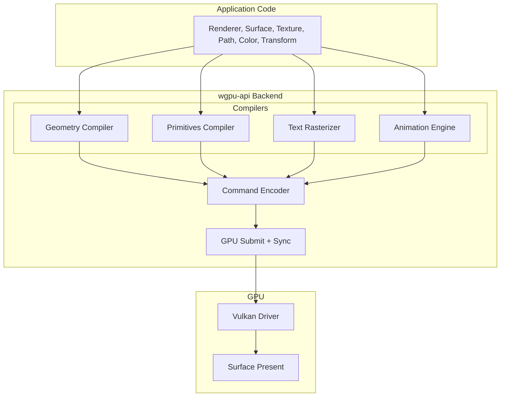

# Renderer Subsystem

## Purpose

The `Renderer` is the core GPU rendering engine. It manages the wgpu device, queue, pipelines, and caches. It is the **single entry point** for creating surfaces, textures, and rendering frames.

## Location

`wgpu-api/src/renderer.rs` (main struct), `wgpu-api/src/gpu.rs` (backend), `wgpu-api/src/render.rs` (pipeline)

## Architecture

### Rendering Pipeline

### Current Rendering Architecture

The dock uses a **hybrid rendering approach**:

| Component | Rendering Method | Path |
|-----------|-----------------|------|
| **Main dock** | Slint software renderer | Slint → CPU pixel buffer → Wayland SHM |
| **Popups** | wgpu-api (when GPU features needed) | wgpu-api → wgpu → Vulkan → Wayland DMA-BUF |

**Slint Integration**: The main dock uses Slint's `MinimalSoftwareWindow` for headless rendering. This is the correct pattern for Slint on Wayland without a windowing system. Slint renders to CPU pixel buffers which are then presented via Wayland SHM.

**wgpu-api Backend**: Provides a complete GPU rendering backend (device/queue, pipelines, shaders, frame submission) ready for use by popups and future GPU features. The backend is fully implemented but the main dock does not use it due to Slint architecture constraints.

**FemtoVG**: Removed. All FemtoVG rendering has been eliminated from the codebase.

## Key Types

| Type | Purpose |
|------|---------|
| `Renderer` | GPU device, queue, pipelines, and caches |
| `RendererConfig` | Backend selection, power preference, limits |
| `RendererBackend` | Vulkan, Metal, DX12, OpenGL, WebGPU, Null |
| `Surface` / `SurfaceId` | Render target (window, offscreen) |
| `Texture` / `TextureId` | GPU texture resource |
| `Command` / `CommandBuffer` | Draw command recording |
| `GpuBackend` | Low-level wgpu wrapper |
| `PipelineCache` | Cached render pipelines |
| `TextureCache` | Cached GPU textures |
| `BufferCache` | Cached GPU buffers |

## Ownership Rules

1. **Renderer owns the wgpu device and queue.** No other subsystem creates or destroys wgpu resources directly.
2. **Surfaces are created by the renderer.** The renderer manages their lifecycle.
3. **Textures are created by the renderer.** Application code requests textures; the renderer allocates them.
4. **GPU resources are hidden.** Public API uses opaque handles (`SurfaceId`, `TextureId`), not wgpu types.

## Coordinate Spaces

- **Input**: Logical pixels (UI coordinates)
- **Output**: Physical pixels (framebuffer coordinates)
- **Conversion**: Viewport handles the logical→physical transformation

## Dependencies

- **Depends on**: `gpu`, `scene`, `texture`, `surface`, `command`, `render`
- **Depended on by**: Application layer, video subsystem (for texture upload)

## Invariants

- Renderer must be initialized asynchronously (`Renderer::new().await`)
- Surfaces must be created before rendering
- Frame rendering uses `renderer.with_frame(surface, |cmd| { ... })`
- GPU resources are cleaned up when the renderer is dropped

## Safe to Modify

- Adding new pipeline types
- Adding new texture formats
- Adding new render states (blend modes, clip modes)
- Optimizing batch sorting
- Adding new GPU cache strategies

## Requires Caution

- Changing the wgpu device/queue lifecycle
- Modifying surface presentation
- Altering buffer upload paths
- Changing pipeline key computation
