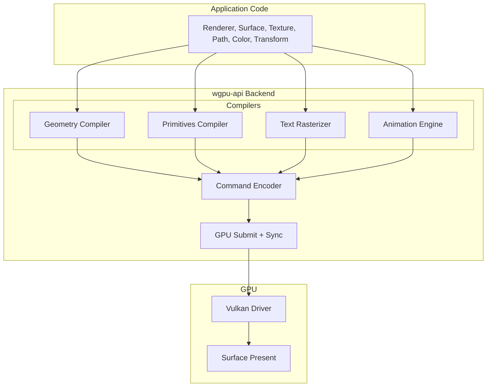

# Renderer Subsystem

## Purpose

The `Renderer` is the core GPU rendering engine. It manages the wgpu device, queue, pipelines, and caches. It is the **single entry point** for creating surfaces, textures, and rendering frames.

## Location

`wgpu-api/src/renderer.rs` (main struct), `wgpu-api/src/gpu.rs` (backend), `wgpu-api/src/render.rs` (pipeline)

## Architecture

### Rendering Pipeline

### Current Rendering Architecture

The dock uses a **hybrid rendering approach**:

| Component | Rendering Method | Path |
|-----------|-----------------|------|
| **Main dock** | Slint software renderer | Slint → CPU pixel buffer → Wayland SHM |
| **Popups** | wgpu-api (when GPU features needed) | wgpu-api → wgpu → Vulkan → Wayland DMA-BUF |

**Slint Integration**: The main dock uses Slint's `MinimalSoftwareWindow` for headless rendering. This is the correct pattern for Slint on Wayland without a windowing system. Slint renders to CPU pixel buffers which are then presented via Wayland SHM.

**wgpu-api Backend**: Owns the GPU device, pipelines, texture resources, and frame submission. The application uses it for the dock and selected popup/widget surfaces through DMA-BUF when available; these paths retain their CPU/SHM fallback. GPU draw commands describe logical-pixel geometry where documented, and DMA-BUF rendering applies the supplied logical-to-physical scale.

### Rendering Fixes and Integration Notes

- Text draw commands are prepared in batches of at most eight items through the renderer-owned glyphon text manager and rendered in the same pass as shapes and images. The atlas's in-use set is reset once per frame so stale, changing window-title glyphs can be evicted instead of accumulating until text preparation fails.
- The textured and solid pipelines, uniform bindings, and sampled-texture bindings share a compatible bind-group layout. Sampled texture bind groups are cached with their textures.
- Static dock, tray, and dashed-widget icons use stable texture keys so redraws do not recreate GPU textures. Dynamic window-capture frames replace their cached texture.
- DMA-BUF widget rendering converts logical geometry and text to physical pixels before drawing. The scale-aware API takes physical target dimensions and a logical-to-physical scale factor.
- Window-list rows have dashed separators; only the row under the pointer receives a dashed perimeter. When the pointer leaves, the list closes after the configured popup timeout, capped at two seconds.
- Context-menu hover highlights use a dashed perimeter.
- DMA-BUF `wl_buffer` objects are destroyed after the compositor releases them. Redraw invalidation is consumed after drawing rather than forcing an unbounded render loop; an open window-list popup refreshes its live capture at 30 Hz.
- Date/time, keyboard-layout, and context-menu text offsets are configurable. Defaults are +7, +6, and +6 logical pixels respectively; window-list title text is twice the configured popup font size and shifted down six logical pixels.
- Tray surfaces are rendered alongside the dock rather than being left disabled.

**FemtoVG**: Removed. All FemtoVG rendering has been eliminated from the codebase.

## Key Types

| Type | Purpose |
|------|---------|
| `Renderer` | GPU device, queue, pipelines, and caches |
| `RendererConfig` | Backend selection, power preference, limits |
| `RendererBackend` | Vulkan, Metal, DX12, OpenGL, WebGPU, Null |
| `Surface` / `SurfaceId` | Render target (window, offscreen) |
| `Texture` / `TextureId` | GPU texture resource |
| `Command` / `CommandBuffer` | Draw command recording |
| `GpuBackend` | Low-level wgpu wrapper |
| `PipelineCache` | Cached render pipelines |
| `TextureCache` | Cached GPU textures |
| `BufferCache` | Cached GPU buffers |

## Ownership Rules

1. **Renderer owns the wgpu device and queue.** No other subsystem creates or destroys wgpu resources directly.
2. **Surfaces are created by the renderer.** The renderer manages their lifecycle.
3. **Textures are created by the renderer.** Application code requests textures; the renderer allocates them.
4. **GPU resources are hidden.** Public API uses opaque handles (`SurfaceId`, `TextureId`), not wgpu types.

## Coordinate Spaces

- **Input**: Logical pixels (UI coordinates)
- **Output**: Physical pixels (framebuffer coordinates)
- **Conversion**: Viewport handles the logical→physical transformation

## Dependencies

- **Depends on**: `gpu`, `scene`, `texture`, `surface`, `command`, `render`
- **Depended on by**: Application layer, video subsystem (for texture upload)

## Invariants

- Renderer must be initialized asynchronously (`Renderer::new().await`)
- Surfaces must be created before rendering
- Frame rendering uses `renderer.with_frame(surface, |cmd| { ... })`
- GPU resources are cleaned up when the renderer is dropped

## Safe to Modify

- Adding new pipeline types
- Adding new texture formats
- Adding new render states (blend modes, clip modes)
- Optimizing batch sorting
- Adding new GPU cache strategies

## Requires Caution

- Changing the wgpu device/queue lifecycle
- Modifying surface presentation
- Altering buffer upload paths
- Changing pipeline key computation
