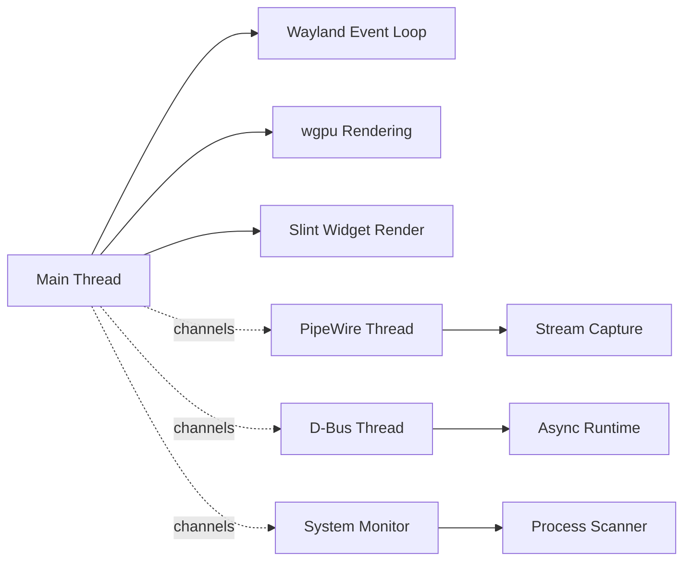

# Threading Architecture

## Thread Ownership Model

Dock uses a **hybrid threading model**: a single main thread for Wayland and rendering, with dedicated background threads for I/O-heavy subsystems.



## Main Thread (Wayland + Rendering)

**Responsibilities:**
- Wayland event queue dispatch
- wgpu device and surface operations
- Scene graph traversal and rendering
- Physics simulation steps
- Slint widget rendering
- Input event processing

**Constraints:**
- **Must not block** on I/O operations (D-Bus, PipeWire, file system).
- All wgpu operations must occur on this thread (device is not thread-safe by default).
- Wayland event queue must be dispatched regularly to avoid compositor timeouts.

**Key types:**
- `wayland_client::EventQueue` — owned by main thread
- `wgpu::Device` — created and used on main thread
- `PhysicsWorld` — stepped on main thread at fixed 120 Hz

## PipeWire Thread

**Responsibilities:**
- PipeWire main loop and stream management
- Frame buffer acquisition and format negotiation
- XDG Desktop Portal communication for screen capture

**Constraints:**
- PipeWire has its own event loop that must run on a dedicated thread.
- Frame data is shared with the main thread via channels or shared buffers.
- Buffer release must happen promptly to avoid memory pressure.

**Synchronization:**
- Frame data sent to main thread via `crossbeam::channel` or `tokio::sync::mpsc`.
- Use `parking_lot::Mutex` for shared state that PipeWire and main thread both access.

## D-Bus Thread (Tokio Runtime)

**Responsibilities:**
- System tray (StatusNotifierWatcher) communication
- Unity launcher badge updates
- Bluetooth device monitoring
- PipeWire portal session management

**Constraints:**
- Runs on a separate `tokio::runtime::Runtime` to avoid blocking the main thread.
- All D-Bus calls are async and must not be `.await`ed on the main thread.
- Results are sent back to the main thread via channels.

**Key types:**
- `zbus::Connection` — owned by tokio runtime
- `tokio::sync::mpsc` — channels for sending results to main thread

## System Monitor Thread

**Responsibilities:**
- Process scanning via `sysinfo`
- CPU and memory usage monitoring
- NVIDIA GPU monitoring via `nvidia-smi`

**Constraints:**
- Runs on a dedicated thread spawned via `std::thread::spawn`.
- Scans at a low frequency (e.g., 1 Hz) to avoid CPU overhead.
- Results are shared via `parking_lot::Mutex` or channels.

## Cross-Thread Communication Patterns

### Pattern 1: Channel-Based (Preferred)

```rust
// Background thread sends results to main thread
let (tx, rx) = crossbeam::channel::bounded(16);
// or
let (tx, rx) = tokio::sync::mpsc::channel(16);

// Main thread receives
while let Ok(event) = rx.try_recv() {
    handle_event(event);
}
```

Use for: D-Bus results, PipeWire frame notifications, system monitor updates.

### Pattern 2: Shared State with Mutex

```rust
let shared = Arc::new(parking_lot::Mutex::new(SharedState::default()));
```

Use for: State that both threads need to read/write, like capture session status.

**Never use `std::sync::Mutex`** for shared state between PipeWire and main thread — use `parking_lot::Mutex` with timeout to prevent deadlocks.

### Pattern 3: One-Way Data Flow

```
Background Thread → Channel → Main Thread
```

Most communication should be one-way: background threads produce data, main thread consumes it. Avoid bidirectional communication unless absolutely necessary.

## Threading Invariants

1. **wgpu device** is accessed only from the main thread.
2. **Wayland event queue** is dispatched only from the main thread.
3. **PipeWire main loop** runs on its own dedicated thread.
4. **D-Bus connections** run on a tokio runtime, not the main thread.
5. **Physics world** is stepped on the main thread.
6. **No blocking I/O** on the main thread under any circumstances.
7. **Channel buffers** are bounded to prevent unbounded memory growth.

## Profiling and Tracing

With `tracing` and `tracing-subscriber` now available:

```rust
use tracing::{info, warn, error, trace, instrument};

#[instrument(skip(self))]
pub fn render_frame(&mut self) {
    trace!("Starting frame render");
    // ...
}
```

Set `RUST_LOG=dock=trace` for detailed per-thread logging with span information.

## Reference

- **Async runtime**: `docs/reference/async-concurrency.md`
- **PipeWire integration**: `docs/architecture/pipewire.md`
- **D-Bus integration**: `docs/reference/system-integration.md`
