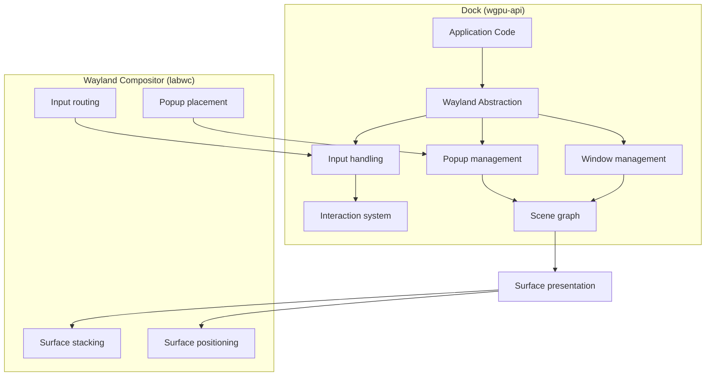

# Wayland Integration Architecture

## Purpose

The Wayland module provides a high-level abstraction over Wayland client protocols for creating windows, popups, and handling input events. It works with `labwc` (and other Wayland compositors) without implementing a compositor itself.

## Location

`wgpu-api/src/wayland.rs` (~1400 lines)

## Architecture

## Responsibilities

| Responsibility | Owner |
|----------------|-------|
| Window positioning, stacking, decorations | **Compositor (labwc)** |
| Input routing | **Compositor (labwc)** |
| Toplevel management | **Compositor (labwc)** |
| Popup placement | **Compositor (labwc)** |
| Rendering pixels inside windows | **Dock (wgpu-api)** |
| Scene graph management | **Dock (wgpu-api)** |
| Animations | **Dock (wgpu-api)** |
| Video rendering | **Dock (wgpu-api)** |

## Two Popup Concepts

| Concept | Description | Use Case |
|---------|-------------|----------|
| **Visual popup** | Group of nodes drawn inside an existing window. No separate Wayland surface. | Tooltips, dropdowns within a window |
| **Wayland popup** | Separate Wayland surface managed by the compositor, with popup positioning, dismissal, and parent relationships. | Contextual menus extending outside the parent window |

## Key Types

| Type | Purpose |
|------|---------|
| `WaylandWindow` | A Wayland toplevel window |
| `WaylandWindowId` | Opaque window handle |
| `WaylandPopup` | A Wayland popup surface |
| `WaylandPopupId` | Opaque popup handle |
| `WaylandConnection` | Wayland client connection |
| `WindowState` | Window state (maximized, fullscreen, etc.) |
| `WindowType` | Window type (normal, tooltip, menu, etc.) |
| `InputEvent` | Unified input event (pointer, keyboard, touch) |
| `PointerEvent` | Pointer button/motion/scroll event |
| `KeyEvent` | Keyboard key press/release event |
| `TouchEvent` | Touch start/move/end/cancel event |
| `VisualPopup` | In-window popup (no separate surface) |
| `OutputInfo` | Display output information |

## Coordinate Space

- **Wayland surface coordinates**: Surface-relative, may differ from logical pixels due to scale factor
- **Logical pixels**: UI coordinates used by the scene graph
- **Conversion**: Viewport handles scale factor transformation

## Invariants

1. **Dock does not implement compositor functionality.** Window management is delegated to the compositor.
2. **Wayland surfaces are managed by the compositor.** Dock creates and configures surfaces; the compositor positions and stacks them.
3. **Input events are delivered by the compositor.** Dock receives and processes them; it does not route them.
4. **Popup surfaces have parent relationships.** A popup is dismissed when its parent is closed.

## Dependencies

- **Depends on**: `geometry` (Size, Point, Rect), `viewport` (scale factor)
- **Depended on by**: Application layer, renderer (for surface presentation)
- **External**: `wayland-client`, `wayland-protocols`, `smithay-client-toolkit`

## Safe to Modify

- Adding new window types
- Adding new popup configurations
- Adding new input event types
- Adding new output info fields

## Requires Caution

- Changing surface lifecycle management
- Modifying input event delivery
- Altering popup parent relationships
- Changing coordinate space conversions
