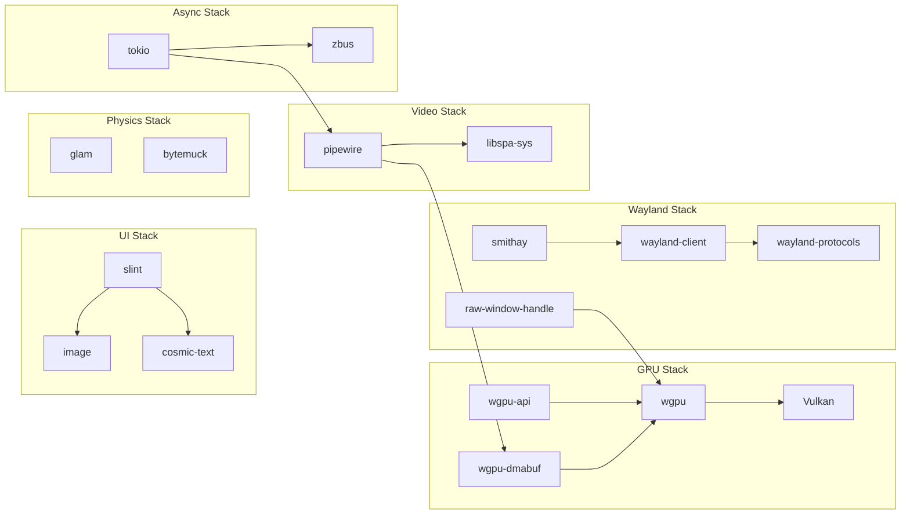

# Technical Documentation Library

This directory contains reference documentation for all major dependencies used in the Dock project. Each file covers official documentation links, API references, architecture notes, migration guides, and dependency compatibility information.

## Purpose

This library enables AI coding agents to understand not just how individual libraries work, but also how they interact within the Dock architecture. It serves as the single source of truth for dependency knowledge.

## Index

| Category | File | Libraries Covered |
|----------|------|-------------------|
| GPU Rendering | [gpu-rendering.md](gpu-rendering.md) | wgpu, Vulkan, wgpu-dmabuf |
| Wayland & Windowing | [wayland.md](wayland.md) | wayland-client, wayland-protocols, smithay, raw-window-handle |
| PipeWire & Capture | [pipewire.md](pipewire.md) | pipewire, pipewire-sys, libspa-sys |
| UI & Widgets | [slint.md](slint.md) | slint, slint-build |
| Image & SVG | [image-svg.md](image-svg.md) | image, resvg, usvg, tiny-skia, cairo, fast_image_resize |
| Text & Fonts | [text-fonts.md](text-fonts.md) | cosmic-text, fontdb, swash, fontdue |
| Physics & Math | [physics.md](physics.md) | glam, bytemuck (Rapier2D removed per ADR 005) |
| Async & Concurrency | [async-concurrency.md](async-concurrency.md) | tokio, futures-util, parking_lot, dashmap |
| System Integration | [system-integration.md](system-integration.md) | zbus, sysinfo, libc |
| Serialization & Utils | [serialization-utils.md](serialization-utils.md) | serde, serde_json, lru, memmap2, walkdir, dirs, log |
| Rust Engineering | [rust-engineering.md](rust-engineering.md) | The Rust Book, std, Cargo, Clippy, API Guidelines |

## How to Use

- **Before modifying code** in a subsystem, read the corresponding reference file.
- **When adding a new dependency**, add a section to the appropriate file.
- **When a dependency version changes**, update the compatibility notes.
- **When debugging**, check the official docs links first, then the integration notes.

## Version Matrix

| Library | Root Crate (dock) | Library Crate (wgpu-api) |
|---------|-------------------|--------------------------|
| wgpu | `30` (Vulkan) | (no dependency) |
| glam | — | `0.29` |
| rapier2d | — | **Removed** (ADR 005) |
| cosmic-text | — | `0.18` |
| tokio | `1.54` (full) | — |
| slint | `1.18.1` | — |
| pipewire | `0.10.1` | — |
| zbus | `6` | — |
| sysinfo | `0.40` | — |

**Note:** The `wgpu-api` library crate has no wgpu dependency — it provides a pure-Rust abstraction over GPU operations. All wgpu usage is confined to the root crate. Do not introduce wgpu types into the wgpu-api public API.

## Cross-Dependency Interactions

## Maintenance

When updating this library:
1. Keep official documentation links current.
2. Update version numbers after dependency upgrades.
3. Add integration notes when discovering new interaction patterns.
4. Flag version incompatibilities in the compatibility section.
